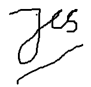
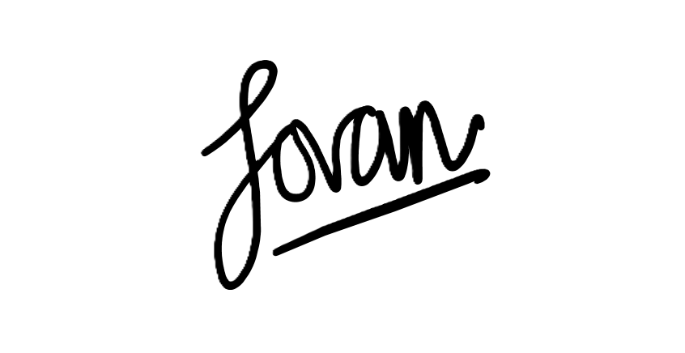

# Deklarasi Penggunaan AI

## Tugas Besar IF2150 - Rekayasa Perangkat Lunak

| Informasi            | Keterangan            |
| -------------------- | --------------------- |
| Kelas                | _K-03_                |
| Nomor Kelompok       | _G-02_                |
| Nama Kelompok        | _DapinKoding_         |
| Nama Perangkat Lunak | _SoClean_ |

**Anggota Kelompok:**

| NIM      | Nama                      |
| -------- | ------------------------- |
| 13525027 | Faishal Ahmad Nurdin      |
| 13525042 | Justin William            |
| 13525060 | M. Aqsha Bagus R.I.B.     |
| 13525087 | Jovan Nathanael           |
| 13525147 | Muhammad Dhafin Al Khairy |

---

### Daftar Isi

- [Milestone 1](#milestone-1)
- Notes: Copy bagian Daftar Isi seperti Milestone 1 untuk Milestone berikutnya, contoh `* [Milestone 2](#milestone-2)`. Ketika Daftar isi diklik maka akan langsung diarahkan ke bagian bawah sesuai dengan Milestone tujuan.

---

### Log Penggunaan AI per Milestone

Silakan catat penggunaan AI yang berdampak signifikan pada pengerjaan tugas (misal: _generate_ fungsi algoritma yang kompleks, _generate_ draf dokumen SKPL/DPPL, atau _debugging_ error utama).
*Penggunaan sepele seperti memperbaiki *typo* atau auto-complete satu baris kode tidak perlu dicatat.*

### Milestone 1

| Tool AI     | Tujuan Penggunaan              | Contoh Prompt Utama                                                                                  | Modifikasi & Validasi Manusia                                                                                                                   |
| :---------- | :----------------------------- | :--------------------------------------------------------------------------------------------------- | :---------------------------------------------------------------------------------------------------------------------------------------------- |
| Gemini  | Merapikan mermaid diagram | "Tolong rapikan format mermaid diagram yang sudah saya buat." | AI merapikan mermaid diagram agar lebih rapi dan estetik secara visual. |   

### Milestone 2

| Tool AI | Tujuan Penggunaan | Contoh Prompt Utama | Modifikasi & Validasi Manusia |  
| :------ | :---------------- | :------------------ | :---------------------------- |
|         |                   |                     |                               | 
|         |                   |                     |                               | 

### Milestone 3

| Tool AI | Tujuan Penggunaan | Contoh Prompt Utama | Modifikasi & Validasi Manusia |  
| :------ | :---------------- | :------------------ | :---------------------------- |
| Claude | Merapikan dan memverifikasi diagram | "Rapikan use case diagram berikut <kode uml>" | Menyesuaikan include yang dikoreksi oleh Claude, menggunakan desain sendiri di draw.io  | 
| Claude | Memverifikasi diagram | "<kode uml> apakah hubungan sudah aman?", "UC2, UC7, UC8 apakah perlu ada association ke actor masyarakat? Atau diinclude saja dari UC yang bersesuaian?"  | Menyesuaikan include yang dikoreksi Claude | 

### Milestone 4

| Tool AI | Tujuan Penggunaan | Contoh Prompt Utama | Modifikasi & Validasi Manusia |  
| :------ | :---------------- | :------------------ | :---------------------------- |
| Claude | Merapikan dan memverifikasi diagram | "Tolong rapikan diagram ini \<kode uml>; sesuaikan dengan konteks proyek ini" | Menyesuaikan diagram yang dikoreksi oleh Claude
| Copilot | Diagram: Gabungan, penambahan atribut sesuai tabel (grunt work), penyesuaian ulang traceability dan pasangan class-UC |  - | Pengecekan ulang |

### Milestone 5

| Tool AI | Tujuan Penggunaan | Contoh Prompt Utama | Modifikasi & Validasi Manusia |  
| :------ | :---------------- | :------------------ | :---------------------------- |
| Claude | Merapikan bahasa untuk bab 1.2 | Tolong rapikan teks yang telah dibuat sebelumnya agar lebih mengalir | Beberapa hal terlalu panjang jadi harus dipersingkat/di-*drop*.
| Claude | Mengetahui | "Maksud diperinci dan diorientasikan kepada P/L pada batasan dalam konteks dokumen kami" | Menyesuaikan saran dari Claude berdasarkan konteks sistem, menambahkan beberapa saran yang cukup saja, menulis dengan bahasa sendiri

---

### Milestone 6

| Tool AI | Tujuan Penggunaan | Contoh Prompt Utama | Modifikasi & Validasi Manusia |  
| :------ | :---------------- | :------------------ | :---------------------------- |
| Claude | Mengetahui cara menganalisis pada kasus spesifik CleanIt kelayakan suatu pola arsitektur | Jelaskan cara menentukan alasan pemilihan berdasarkan karakteristik P/L yang dibuat | Menyesuaikan dan menambahkan jawaban yang diberikan dengan kondisi sebenarnya pada dokumen, dengan bahasa sendiri, serta dengan sumber lain.
| Claude | Merapikan dan memverifikasi diagram | "Tolong rapikan diagram ini \<kode uml>; sesuaikan dengan konteks proyek ini" | Menyesuaikan diagram yang dikoreksi oleh Claude

### Milestone 7

| Tool AI | Tujuan Penggunaan | Contoh Prompt Utama | Modifikasi & Validasi Manusia |  
| :------ | :---------------- | :------------------ | :---------------------------- |
| Copilot | Duplikat 3.1 sampai 3.9 sebagai template agar tidak konflik (grunt work) | Copy 3.1 dan subsubbabnya 9 kali hingga 3.9 | Verifikasi ulang
| Gemini | Memperbaiki diagram sekuens | Cara agar lifeline titik-titik, cara menyesuaikan tinggi objek yang baru dibuat, fix urutan berantakan | Verifikasi ulang

### Milestone 8

| Tool AI | Tujuan Penggunaan | Contoh Prompt Utama | Modifikasi & Validasi Manusia |  
| :------ | :---------------- | :------------------ | :---------------------------- |
| Copilot | Menduplikasi template operasi kelas |Duplikat template bagian Operasi Kelas sejumlah nama kelas | Verifikasi ulang
| Claude | Referensi desain | Contoh desain untuk page X | Banyak yang disesuaikan dan dihapus agar lebih sesuai dan lebih sederhana layaknya sebuah prototipe

### Milestone 9

| Tool AI | Tujuan Penggunaan | Contoh Prompt Utama | Modifikasi & Validasi Manusia |  
| :------ | :---------------- | :------------------ | :---------------------------- |
| Claude Code | (FE-A, Jovan) Mengimplementasikan FE-01–FE-08 dan FE-13: design tokens, komponen UI, layout dan navigasi, API client dan mock MSW, auth guard, halaman Login, Register, dan Beranda, draf offline, beserta unit test | "Coba bantu saya kerjakan bagian FE-06 yang tidak butuh FE-03", "Tolong lanjutkan untuk yang FE-05" | Diff setiap tugas direview sebelum di-commit; commit, push, dan PR dilakukan sendiri; menjalankan `npm run lint`, `tsc`, dan `npm test`; mencoba hasilnya di browser lewat Docker dengan akun seed; memperbaiki dari yang sudah digenerate |
| Claude Code + Figma MCP | (FE-A, Jovan) Membaca desain Figma (warna, font, radius, frame Login, Register, dan Beranda) untuk diterjemahkan ke design tokens dan komponen | "Coba eksekusikan untuk FE-01" | Hasil dibandingkan dengan Figma lewat screenshot; keputusan font dan ukuran ditentukan sendiri |
| Claude Code | (FE-A, Jovan) Menyusun teks Issue dan PR sesuai template kontrak v0.8. | "Buatlah teks PR serta issues untuk FE-06" | Teks diedit, screenshot diberikan, nomor Issue dan reviewer diisi sendiri |

### Pernyataan Integritas dan Persetujuan

Kami yang bertanda tangan di bawah ini menyatakan bahwa seluruh log penggunaan AI di atas adalah benar. Kami telah memvalidasi seluruh hasil AI dan bertanggung jawab penuh atas orisinalitas, keamanan, dan kebenaran hasil akhir dari tugas ini.

|                   Tanda Tangan                    | Nama Anggota               |
| :-----------------------------------------------: | :------------------------- |
|  | **13525027 - Faishal Ahmad Nurdin** |
|  | **13525042 - Justin William** |
|  | **13525060 - M. Aqsha Bagus R.I.B.** |
|  | **13525087 - Jovan Nathanael** |
|  | **13525147 - Muhammad Dhafin Al Khairy** |

