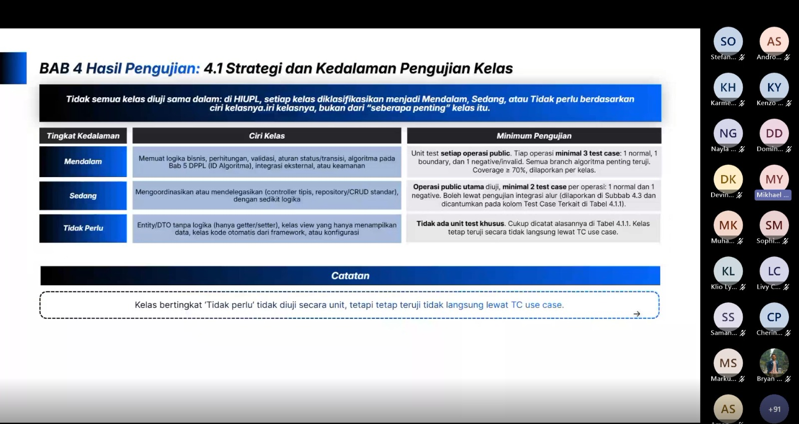

# Form Asistensi

## Tugas Besar IF2150 - Rekayasa Perangkat Lunak

| Informasi | Keterangan |
| --- | --- |
| **Hari** | *Senin* |
| **Tanggal** | *16 November 2026* |
| **Kelas** | *K-03* |
| **Nomor Kelompok** | *G-02*  |
| **Nama Kelompok** | *DapinKoding*  |
| **Nama Perangkat Lunak** | *SoClean*  |
| **Dokumen** | *K03_G02_HIUPL*  |

### Anggota Kelompok

| NIM      | Nama                      |
| -------- | ------------------------- |
| 13525027 | Faishal Ahmad Nurdin      |
| 13525042 | Justin William            |
| 13525060 | M. Aqsha Bagus R.I.B.     |
| 13525087 | Jovan Nathanael           |
| 13525147 | Muhammad Dhafin Al Khairy |

### Catatan

| Catatan |
| --- |
| 1. Bagian awal dokumen HIUPL berisikan informasi umum seputar perangkat lunak kita, seperti pendahuluan, deskripsi umum, dan implementasi. |
| 2. Penjelasan seputar konsep software testing, seperti tujuan testing, manual/automatic testing, tingkatan testing, dll. |
| 3. Dijelaskan tabel-tabel dan bagian yang perlu diisi pada dokumen bagian Bab 4 dan 5. |

## Dokumentasi

<!--  -->

  

  <i>Gambar 1. Dokumentasi kegiatan asistensi.</i>

