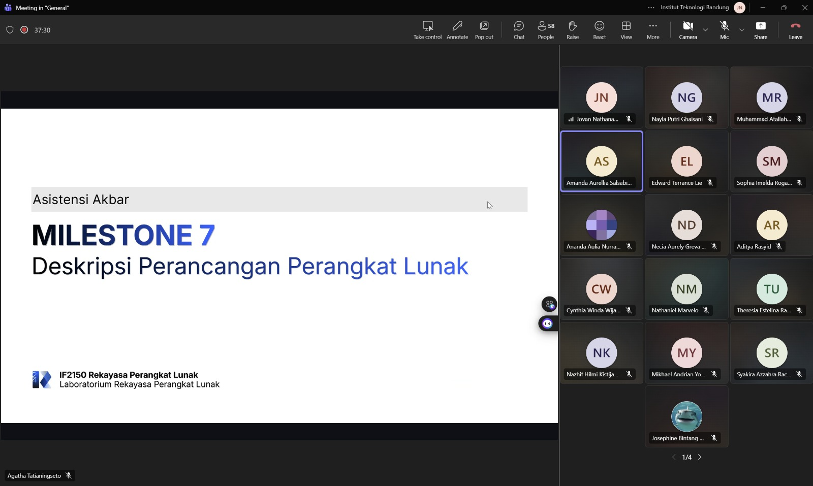

# Form Asistensi

## Tugas Besar IF2150 - Rekayasa Perangkat Lunak

| Informasi | Keterangan |
| --- | --- |
| **Hari** | Jumat |
| **Tanggal** | 02/10/2026 |
| **Kelas** | K-03 |
| **Nomor Kelompok** | G-02 |
| **Nama Kelompok** | DapinKoding  |
| **Nama Perangkat Lunak** | SoClean |
| **Dokumen** | K-03_G02_DPPL  |

### Anggota Kelompok

| NIM      | Nama                      |
| -------- | ------------------------- |
| 13525027 | Faishal Ahmad Nurdin      |
| 13525042 | Justin William            |
| 13525060 | M. Aqsha Bagus R.I.B.     |
| 13525087 | Jovan Nathanael           |
| 13525147 | Muhammad Dhafin Al Khairy |

### Catatan
Asistensi akbar membahas beberapa hal seputar perancangan arsitektur, realisasi use case menggunakan sequence diagram (dijelaskan juga seputar notasinya), dan diagram kelas keseluruhan serta matriks kerunutan.

## Dokumentasi

<!--  -->

  

  <i>Gambar 1. Dokumentasi kegiatan asistensi (note: Asistensi Akbar)</i>

