<h1>
IF2150 REKAYASA PERANGKAT LUNAK
<br>
TUGAS 5
<br>
DESKRIPSI PERANCANGAN PERANGKAT LUNAK (DPPL)
</h1>
<br>

## *SoClean*

### Untuk: *Aurelia Jennifer Gunawan*

Dipersiapkan oleh:

| Informasi | Keterangan |
| --- | --- |
| Kelas | *K-03* |
| Kelompok | *G-02*  |
| Nama Kelompok | *DapinKoding*  |

| NIM | Nama |
|---|---|
| 13525027 | Faishal Ahmad Nurdin      |
| 13525042 | Justin William            |
| 13525060 | M. Aqsha Bagus R.I.B.     |
| 13525087 | Jovan Nathanael           |
| 13525147 | Muhammad Dhafin Al Khairy |
---

<br>

## Daftar Perubahan

| Revisi | Deskripsi |
| :--- | :--- |
| *A* | *Deskripsikan perubahan yang dilakukan dari dokumen sebelumnya pada dokumen ini. Jika tidak terdapat perubahan, harap kosongkan tabel.* |
| *B* |  |
| *C* |  |
| ... |  |

---

<br>

> **Petunjuk pengerjaan:** *[Silahkan hapus bagian ini setelah selesai mengerjakan]*
>
> Dokumen ini melanjutkan **Spesifikasi Kebutuhan Perangkat Lunak (SKPL)** dan **Arsitektur Perangkat Lunak (APL)**. Gunakan nama, ID, kebutuhan, dan use case yang konsisten dengan kedua dokumen tersebut. Contoh pola ID baru di bawah dapat disesuaikan dengan kesepakatan kelompok, ID yang sudah ada tetap dipertahankan.

<br>

---


# BAB 1: Pendahuluan

## 1.1 Tujuan Penulisan Dokumen
Dokumen Deskripsi Perancangan Perangkat Lunak (DPPL) disusun untuk menjabarkan rancangan perangkat lunak *SoClean* sebagai kelanjutan dari dokumen Spesifikasi Kebutuhan Perangkat Lunak (SKPL) dan Arsitektur Perangkat Lunak (APL). Dokumen ini berisikan rancangan implementasi, *style/pattern* arsitektur, identifikasi komponen, model arsitektur, realisasi setiap use case dalam bentuk *sequence diagram* dan diagram kelas perancangan, diagram kelas keseluruhan, serta matriks kerunutan antara kelas perancangan dan use case. 

## 1.2 Lingkup Masalah
SoClean adalah perangkat lunak berbasis web yang dapat diakses melalui perangkat desktop maupun mobile untuk menekan kebocoran sampah domestik dari aktivitas darat ke ekosistem perairan Indonesia. Permasalahan ini tergolong mendesak: World Bank memperkirakan Indonesia menghasilkan sekitar 7,8 juta ton sampah plastik setiap tahun dengan sekitar 346.000 ton di antaranya bocor ke laut, sementara kanal pelaporan pemerintah yang tersedia seperti SP4N-LAPOR! dan e-GAKKUM LH hanya menampung laporan tanpa melibatkan masyarakat dalam penanganannya dan kerap lambat ditindaklanjuti, sedangkan aplikasi sejenis seperti Clean Swell hanya bergantung pada sukarelawan tanpa insentif nyata. SoClean menjawab celah tersebut melalui pendekatan crowdsourcing dan gamifikasi dengan dua fitur utama, yaitu ReportIt, tempat masyarakat melaporkan lokasi perairan tercemar beserta bukti foto/video yang kemudian diverifikasi oleh Operator dan dipublikasikan sebagai bounty, serta CleanIt, tempat masyarakat memilih lokasi tercemar tersebut, membersihkannya, lalu mengunggah bukti pembersihan untuk diverifikasi oleh Operator; setiap kontribusi yang dinyatakan valid diganjar poin yang dapat ditukarkan dengan reward. Lingkup sistem dibatasi pada sampah domestik yang dapat ditangani langsung oleh masyarakat (tidak mencakup limbah B3 maupun pelanggaran lain seperti illegal fishing) serta pada wilayah yang bekerja sama, sejalan dengan SDG 14 Target 14.1 mengenai pengurangan polusi laut yang bersumber dari aktivitas darat.

<!-- Ini diambil lgsg dari SKPL -->

<!-- Tuliskan dengan ringkas nama aplikasi dan deskripsi singkatnya. Bagian ini maksimal berisi satu paragraf, dapat diambil dari SKPL. -->

## 1.3 Definisi, Istilah, dan Singkatan
<!-- Semua definisi dan singkatan yang digunakan dalam dokumen ini beserta penjelasannya. -->

Tabel 1.3. Definisi Istilah dan Singkatan

| Singkatan, Akronim, atau Istilah | Penjelasan |
| :--- | :--- |
| *P/L* | *Singkatan dari Perangkat Lunak, yaitu aplikasi yang memberikan perintah kepada komputer untuk menjalankan tugas tertentu.* |
| *SKPL* | *Singkatan dari Spesifikasi Kebutuhan Perangkat Lunak, yaitu dokumen yang mendefinisikan kebutuhan fungsional, kebutuhan non-fungsional, use case, pemodelan kelas dan use case dari P/L.* |
| *APL* | *Singkatan dari Arsitektur Perangkat Lunak, yaitu dokumen yang mendefinisikan style/pattern arsitektur, komponen, dan model arsitektur P/L.* |
| *DPPL* | *Singkatan dari Deskripsi Perancangan Perangkat Lunak, yaitu dokumen yang menjabarkan rancangan arsitektur, realisasi use case, dan kelas perancangan sebagai acuan implementasi P/L.* |
| *KF* | *Singkatan dari Kebutuhan Fungsional.* |
| *KNF* | *Singkatan dari Kebutuhan Non-Fungsional.* |
| *UC* | *Singkatan dari Use Case.* |
| *SoClean* | *Nama perangkat lunak berbasis web yang dirancang untuk mengurangi kebocoran sampah domestik ke ekosistem perairan.* |
| 

## 1.4 Aturan Penomoran
<!-- Tuliskan aturan penomoran (ID) yang digunakan dalam dokumen ini. Gunakan pola ID yang **sama** dengan yang sudah dipakai pada dokumen-dokumen sebelumnya, jangan membuat pola baru di dokumen ini. -->

Tabel 1.4. Aturan Penomoran

| Hal/Bagian | Penomoran | Keterangan |
| :--- | :--- | :--- |
| *Kebutuhan* | *RXX* | *Digunakan untuk menomori Kebutuhan/Requirements, dengan 'XX' adalah dua digit angka berurutan.* |
| *Kebutuhan Fungsional* | *KFXX* | *Digunakan untuk menomori Kebutuhan Fungsional, dengan 'XX' adalah dua digit angka berurutan.* |
| *Kebutuhan Non-Fungsional* | *KNFXX* | *Digunakan untuk menomori Kebutuhan Non-Fungsional, dengan 'XX' adalah dua digit angka berurutan.* |
| *Aktor* | *AXX* | *Digunakan untuk menomori Aktor, dengan 'XX' adalah dua digit angka berurutan.* |
| *Use Case* | *UCXX* | *Digunakan untuk menomori Use Case, dengan 'XX' adalah dua digit angka berurutan.* |
| *Kelas* | *CXX* | *Digunakan untuk menomori Kelas, dengan 'XX' adalah dua digit angka berurutan.* |

## 1.5 Referensi
<!-- Cantumkan dokumentasi P/L yang dirujuk oleh dokumen ini, **minimal dokumen SKPL dan APL**. Tambahkan buku, panduan, atau dokumentasi lain apabila digunakan. -->
1. Kelompok G-02 K-03. [*Spesifikasi Kebutuhan Perangkat Lunak (SKPL) SoClean*](../M5/K03_G02_SKPL.md). 
2. Kelompok G-02 K-03. [*Arsitektur Perangkat Lunak (APL) SoClean*](../M6/K03_G02_APL.md).
3. Sommerville, I. (2016). *Software Engineering* (10th ed.). Pearson.
<!-- ini buku sommerville buku acuan matkul RPL kita --> 

## 1.6 Deskripsi Umum Dokumen (Ikhtisar)
Dokumen ini terdiri atas 5 bab. Bab 1 (Pendahuluan) memuat tujuan penulisan dokumen, lingkup masalah, definisi dan istilah spesifik di dalam dokumen, aturan penomoran, referensi, serta ikhtisar dokumen. Bab 2 (Perancangan Arsitektur) memuat rancangan lingkungan implementasi, style/pattern arsitektur acuan, identifikasi komponen penyusun aplikasi, serta model arsitektur perangkat lunak. Bab 3 (Realisasi Use Case) memuat identifikasi kelas, sequence diagram, serta diagram kelas perancangan untuk setiap use case. Bab 4 (Diagram Kelas Keseluruhan) memuat diagram kelas perancangan keseluruhan beserta daftar rincian atribut dan metode/operasinya. Bab 5 (Matriks Kerunutan) memuat pemetaan kerunutan (traceability) antara kelas perancangan dengan use case yang terkait.
<br>

---

# BAB 2: Perancangan Arsitektur

## 2.1 Rancangan Lingkungan Implementasi

Lingkungan implementasi yang digunakan dalam pengembangan dan pengoperasian perangkat lunak *SoClean* dirancang sebagai berikut:

Tabel 2.1. Rancangan Lingkungan Implementasi

| Komponen | Spesifikasi |
| :--- | :--- |
| *Operating System (OS)* | *Cross-platform*: Linux (di dalam *container* Docker untuk *server*), serta Windows, Linux, dan Android (diakses melalui *web browser* pada perangkat *desktop* maupun *mobile*). |
| *DBMS* | PostgreSQL 18 (untuk penyimpanan data relasional dan persisten). |
| *Filing System / Storage* | *Object Storage* berbasis S3, yaitu Cloudflare R2 (untuk menyimpan berkas media foto dan video bukti laporan), serta penyimpanan lokal (*browser cache/local storage*) untuk menyimpan draf input sementara saat luring (*offline*). |
| *Bahasa Pemrograman* | TypeScript / JavaScript, HTML, CSS, dan SQL. |
| *Framework & Runtime* | Next.js 16 (Node.js). |
| *Development Tools* | Docker (untuk kontainerisasi), Git & GitHub (untuk manajemen versi kode), Visual Studio Code (sebagai IDE/*code editor*), serta Mermaid.js, Draw.io, dan StarUML (untuk pemodelan diagram). |
| *Client & Hardware* | *Web Browser* modern (Google Chrome, Mozilla Firefox) pada perangkat pengguna (*desktop* maupun *mobile*) yang dilengkapi dengan kamera dan GPS. |

## 2.2 Style/Pattern Arsitektur Acuan

Tentukan *architectural style* atau *pattern* yang menjadi acuan aplikasi, misalnya *layered architecture*, *client-server*, *repository*, *pipe and filter*, atau MVC (*Model-View-Controller*).


Gunakan hasil **BAB 1 Style/Pattern Arsitektur Acuan pada dokumen APL**, termasuk alasan pemilihan dan gambar penerapannya pada P/L kelompok. Gunakan komponen aplikasi sendiri pada gambar, bukan hanya contoh pola umum.

<p align="center">

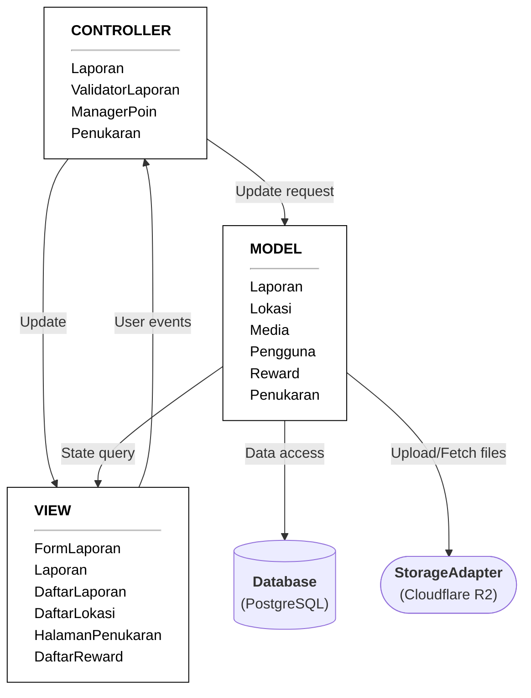

</p>
<p align="center">
<i>Gambar 1. Arsitektur MVC</i>
</p>

Style/pattern arsitektur yang digunakan dalam pengembangan P/L SoClean adalah MVC (Model-View-Controller). Model berperan sebagai pendefinisi struktur data dan logika bisnis. View berperan sebagai media penyajian informasi kepada pengguna. Controller berperan sebagai handler logic utama yang mengkoordinasi interaksi antar model dan view.

SoClean menggunakan style/pattern MVC dengan tujuan utama agar arsitektur mengutamakan simplisitas dan modularitas fitur-fitur yang dimiliki oleh P/L ini. Proses bisnis relatif sederhana sehingga pola yang dapat diabstraksikan menggunakan pemodelan MVC. Sebagai contoh, ketika pengguna membuat laporan (model) melalui request interface (view), operator dapat memverifikasi laporan dengan luaran sistem menolak atau menerima dan menyimpan status laporan ke dalam daftar lokasi (controller). KF dalam P/L ini juga dapat dipetakan dan digeneralisasi menjadi sebuah operasi yang melibatkan komponen-komponen MVC, sebagai contoh KF02, KF11, KF04, dll. (model); KF01, KF05, KF08, dll. (view); KF03, KF10, KF13, dll. (controller). Pemisahan berdasarkan MVC juga mendukung KNF yang ada, misalnya dari segi performa dan kemudahan maintenance. Modularitas struktural yang direncanakan juga membuat proses pengembangan lebih efisien karena pembagian kerja yang relatif lebih independen. Sebagai contoh dari efisiensi alur kerja proses dengan MVC, salah satu pengembang dapat mengerjakan bagian A (misal komponen view) sedangkan pengembang lain dapat mengerjakan fitur B (misal controller) secara bersamaan.

## 2.3 Identifikasi Komponen / Modul / Subsistem

<!-- Identifikasi komponen, modul, atau subsistem penyusun aplikasi berdasarkan *pattern* yang telah ditetapkan. Jelaskan tanggung jawab masing-masing komponen. Pengelompokan dapat mengikuti lapisan arsitektur atau fungsi/peran komponen dalam sistem.

Ambil dari **Tabel 2.1 dokumen APL**, lalu kelompokkan berdasarkan lapisan (Model/View/Controller). Kolom **Jenis** diisi sesuai pattern, misalnya View, Controller, Model, Service, Repository. Satu komponen merepresentasikan saatu tanggung jawab utama yang jelas, -->

Tabel 2.3. Identifikasi Komponen/Modul/Subsistem

| Nama Komponen/Modul/Subsistem | Jenis                 | Penjelasan                                                                                                           |
| :---------------------------- | :-------------------- | :------------------------------------------------------------------------------------------------------------------- |
| *FormLaporan* | *View* | *Menampilkan form pembuatan laporan dan meneruskannya dalam bentuk Laporan ke ValidatorLaporan* |
| *Laporan* | *View* | *Menampilakan informasi dalam suatu laporan yang sudah dibuat pada FormLaporan* |
| *DaftarLaporan* | *View*| *Menampilakan daftar laporan yang sudah dibuat pada FormLaporan* |
| *DaftarLokasi* | *View* | *Menampilkan daftar lokasi yang diambil dari laporan yang sudah dibuat* |
| *HalamanPenukaran* | *View* | *Menampilakn halaman penukaran yang berisi DaftarReward dan jumlah poin serta meneruskan aksi pengguna (seperti menukar poin dengan reward) ke ManagerPoin dan Penukaran* |
| *DaftarReward* | *View* | *Menampilkan daftar reward yang tersedia untuk ditukarkan dengan poin* |
| *Laporan* | *Controller* | *Memproses status validasi suatu laporan pada DaftarLaporan* |
| *ValidatorLaporan* | *Controller* | *Memproses permintaan validasi laporan yang berada pada DaftarLaporan* |
| *ManagerPoin* | *Controller* | *Memproses perubahan jumlah poin yang dimiliki pengguna* |
| *Penukaran* | *Controller* | *Memproses permintaan penukaran poin dengan reward* |
| *Laporan* | *Model* | *Mendefinisikan struktur data dan informasi utama suatu laporan, termasuk data laporan dan status validasinya.* |
| *Lokasi* | *Model* | *Mendefinisikan struktur data lokasi yang berkaitan dengan suatu laporan dan digunakan untuk membentuk daftar lokasi.* |
| *Media* | *Model* | *Mendefinisikan struktur data media yang digunakan sebagai bukti pendukung laporan, seperti foto atau video.* |
| *Pengguna* | *Model* | *Mendefinisikan struktur data pengguna dan informasi yang berkaitan dengan pengguna dalam sistem.* |
| *Reward* | *Model* | *Mendefinisikan struktur data reward yang tersedia untuk ditukarkan menggunakan poin.* |
| *Penukaran* | *Model* | *Mendefinisikan struktur data transaksi penukaran poin pengguna dengan reward.* |
| *Database* | *Pendukung* | *Menyediakan penyimpanan data persisten bagi komponen model dan menggunakan PostgreSQL sebagai DBMS.* |
| *Storage* | *Pendukung* | *Menyediakan abstraksi akses object storage untuk melakukan proses upload file.* |

## 2.4 Model Arsitektur Perangkat Lunak

Architectural View adalah cara melihat atau mendeskripsikan arsitektur sebuah sistem dari sudut pandang tertentu. Untuk perangkat lunak SoClean, kami menggunakan satu view, yaitu Logical View, untuk menggambarkan bagaimana seluruh komponen pada Tabel 2.3 saling berinteraksi dalam menjalankan fungsi utama sistem.

<!-- Buat model arsitektur dalam bentuk satu atau lebih *view* yang memperlihatkan interaksi dan kolaborasi komponen, modul, serta subsistem dalam menjalankan fungsi sistem. Pilih notasi yang sesuai. Contoh *view*: *Logical View*, *Process View*, *Development View*, dan *Physical View*.

Gunakan hasil **BAB 3 Model Arsitektur Perangkat Lunak pada dokumen APL**. -->

## 2.4.1 Logical View
Logical View SoClean digambarkan dalam bentuk block diagram yang dikelompokkan sesuai pola MVC pada BAB 1, yaitu View, Controller, dan Model, ditambah komponen Pendukung. View ini dipilih karena paling sesuai untuk memperlihatkan pembagian tanggungjawab antarkomponen, sehingga menjadi alasan utama pemilihan MVC. Selain itu, view ini dapat menggambarkan kedua alur utama SoClean dalam satu diagram. Alur pertama adalah pelaporan dan verifikasi (ReportIt dan CleanIt), dan alur kedua adalah pengelolaan serta penukaran poin.

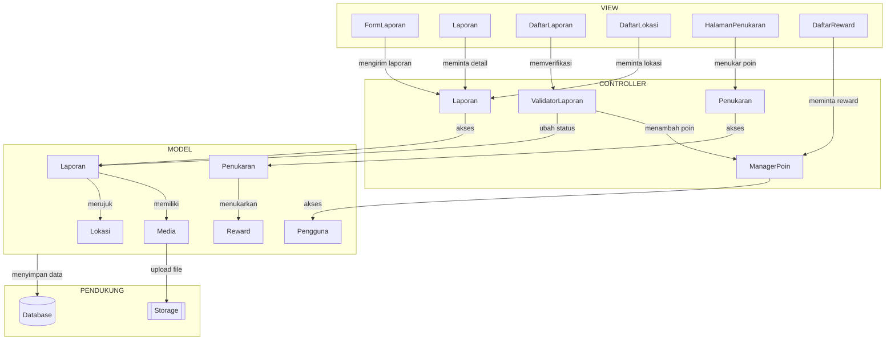

<p align="center"> <i>Gambar 2. Logical View P/L SoClean</i> </p>

Pada Gambar 2, komponen View meneruskan aksi pengguna ke komponen Controller yang sesuai, lalu Controller mengakses Model untuk membaca atau mengubah data.

Pada alur pelaporan, FormLaporan mengirim laporan ke Controller Laporan. Operator kemudian memverifikasi laporan melalui DaftarLaporan, yang diproses oleh ValidatorLaporan. Jika laporan pembersihan dinyatakan valid, ValidatorLaporan meminta ManagerPoin untuk menambahkan poin ke Pengguna.

Pada alur penukaran, HalamanPenukaran meneruskan permintaan ke Controller Penukaran, yang mencatat transaksi pada Model Penukaran beserta Reward yang ditukarkan.

Hubungan antar-model mengikuti diagram kelas yang ada sebelumnya. Laporan memiliki Media sebagai bukti dan merujuk Lokasi pencemaran. Seluruh Model menyimpan datanya pada Database (PostgreSQL), sedangkan file foto/video pada Media diupload melalui Storage ke object storage (Cloudflare R2).

<br>

---


# BAB 3: Realisasi Use Case

## 3.1 Use Case *Membuat Laporan Pencemaran*

**ID Use Case:** *UC01*  
**Nama Use Case:** *Membuat Laporan Pencemaran*

### 3.1.1 Identifikasi Kelas

Identifikasi kelas yang terkait dengan use case tersebut. Kelas di tahap perancangan dapat berbeda dengan dengan kelas di tahap analisis. Dapat menggunakan tabel di bawah:

Tabel 3.1. Identifikasi Kelas Use Case [UC01]

| No | Nama Kelas Perancangan | Nama Kelas Analisis Terkait |
|:--- | :--- | :--- |
| 1 | *FormLaporan* | *FormLaporan* |
| 2 | *Laporan, LaporanController* | *Laporan* |
| 3 | *DaftarLaporan* | *DaftarLaporan* |

### 3.1.2 Sequence Diagram

Buat *sequence diagram* untuk **setiap skenario use case**, mencakup skenario normal dan alternatif pada subbab 4.4 SKPL. Diagram melibatkan kelas-kelas yang telah diidentifikasi pada SKPL. 

- **Skenario Normal**

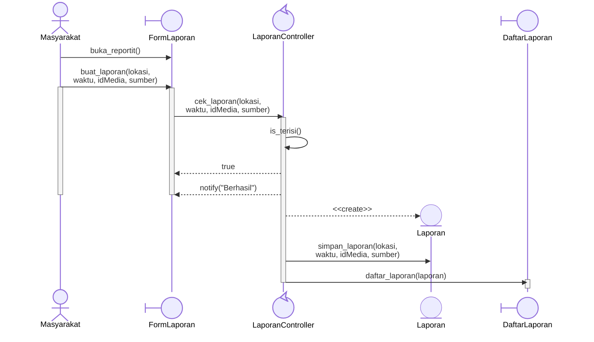
<p align="center">
<i>Gambar 3. Sequence Diagram UC01</i>
</p>

- **Skenario Alternatif 1: Informasi Tidak Sesuai Format**
<!--Jujur kita gak ada is_format_valid(); tanya kakaknya lagi ini boleh atau enggak-->

<p align="center">
<i>Gambar 4. Sequence Diagram UC01 - Informasi Tidak Sesuai Format</i>
</p>

- **Skenario Alternatif 2: Informasi Pada Laporan Tidak Lengkap**

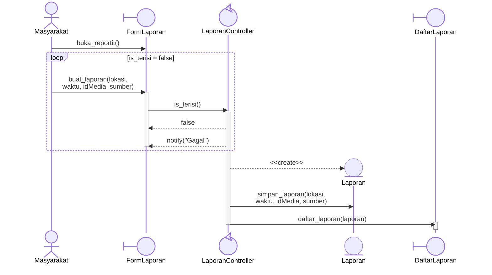
<p align="center">
<i>Gambar 4. Sequence Diagram UC01 - Informasi Pada Laporan Tidak Lengkap</i>
</p>

### 3.1.3 Diagram Kelas

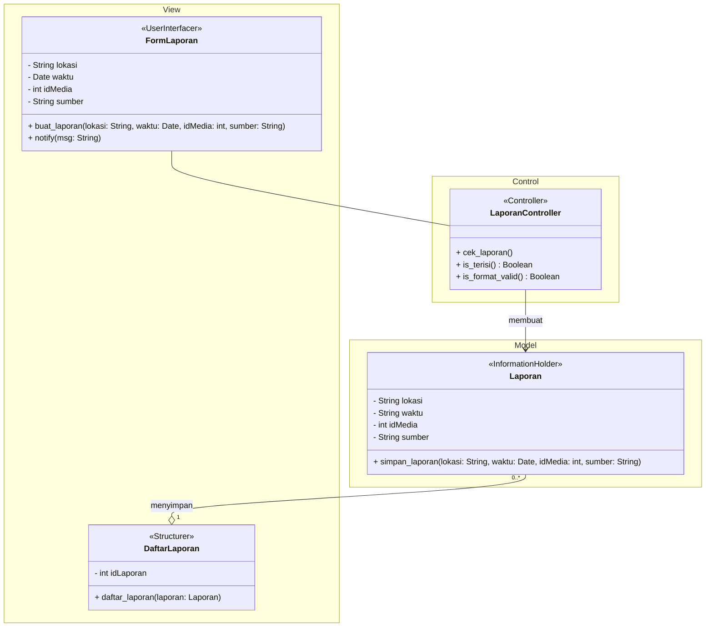
<p align="center">
<i>Gambar 5. Diagram Kelas UC01</i>
</p>

## 3.2 Use Case *Mengambil Bukti Foto/Video*

**ID Use Case:** *UC02*  
**Nama Use Case:** *Mengambil Bukti Foto/Video*

### 3.2.1 Identifikasi Kelas

Tabel 3.2. Identifikasi Kelas Use Case [UC02]

| No | Nama Kelas Perancangan | Nama Kelas Analisis Terkait |
|:--- | :--- | :--- |
| 1 | *FormLaporan* | *Form Laporan* |
| 2 | *Media* | *Media* |

### 3.2.2 Sequence Diagram

<!--Buat *sequence diagram* untuk **setiap skenario use case**, mencakup skenario normal dan alternatif pada subbab 4.4 SKPL. Diagram melibatkan kelas-kelas yang telah diidentifikasi pada SKPL.-->

- **Skenario Normal**

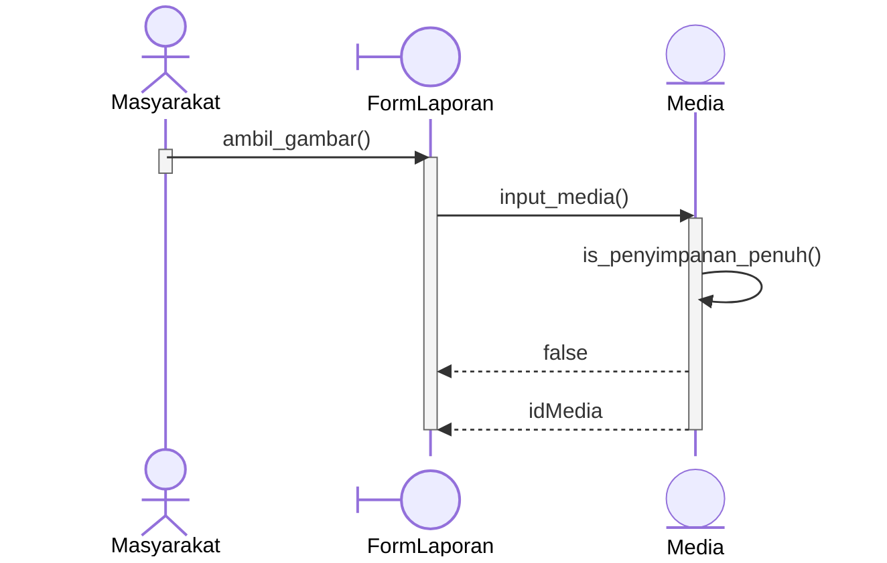
<p align="center">
<i>Gambar 6. Sequence Diagram UC02</i>
</p>

- **Skenario Alternatif 1: Penyimpanan Perangkat Penuh**

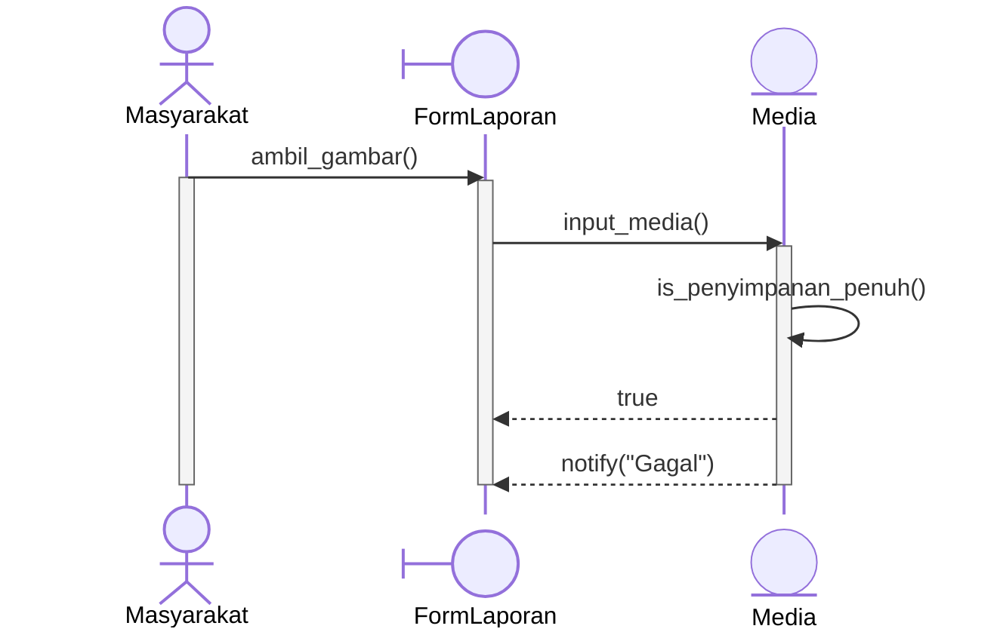
<p align="center">
<i>Gambar 7. Sequence Diagram UC02 - Penyimpanan Perangkat Penuh</i>
</p>

### 3.2.3 Diagram Kelas

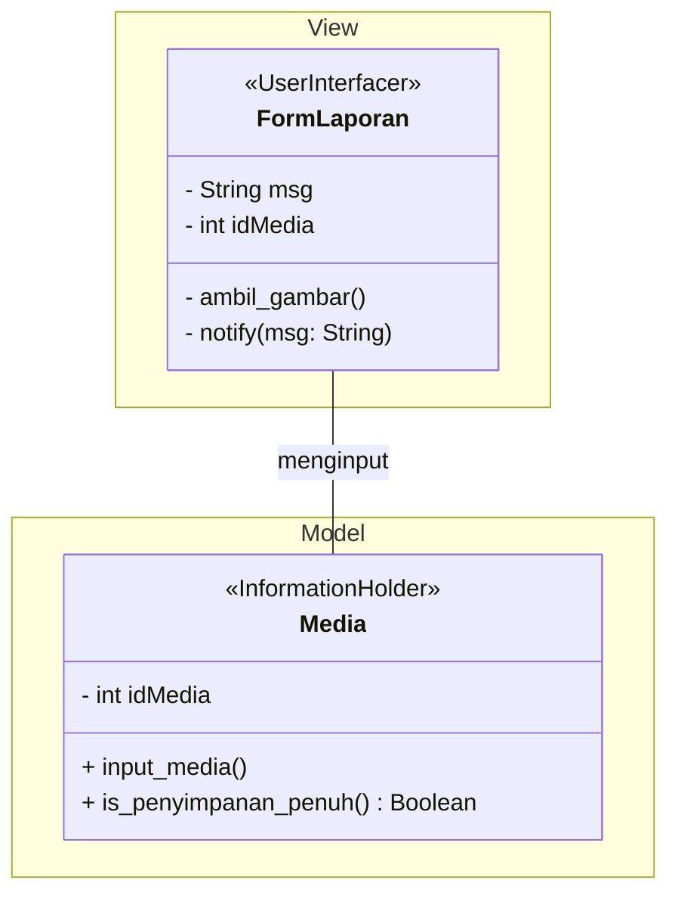
<p align="center">
<i>Gambar 8. Diagram Kelas Mengambil Bukti Foto/Video</i>
</p>

## 3.3 Use Case *Memverifikasi Laporan ReportIt*

**ID Use Case:** *UC03*  
**Nama Use Case:** *Memverifikasi Laporan ReportIt*

### 3.3.1 Identifikasi Kelas

Identifikasi kelas yang terkait dengan use case tersebut. Kelas di tahap perancangan dipetakan berdasarkan arsitektur MVC yang didefinisikan pada Bab 2.

Tabel 3.3. Identifikasi Kelas Use Case [UC03]

| No | Nama Kelas Perancangan | Nama Kelas Analisis Terkait |
|:--- | :--- | :--- |
| 1 | *DaftarLaporan (View)* | *DaftarLaporan* |
| 2 | *LaporanView (View)* | *Laporan* |
| 3 | *ValidatorLaporan (Controller)* | *ValidatorLaporan* |
| 4 | *Laporan (Model)* | *Laporan* |
| 5 | *Lokasi (Model)* | *Lokasi* |

### 3.3.2 Sequence Diagram

Berikut adalah *sequence diagram* untuk skenario normal dan alternatif berdasarkan alur use case memverifikasi laporan ReportIt. 

- **Skenario Normal**

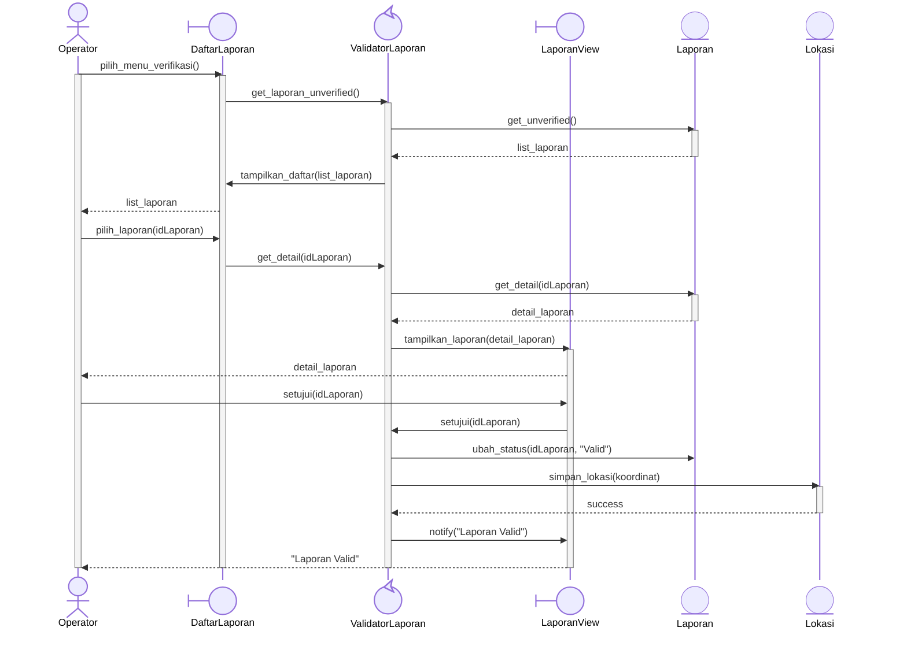
<p align="center">
<i>Gambar 9. Sequence Diagram UC03 - Skenario Normal</i>
</p>

- **Skenario Alternatif 1: Laporan Tidak Valid**

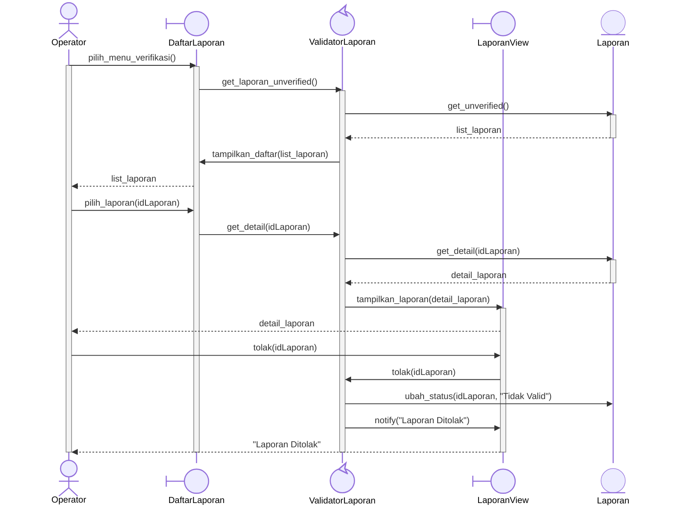
<p align="center">
<i>Gambar 10. Sequence Diagram UC03 - Laporan Tidak Valid</i>
</p>

### 3.3.3 Diagram Kelas

Diagram kelas di bawah ini merangkum interaksi antarkelas perancangan MVC yang diidentifikasi pada use case verifikasi laporan pencemaran.

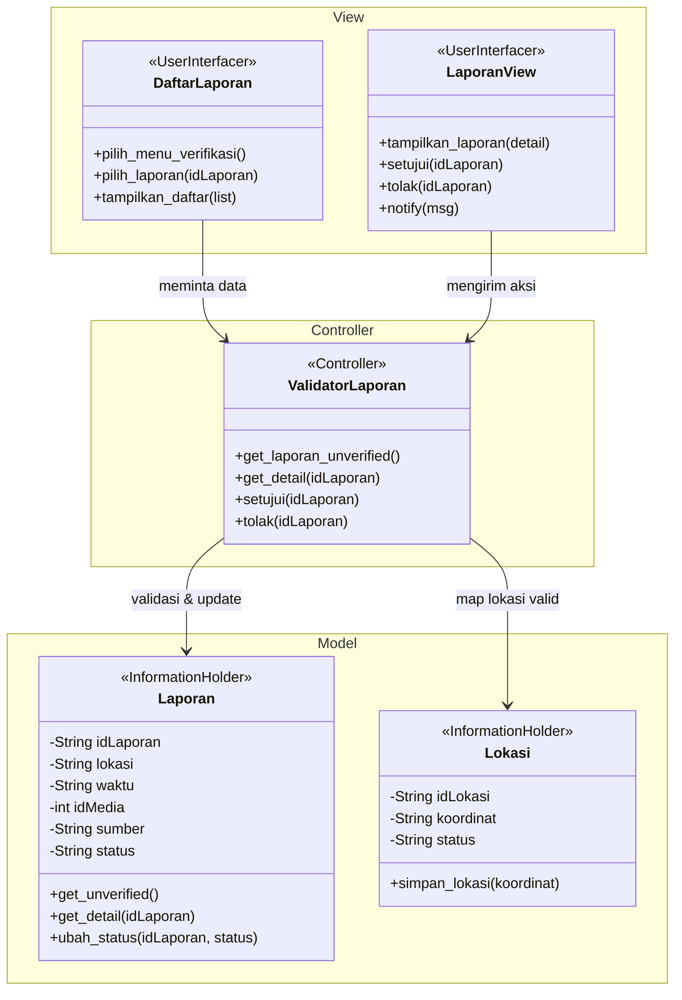
<p align="center">
<i>Gambar 11. Diagram Kelas UC03</i>
</p>

---

## 3.4 Use Case *Melihat Daftar Lokasi Pencemaran (CleanIt)*

**ID Use Case:** *UC04*  
**Nama Use Case:** *Melihat Daftar Lokasi Pencemaran (CleanIt)*

### 3.4.1 Identifikasi Kelas

Identifikasi kelas yang terkait dengan fitur melihat daftar lokasi untuk dibersihkan.

Tabel 3.4. Identifikasi Kelas Use Case [UC04]

| No | Nama Kelas Perancangan | Nama Kelas Analisis Terkait |
|:--- | :--- | :--- |
| 1 | *DaftarLokasi (View)* | *DaftarLokasi* |
| 2 | *LaporanView (View)* | *Laporan* |
| 3 | *ManagerLaporan (Controller)* | *Laporan* |
| 4 | *Lokasi (Model)* | *Lokasi* |

### 3.4.2 Sequence Diagram

Berikut adalah *sequence diagram* untuk melihat daftar pencemaran berdasarkan skenario normal dan alternatifnya. 

- **Skenario Normal**

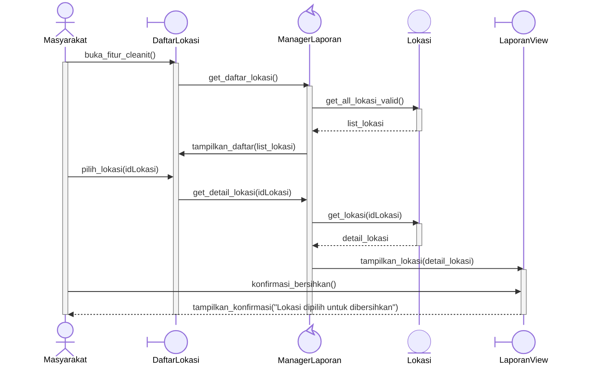
<p align="center">
<i>Gambar 12. Sequence Diagram UC04 - Skenario Normal</i>
</p>

- **Skenario Alternatif 1: Tidak Ada Lokasi Pencemaran di Daftar**

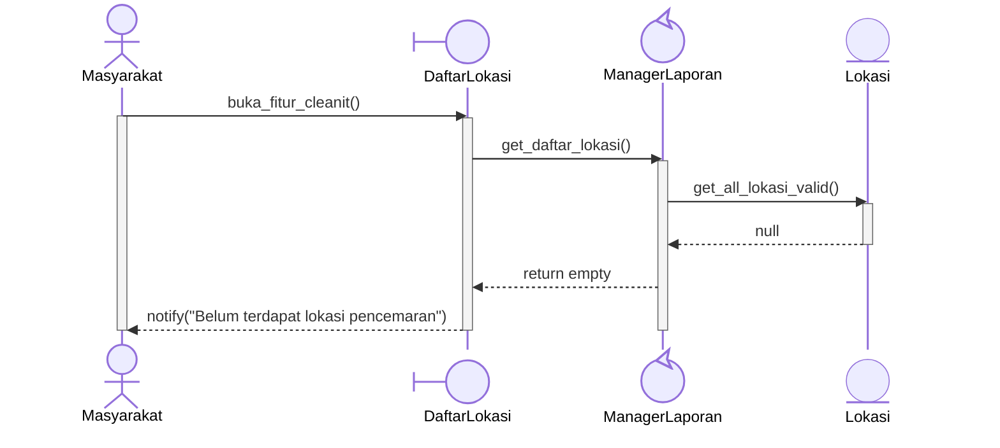
<p align="center">
<i>Gambar 13. Sequence Diagram UC04 - Tidak Ada Lokasi Pencemaran</i>
</p>

### 3.4.3 Diagram Kelas

Diagram kelas di bawah memvisualisasikan atribut, metode, dan relasi antarkelas perancangan pada proses melihat daftar lokasi CleanIt.

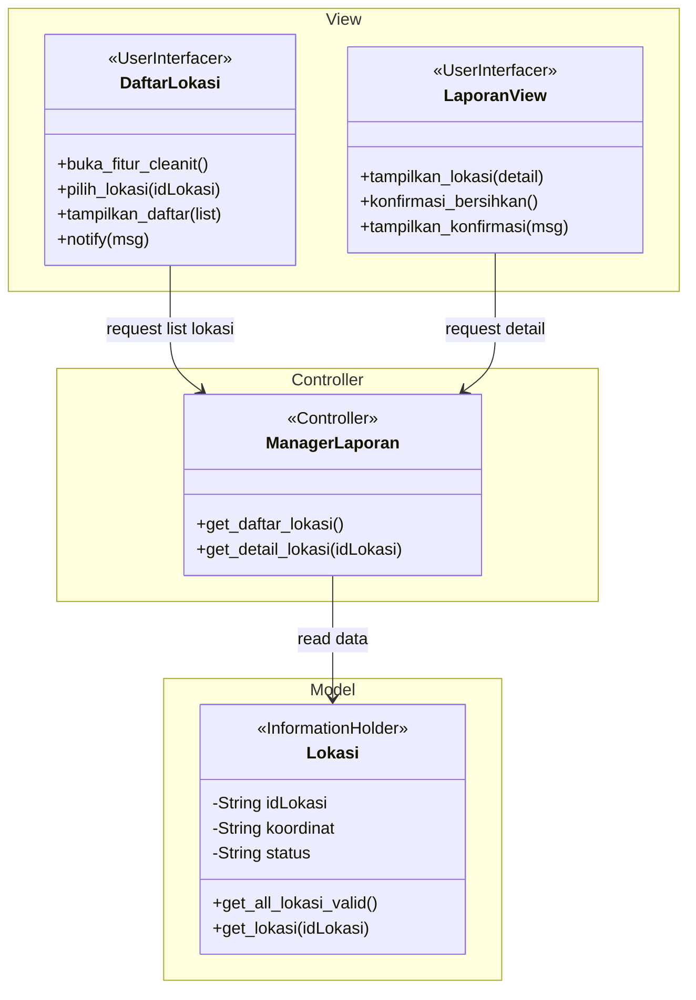
<p align="center">
<i>Gambar 14. Diagram Kelas UC04</i>
</p>

## 3.5 Use Case *Mengirimkan Bukti Pembersihan (CleanIt)*

**ID Use Case:** *UC05*  
**Nama Use Case:** *Mengirimkan Bukti Pembersihan (CleanIt)*

### 3.5.1 Identifikasi Kelas

Identifikasi kelas yang terkait dengan fitur mengirimkan bukti pembersihan.

Tabel 3.5. Identifikasi Kelas Use Case [UC05]

| No | Nama Kelas Perancangan | Nama Kelas Analisis Terkait |
|:--- | :--- | :--- |
| 1 | *FormLaporan (View)* | *FormLaporan* |
| 2 | *ManagerLaporan (Controller)* | *Laporan* |
| 3 | *DaftarLaporan (View)* | *DaftarLaporan* |
| 4 | *Laporan (Model)* | *Laporan* |

### 3.5.2 Sequence Diagram

Berikut adalah *sequence diagram* untuk mengirimkan bukti pembersihan berdasarkan skenario normal dan alternatifnya. 

- **Skenario Normal**

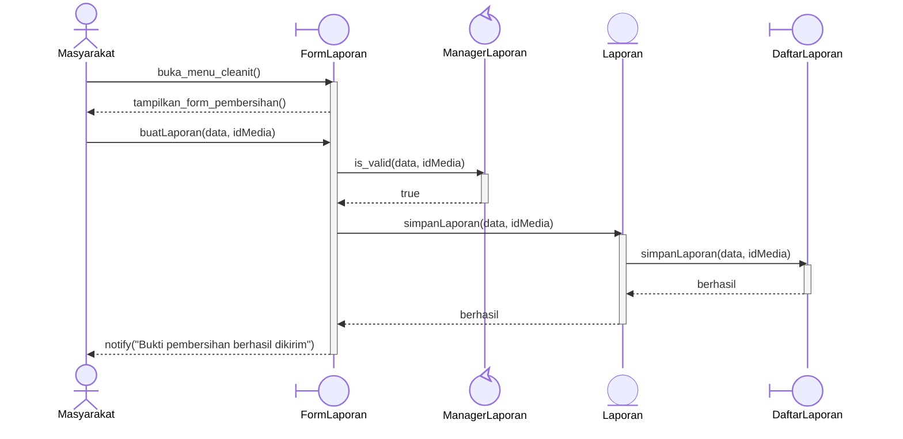
<p align="center">
<i>Gambar 15. Sequence Diagram UC05 - Skenario Normal</i>
</p>

- **Skenario Alternatif 1: Pengiriman Bukti Pembersihan Gagal**

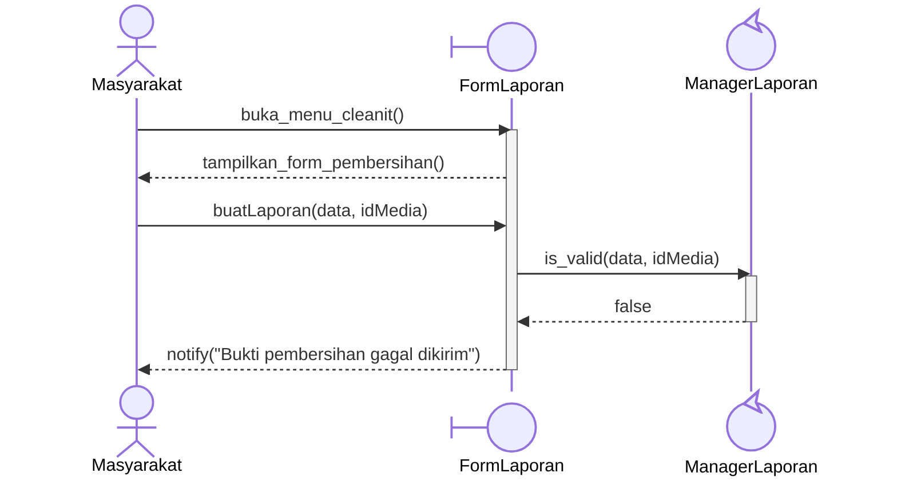
<p align="center">
<i>Gambar 16. Sequence Diagram UC05 - Pengiriman Bukti Pembersihan Gagal</i>
</p>


### 3.5.3 Diagram Kelas

Diagram kelas di bawah memvisualisasikan atribut, metode, dan relasi antarkelas perancangan pada proses mengirimkan bukti pembersihan.

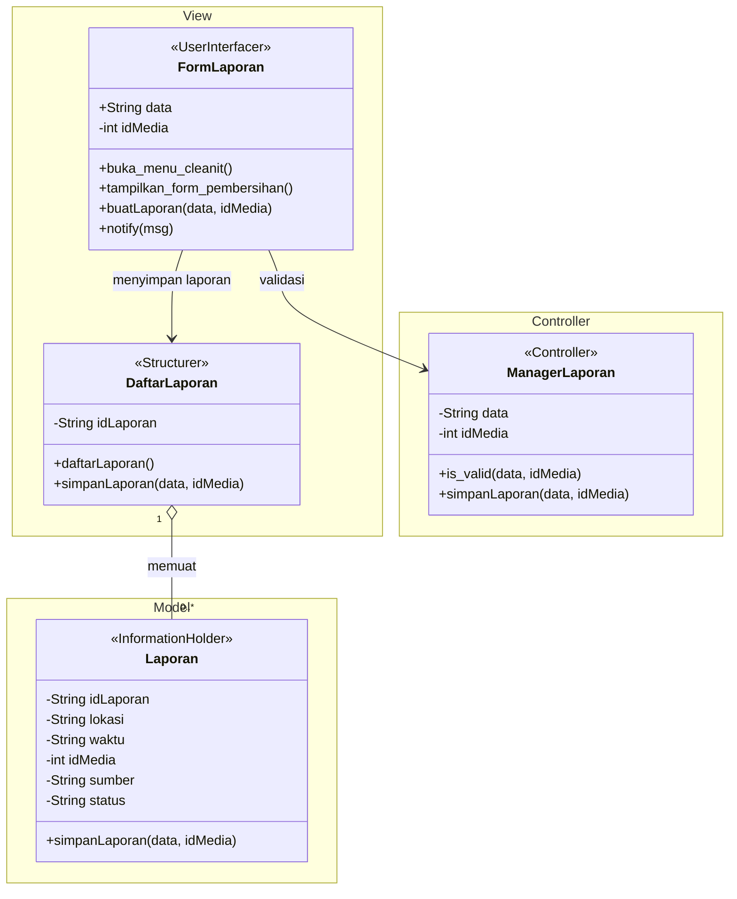
<p align="center">
<i>Gambar 17. Diagram Kelas UC05</i>
</p>


## 3.6 Use Case *Memverifikasi Laporan Pembersihan (CleanIt)*

**ID Use Case:** *UC06*  
**Nama Use Case:** *Memverifikasi Laporan Pembersihan (CleanIt)*

### 3.6.1 Identifikasi Kelas

Identifikasi kelas yang terkait dengan fitur memverifikasi laporan pembersihan.

Tabel 3.6. Identifikasi Kelas Use Case [UC06]

| No | Nama Kelas Perancangan | Nama Kelas Analisis Terkait |
|:--- | :--- | :--- |
| 1 | *LaporanView (View)* | *Laporan* |
| 2 | *ManagerLaporan (Controller)* | *Laporan* |
| 3 | *DaftarLaporan (View)* | *DaftarLaporan* |
| 4 | *ValidatorLaporan (Controller)* | *ValidatorLaporan* |
| 5 | *ManagerPoin (Controller)* | *Pengguna* |
| 6 | *Pengguna (Model)* | *Pengguna* |
| 7 | *Laporan (Model)* | *Laporan* |

### 3.6.2 Sequence Diagram

Berikut adalah *sequence diagram* untuk memverifikasi laporan pembersihan berdasarkan skenario normal dan alternatifnya. 

- **Skenario Normal**

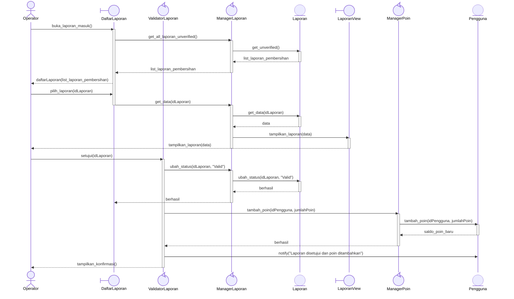
<p align="center">
<i>Gambar 18. Sequence Diagram UC06 - Skenario Normal</i>
</p>

- **Skenario Alternatif 1: Operator Menolak Laporan karena Bukti Tidak Sah**

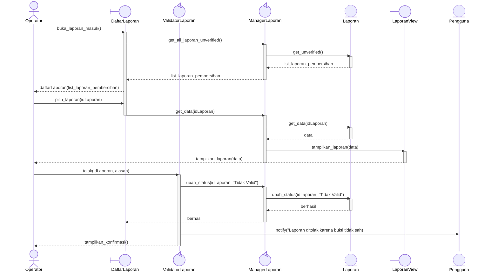
<p align="center">
<i>Gambar 19. Sequence Diagram UC06 - Operator Menolak Laporan karena Bukti Tidak Sah</i>
</p>

### 3.6.3 Diagram Kelas

Diagram kelas di bawah memvisualisasikan atribut, metode, dan relasi antarkelas perancangan pada proses validasi laporan pembersihan.

```mermaid
classDiagram
    direction TB

    namespace View {
        class DaftarLaporan {
            -String idLaporan
            +buka_laporan_masuk()
            +pilih_laporan(idLaporan)
            +daftarLaporan(list_laporan_pembersihan)
        }
        class LaporanView {
            -String data
            -int idMedia
            +tampilkan_laporan(data)
        }
    }
    namespace Controller {
        class ManagerPoin {
            +tambah_poin(idPengguna, jumlahPoin)
        }
        class ValidatorLaporan {
            +setujui(idLaporan)
            +tolak(idLaporan, alasan)
            +tampilkan_konfirmasi()
        }
        class ManagerLaporan {
            -String data
            -int idMedia
            +get_all_laporan_unverified()
            +get_data(idLaporan)
            +ubah_status(idLaporan, status)
            +simpan_alasan_penolakan(idLaporan, alasan)
        }
    }
    namespace Model {
        class Laporan {
            -String idLaporan
            -String lokasi
            -String waktu
            -int idMedia
            -String sumber
            -String status
            +get_unverified()
            +get_data(idLaporan)
            +get_detail(idLaporan)
            +ubah_status(idLaporan, status)
            +simpan_alasan_penolakan(idLaporan, alasan)
        }
        class Pengguna {
            -int idPengguna
            -int saldoPoin
            +tambah_poin(idPengguna, jumlahPoin)
            +notify(msg)
        }
    }

    <<Controller>> ValidatorLaporan
    <<UserInterfacer>> LaporanView
    <<Controller>> ManagerLaporan
    <<Controller>> ManagerPoin
    <<Structurer>> DaftarLaporan
    <<InformationHolder>> Laporan
    <<InformationHolder>> Pengguna

    DaftarLaporan --> ManagerLaporan : meminta data
    ManagerLaporan --> Laporan : membaca dan mengubah status
    ManagerLaporan --> LaporanView : menampilkan detail
    ValidatorLaporan --> ManagerLaporan : memvalidasi laporan
    ValidatorLaporan --> ManagerPoin : menambah poin
    ManagerPoin --> Pengguna : memperbarui poin
    ValidatorLaporan ..> Pengguna : notifikasi
    DaftarLaporan "1" o-- "0..*" Laporan : memuat
```
<p align="center">
<i>Gambar 20. Diagram Kelas UC06</i>
</p>

## 3.7 Use Case *Membuat Laporan Pencemaran*

**ID Use Case:** *UC01*  
**Nama Use Case:** *Membuat Laporan Pencemaran*

### 3.7.1 Identifikasi Kelas

Identifikasi kelas yang terkait dengan use case tersebut. Kelas di tahap perancangan dapat berbeda dengan dengan kelas di tahap analisis. Dapat menggunakan tabel di bawah:

Tabel 3.7. Identifikasi Kelas Use Case [UC01]

| No | Nama Kelas Perancangan | Nama Kelas Analisis Terkait |
|:--- | :--- | :--- |
| 1 | *[Nama kelas perancangan]* | *[Nama kelas analisis pada SKPL]* |
| 2 | *[Nama kelas perancangan]* | *[Nama kelas analisis pada SKPL]* |
| ... | *...* | *...* |

### 3.7.2 Sequence Diagram

Buat *sequence diagram* untuk **setiap skenario use case**, mencakup skenario normal dan alternatif pada subbab 4.4 SKPL. Diagram melibatkan kelas-kelas yang telah diidentifikasi pada SKPL. 

- **Skenario Normal**

<p align="center">

</p>
<p align="center">
<i>Gambar X. Sequence Diagram [UC01]</i>
</p>

- **Skenario Alternatif [Nomor]: [Nama Skenario]**

<p align="center">

</p>
<p align="center">
<i>Gambar X. Sequence Diagram [UC01] - [Nama skenario alternatif]</i>
</p>

### 3.7.3 Diagram Kelas

Buatlah diagram kelas untuk use case ini yang terdiri atas kelas-kelas dari 3.7.1. **Setiap kelas pada diagram wajib menampilkan atribut dan metode/operasi langsung di dalam kotak kelasnya**, sehingga tidak perlu membuat tabel daftar atribut dan metode per kelas pada subbab ini. Daftar lengkap atribut dan metode seluruh kelas disajikan pada Tabel 4.1 (Bab 4).

<p align="center">

</p>
<p align="center">
<i>Gambar X. Diagram Kelas [Nama Uce Case]</i>
</p>

Pada diagram, pastikan:
- Atribut dituliskan beserta visibilitas dan tipe datanya, misalnya `- email: String`.
- Operasi dituliskan beserta visibilitas, parameter, dan tipe kembaliannya, misalnya `+ login(email: String, password: String): Boolean`.
- Relasi antarkelas (asosiasi, agregasi, komposisi, generalisasi, dan dependensi) digambarkan lengkap dengan multiplisitas.
- Semua operasi yang dipanggil pada sequence diagram 3.7.2 (skenario normal dan alternatif) ada pada kelas yang bersangkutan.
- Kelas yang sama dengan kelas di use case lain memakai nama, atribut, dan metode yang konsisten.

## 3.8 Use Case *Membuat Laporan Pencemaran*

**ID Use Case:** *UC01*  
**Nama Use Case:** *Membuat Laporan Pencemaran*

### 3.8.1 Identifikasi Kelas

Identifikasi kelas yang terkait dengan use case tersebut. Kelas di tahap perancangan dapat berbeda dengan dengan kelas di tahap analisis. Dapat menggunakan tabel di bawah:

Tabel 3.8. Identifikasi Kelas Use Case [UC01]

| No | Nama Kelas Perancangan | Nama Kelas Analisis Terkait |
|:--- | :--- | :--- |
| 1 | *[Nama kelas perancangan]* | *[Nama kelas analisis pada SKPL]* |
| 2 | *[Nama kelas perancangan]* | *[Nama kelas analisis pada SKPL]* |
| ... | *...* | *...* |

### 3.8.2 Sequence Diagram

Buat *sequence diagram* untuk **setiap skenario use case**, mencakup skenario normal dan alternatif pada subbab 4.4 SKPL. Diagram melibatkan kelas-kelas yang telah diidentifikasi pada SKPL. 

- **Skenario Normal**

<p align="center">

</p>
<p align="center">
<i>Gambar X. Sequence Diagram [UC01]</i>
</p>

- **Skenario Alternatif [Nomor]: [Nama Skenario]**

<p align="center">

</p>
<p align="center">
<i>Gambar X. Sequence Diagram [UC01] - [Nama skenario alternatif]</i>
</p>

### 3.8.3 Diagram Kelas

Buatlah diagram kelas untuk use case ini yang terdiri atas kelas-kelas dari 3.8.1. **Setiap kelas pada diagram wajib menampilkan atribut dan metode/operasi langsung di dalam kotak kelasnya**, sehingga tidak perlu membuat tabel daftar atribut dan metode per kelas pada subbab ini. Daftar lengkap atribut dan metode seluruh kelas disajikan pada Tabel 4.1 (Bab 4).

<p align="center">

</p>
<p align="center">
<i>Gambar X. Diagram Kelas [Nama Uce Case]</i>
</p>

Pada diagram, pastikan:
- Atribut dituliskan beserta visibilitas dan tipe datanya, misalnya `- email: String`.
- Operasi dituliskan beserta visibilitas, parameter, dan tipe kembaliannya, misalnya `+ login(email: String, password: String): Boolean`.
- Relasi antarkelas (asosiasi, agregasi, komposisi, generalisasi, dan dependensi) digambarkan lengkap dengan multiplisitas.
- Semua operasi yang dipanggil pada sequence diagram 3.8.2 (skenario normal dan alternatif) ada pada kelas yang bersangkutan.
- Kelas yang sama dengan kelas di use case lain memakai nama, atribut, dan metode yang konsisten.

## 3.9 Use Case *Membuat Laporan Pencemaran*

**ID Use Case:** *UC01*  
**Nama Use Case:** *Membuat Laporan Pencemaran*

### 3.9.1 Identifikasi Kelas

Identifikasi kelas yang terkait dengan use case tersebut. Kelas di tahap perancangan dapat berbeda dengan dengan kelas di tahap analisis. Dapat menggunakan tabel di bawah:

Tabel 3.9. Identifikasi Kelas Use Case [UC01]

| No | Nama Kelas Perancangan | Nama Kelas Analisis Terkait |
|:--- | :--- | :--- |
| 1 | *[Nama kelas perancangan]* | *[Nama kelas analisis pada SKPL]* |
| 2 | *[Nama kelas perancangan]* | *[Nama kelas analisis pada SKPL]* |
| ... | *...* | *...* |

### 3.9.2 Sequence Diagram

Buat *sequence diagram* untuk **setiap skenario use case**, mencakup skenario normal dan alternatif pada subbab 4.4 SKPL. Diagram melibatkan kelas-kelas yang telah diidentifikasi pada SKPL. 

- **Skenario Normal**

<p align="center">

</p>
<p align="center">
<i>Gambar X. Sequence Diagram [UC01]</i>
</p>

- **Skenario Alternatif [Nomor]: [Nama Skenario]**

<p align="center">

</p>
<p align="center">
<i>Gambar X. Sequence Diagram [UC01] - [Nama skenario alternatif]</i>
</p>

### 3.9.3 Diagram Kelas

Buatlah diagram kelas untuk use case ini yang terdiri atas kelas-kelas dari 3.9.1. **Setiap kelas pada diagram wajib menampilkan atribut dan metode/operasi langsung di dalam kotak kelasnya**, sehingga tidak perlu membuat tabel daftar atribut dan metode per kelas pada subbab ini. Daftar lengkap atribut dan metode seluruh kelas disajikan pada Tabel 4.1 (Bab 4).

<p align="center">

</p>
<p align="center">
<i>Gambar X. Diagram Kelas [Nama Uce Case]</i>
</p>

Pada diagram, pastikan:
- Atribut dituliskan beserta visibilitas dan tipe datanya, misalnya `- email: String`.
- Operasi dituliskan beserta visibilitas, parameter, dan tipe kembaliannya, misalnya `+ login(email: String, password: String): Boolean`.
- Relasi antarkelas (asosiasi, agregasi, komposisi, generalisasi, dan dependensi) digambarkan lengkap dengan multiplisitas.
- Semua operasi yang dipanggil pada sequence diagram 3.9.2 (skenario normal dan alternatif) ada pada kelas yang bersangkutan.
- Kelas yang sama dengan kelas di use case lain memakai nama, atribut, dan metode yang konsisten.

<br>

## 3.10 Use Case *Melihat Saldo Poin*

**ID Use Case:** *UC07*  
**Nama Use Case:** *Melihat Saldo Poin*

### 3.10.1 Identifikasi Kelas

Use case Melihat Saldo Poin direalisasikan menggunakan tiga kelas berdasarkan arsitektur MVC. HalamanPenukaran bertindak sebagai View, ManagerPoin sebagai Controller, dan Pengguna sebagai Model yang menyimpan saldo poin.

Tabel 3.10. Identifikasi Kelas Use Case [UC07]

| No | Nama Kelas Perancangan | Nama Kelas Analisis Terkait |
| :--- | :--- | :--- |
| 1 | *HalamanPenukaran (View)* | *HalamanPenukaran* |
| 2 | *ManagerPoin (Controller)* | *ManagerPoin* |
| 3 | *Pengguna (Model)* | *Pengguna* |

### 3.10.2 Sequence Diagram

Sequence diagram berikut menggambarkan proses pengambilan saldo poin pengguna melalui ManagerPoin.

- **Skenario Normal**

```mermaid
sequenceDiagram
    actor M as Masyarakat
    participant HP as HalamanPenukaran
    participant MP as ManagerPoin
    participant P as Pengguna

    M->>HP: Membuka menu poin dan reward
    activate HP

    HP->>MP: lihatSaldo(pengguna)
    activate MP

    MP->>P: getSaldoPoin()
    activate P
    P-->>MP: saldoPoin
    deactivate P

    MP-->>HP: saldoPoin
    deactivate MP

    HP->>HP: tampilkanSaldo(saldoPoin)
    HP-->>M: Saldo poin ditampilkan

    deactivate HP
```

<p align="center">
<i>Gambar X. Sequence Diagram UC07 - Skenario Normal</i>
</p>

Use case UC07 hanya memiliki skenario normal, sehingga tidak diperlukan diagram alternatif.

### 3.10.3 Diagram Kelas

Diagram kelas menggambarkan hubungan antara View HalamanPenukaran, Controller ManagerPoin, dan Model Pengguna. Permintaan saldo diteruskan melalui ManagerPoin sehingga View tidak mengakses Model secara langsung.

```mermaid
classDiagram
    direction TB

    namespace View {
        class HalamanPenukaran {
            <<UserInterfacer>>
            +tampilkanSaldo(saldo: int) void
            +pilihReward(idReward: String) void
            +tampilkanNotifikasi(pesan: String) void
        }
    }

    namespace Controller {
        class ManagerPoin {
            <<Controller>>
            +lihatSaldo(pengguna: Pengguna) int
            +lihatRewardTersedia() List~Reward~
            +cekPoin(pengguna: Pengguna, harga: int) Boolean
            +kurangiPoin(pengguna: Pengguna, jumlah: int) Boolean
            +tambahPoin(idPengguna: String, jumlah: int) void
        }
    }

    namespace Model {
        class Pengguna {
            <<InformationHolder>>
            -idPengguna: String
            -nama: String
            -saldoPoin: int
            +getSaldoPoin() int
            +cukupPoin(harga: int) Boolean
            +kurangiPoin(jumlah: int) Boolean
        }
    }

    HalamanPenukaran "1" --> "1" ManagerPoin : meminta saldo
    ManagerPoin ..> Pengguna : membaca saldo
```

<p align="center">
<i>Gambar X. Diagram Kelas UC07 - Melihat Saldo Poin</i>
</p>


## 3.11 Use Case *Melihat Reward yang Tersedia*

**ID Use Case:** *UC08*  
**Nama Use Case:** *Melihat Reward yang Tersedia*

### 3.11.1 Identifikasi Kelas

Use case Melihat Reward yang Tersedia melibatkan HalamanPenukaran dan DaftarReward sebagai View, ManagerPoin sebagai Controller, serta Reward sebagai Model. DaftarReward bertanggung jawab menampilkan daftar hadiah, sedangkan ManagerPoin mengambil informasi reward dari Model.

Tabel 3.11. Identifikasi Kelas Use Case [UC08]

| No | Nama Kelas Perancangan | Nama Kelas Analisis Terkait |
| :--- | :--- | :--- |
| 1 | *HalamanPenukaran (View)* | *HalamanPenukaran* |
| 2 | *DaftarReward (View)* | *DaftarReward* |
| 3 | *ManagerPoin (Controller)* | *ManagerPoin* |
| 4 | *Reward (Model)* | *Reward* |

### 3.11.2 Sequence Diagram

Sequence diagram berikut menunjukkan interaksi ketika masyarakat membuka menu reward. HalamanPenukaran menampilkan komponen DaftarReward, yang kemudian meminta data melalui ManagerPoin. ManagerPoin mengambil reward yang tersedia dari Model Reward.

- **Skenario Normal**

```mermaid
sequenceDiagram
    actor M as Masyarakat
    participant HP as HalamanPenukaran
    participant DR as DaftarReward
    participant MP as ManagerPoin
    participant R as Reward

    M->>HP: Membuka menu reward
    activate HP

    HP->>DR: muatRewardTersedia()
    activate DR

    DR->>MP: lihatRewardTersedia()
    activate MP

    MP->>R: getRewardTersedia()
    activate R
    R-->>MP: daftarRewardTersedia
    deactivate R

    MP-->>DR: daftarRewardTersedia
    deactivate MP

    DR->>DR: tampilkanDaftarReward(daftarRewardTersedia)
    DR-->>M: Daftar reward ditampilkan

    deactivate DR
    deactivate HP
```

<p align="center">
<i>Gambar X. Sequence Diagram UC08 - Skenario Normal</i>
</p>

Use case UC08 hanya memiliki skenario normal, sehingga tidak diperlukan diagram alternatif.

### 3.11.3 Diagram Kelas

Diagram kelas memperlihatkan bahwa DaftarReward merupakan komponen View yang berada di dalam HalamanPenukaran. DaftarReward berinteraksi dengan ManagerPoin untuk memperoleh data reward, sedangkan ManagerPoin mengakses Model Reward.

```mermaid
classDiagram
    direction TB

    namespace View {
        class HalamanPenukaran {
            <<UserInterfacer>>
            +tampilkanSaldo(saldo: int) void
            +pilihReward(idReward: String) void
            +tampilkanNotifikasi(pesan: String) void
        }

        class DaftarReward {
            <<UserInterfacer>>
            +muatRewardTersedia() void
            +tampilkanDaftarReward(daftar: List~Reward~) void
            +pilihReward(idReward: String) void
        }
    }

    namespace Controller {
        class ManagerPoin {
            <<Controller>>
            +lihatSaldo(pengguna: Pengguna) int
            +lihatRewardTersedia() List~Reward~
            +cekPoin(pengguna: Pengguna, harga: int) Boolean
            +kurangiPoin(pengguna: Pengguna, jumlah: int) Boolean
            +tambahPoin(idPengguna: String, jumlah: int) void
        }
    }

    namespace Model {
        class Reward {
            <<InformationHolder>>
            -idReward: String
            -nama: String
            -jenis: String
            -hargaPoin: int
            -stok: int
            +getRewardTersedia() List~Reward~
            +cariReward(idReward: String) Reward
            +getHargaPoin() int
            +tersedia() Boolean
            +kurangiStok() Boolean
        }
    }

    HalamanPenukaran "1" *-- "1" DaftarReward : memuat tampilan
    DaftarReward --> ManagerPoin : meminta reward
    ManagerPoin ..> Reward : mengambil data
    DaftarReward ..> Reward : menampilkan data
```

<p align="center">
<i>Gambar X. Diagram Kelas UC08 - Melihat Reward yang Tersedia</i>
</p>


## 3.12 Use Case *Menukarkan Poin dengan Reward*

**ID Use Case:** *UC09*  
**Nama Use Case:** *Menukarkan Poin dengan Reward*

### 3.12.1 Identifikasi Kelas

Use case Menukarkan Poin dengan Reward melibatkan komponen View, Controller, dan Model. HalamanPenukaran dan DaftarReward bertanggung jawab menerima pilihan masyarakat. Controller Penukaran mengoordinasikan transaksi penukaran dengan bantuan ManagerPoin untuk memeriksa dan mengubah saldo. Model Pengguna menyimpan saldo poin, Reward menyimpan informasi hadiah, dan Penukaran mencatat transaksi yang berhasil dilakukan.

Tabel 3.12. Identifikasi Kelas Use Case [UC09]

| No | Nama Kelas Perancangan | Nama Kelas Analisis Terkait |
| :--- | :--- | :--- |
| 1 | *HalamanPenukaran (View)* | *HalamanPenukaran* |
| 2 | *DaftarReward (View)* | *DaftarReward* |
| 3 | *Penukaran (Controller)* | *Penukaran* |
| 4 | *ManagerPoin (Controller)* | *ManagerPoin* |
| 5 | *Pengguna (Model)* | *Pengguna* |
| 6 | *Reward (Model)* | *Reward* |
| 7 | *Penukaran (Model)* | *Penukaran* |

### 3.12.2 Sequence Diagram

Sequence diagram UC09 menggambarkan proses penukaran poin dengan reward melalui Controller Penukaran. Controller ini mengoordinasikan pengecekan reward, kecukupan saldo, dan pencatatan transaksi. ManagerPoin menangani pemeriksaan serta perubahan saldo pengguna.

- **Skenario Normal**

Pada skenario normal, masyarakat memilih reward dan memiliki poin yang mencukupi. Sistem kemudian memeriksa ketersediaan reward, mengurangi saldo dan stok, serta mencatat transaksi penukaran.

```mermaid
sequenceDiagram
    actor M as Masyarakat
    participant DR as DaftarReward
    participant HP as HalamanPenukaran
    participant PC as Penukaran (Controller)
    participant MP as ManagerPoin
    participant R as Reward
    participant P as Pengguna
    participant PN as Penukaran (Model)

    M->>DR: pilihReward(idReward)
    activate DR

    DR->>HP: pilihReward(idReward)
    activate HP
    deactivate DR

    HP->>PC: tukarPoin(pengguna, idReward)
    activate PC

    PC->>R: cariReward(idReward)
    activate R
    R-->>PC: reward
    deactivate R

    PC->>R: getHargaPoin()
    activate R
    R-->>PC: hargaPoin
    deactivate R

    PC->>R: tersedia()
    activate R
    R-->>PC: true
    deactivate R

    PC->>MP: cekPoin(pengguna, hargaPoin)
    activate MP

    MP->>P: cukupPoin(hargaPoin)
    activate P
    P-->>MP: true
    deactivate P

    MP-->>PC: true
    deactivate MP

    Note over PC,PN: Semua perubahan dilakukan dalam satu transaksi database atomik

    PC->>MP: kurangiPoin(pengguna, hargaPoin)
    activate MP

    MP->>P: kurangiPoin(hargaPoin)
    activate P
    P-->>MP: success
    deactivate P

    MP-->>PC: success
    deactivate MP

    PC->>R: kurangiStok()
    activate R
    R-->>PC: success
    deactivate R

    PC->>PN: buatPenukaran(pengguna, reward)
    activate PN
    PN-->>PC: success
    deactivate PN

    Note over PC,PN: Commit jika berhasil, rollback seluruh perubahan jika gagal

    PC-->>HP: penukaranBerhasil
    deactivate PC

    HP->>HP: tampilkanNotifikasi("Penukaran berhasil")
    HP-->>M: Konfirmasi penukaran berhasil

    deactivate HP
```

<p align="center">
<i>Gambar X. Sequence Diagram UC09 - Skenario Normal</i>
</p>

- **Skenario Alternatif 1: Poin Tidak Cukup**

Pada skenario alternatif, sistem menemukan bahwa saldo poin masyarakat tidak mencukupi harga reward. Controller Penukaran menghentikan proses transaksi dan menampilkan notifikasi kegagalan melalui HalamanPenukaran. Tidak ada perubahan saldo maupun stok reward.

```mermaid
sequenceDiagram
    actor M as Masyarakat
    participant DR as DaftarReward
    participant HP as HalamanPenukaran
    participant PC as Penukaran (Controller)
    participant MP as ManagerPoin
    participant R as Reward
    participant P as Pengguna

    M->>DR: pilihReward(idReward)
    activate DR

    DR->>HP: pilihReward(idReward)
    activate HP
    deactivate DR

    HP->>PC: tukarPoin(pengguna, idReward)
    activate PC

    PC->>R: cariReward(idReward)
    activate R
    R-->>PC: reward
    deactivate R

    PC->>R: getHargaPoin()
    activate R
    R-->>PC: hargaPoin
    deactivate R

    PC->>R: tersedia()
    activate R
    R-->>PC: true
    deactivate R

    PC->>MP: cekPoin(pengguna, hargaPoin)
    activate MP

    MP->>P: cukupPoin(hargaPoin)
    activate P
    P-->>MP: false
    deactivate P

    MP-->>PC: false
    deactivate MP

    Note over PC,P: Penukaran dihentikan tanpa perubahan data

    PC-->>HP: penukaranGagal
    deactivate PC

    HP->>HP: tampilkanNotifikasi("Poin tidak cukup")
    HP-->>M: Notifikasi penukaran gagal

    deactivate HP
```

<p align="center">
<i>Gambar X. Sequence Diagram UC09 - Poin Tidak Cukup</i>
</p>

### 3.12.3 Diagram Kelas

Diagram kelas berikut menunjukkan hubungan antarkomponen perancangan dalam proses penukaran. HalamanPenukaran mengirim permintaan penukaran ke Controller Penukaran. Controller Penukaran menggunakan ManagerPoin untuk mengelola saldo, mengakses Reward untuk memeriksa dan mengubah stok, serta membuat catatan transaksi melalui Model Penukaran.

Kedua komponen bernama Penukaran dibedakan berdasarkan peran Controller dan Model agar tidak terjadi ambiguitas pada diagram.

```mermaid
classDiagram
    direction TB

    namespace View {
        class HalamanPenukaran {
            <<UserInterfacer>>
            +tampilkanSaldo(saldo: int) void
            +pilihReward(idReward: String) void
            +tampilkanNotifikasi(pesan: String) void
        }

        class DaftarReward {
            <<UserInterfacer>>
            +muatRewardTersedia() void
            +tampilkanDaftarReward(daftar: List~Reward~) void
            +pilihReward(idReward: String) void
        }
    }

    namespace Controller {
        class PenukaranCtrl["Penukaran (Controller)"] {
            <<Controller>>
            +tukarPoin(pengguna: Pengguna, idReward: String) Boolean
        }

        class ManagerPoin {
            <<Controller>>
            +lihatSaldo(pengguna: Pengguna) int
            +lihatRewardTersedia() List~Reward~
            +cekPoin(pengguna: Pengguna, harga: int) Boolean
            +kurangiPoin(pengguna: Pengguna, jumlah: int) Boolean
            +tambahPoin(idPengguna: String, jumlah: int) void
        }
    }

    namespace Model {
        class Pengguna {
            <<InformationHolder>>
            -idPengguna: String
            -nama: String
            -saldoPoin: int
            +getSaldoPoin() int
            +cukupPoin(harga: int) Boolean
            +kurangiPoin(jumlah: int) Boolean
        }

        class Reward {
            <<InformationHolder>>
            -idReward: String
            -nama: String
            -jenis: String
            -hargaPoin: int
            -stok: int
            +getRewardTersedia() List~Reward~
            +cariReward(idReward: String) Reward
            +getHargaPoin() int
            +tersedia() Boolean
            +kurangiStok() Boolean
        }

        class PenukaranModel["Penukaran (Model)"] {
            <<InformationHolder>>
            -idPenukaran: String
            -waktuPenukaran: Date
            -poinDipakai: int
            +buatPenukaran(pengguna: Pengguna, reward: Reward) Boolean
        }
    }

    HalamanPenukaran "1" *-- "1" DaftarReward : memuat tampilan
    DaftarReward --> HalamanPenukaran : pilihan reward
    HalamanPenukaran --> PenukaranCtrl : meminta penukaran

    PenukaranCtrl --> ManagerPoin : mengelola poin
    ManagerPoin ..> Pengguna : membaca dan mengubah saldo
    PenukaranCtrl ..> Reward : memeriksa dan mengubah stok
    PenukaranCtrl ..> PenukaranModel : mencatat transaksi

    Pengguna "1" -- "0..*" PenukaranModel : memiliki riwayat
    PenukaranModel "0..*" --> "1" Reward : menukarkan
```

<p align="center">
<i>Gambar X. Diagram Kelas UC09 - Menukarkan Poin dengan Reward</i>
</p>

---

# BAB 4: Diagram Kelas Keseluruhan

## 4.1 Diagram Kelas

**Bagian ini diisi dengan diagram kelas keseluruhan.**

<p align="center">

</p>
<p align="center">
<i>Gambar 4.1. Diagram Kelas Perancangan Keseluruhan [Nama P/L]</i>
</p>

Tabel 4.1. Daftar Kelas Perancangan Keseluruhan

| ID Kelas | Nama Kelas | Atribut | Metode/Operasi |
| :--- | :--- | :--- | :--- |
| *[C01]* | *[Nama kelas]* | *[Daftar atribut]* | *[Daftar metode/operasi]* |
| *[C02]* | *[Nama kelas]* | *[Daftar atribut]* | *[Daftar metode/operasi]* |
| *[C03]* | *[Nama kelas]* | *[Daftar atribut]* | *[Daftar metode/operasi]* |
| *...* | *...* | *...* | *...* |

<br>

---

# BAB 5: Matriks Kerunutan

Petakan kelas perancangan dengan use case yang terkait. Gunakan **BAB 6 Traceability pada dokumen SKPL** sebagai acuan keterkaitan kelas analisis dan use case, lalu sesuaikan dengan realisasi use case dan kelas perancangan pada BAB 3–BAB 5 DPPL.

Tabel 7.1. Matriks Kerunutan Kelas terhadap Use Case

| Kelas | Use Case Terkait |
| :--- | :--- |
| *[ID kelas - Nama kelas]* | *[ID UC - Nama use case]* |
| *[ID kelas - Nama kelas]* | *[ID UC - Nama use case]* |
| *...* | *...* |
