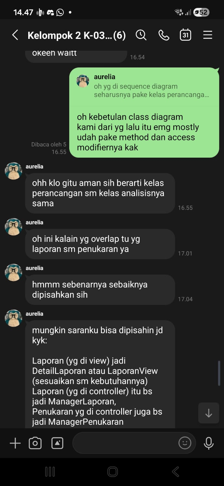
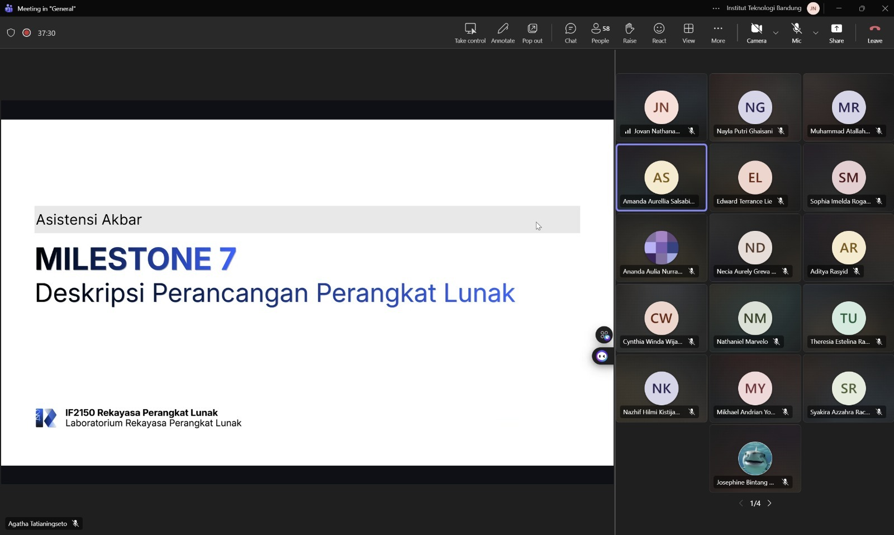

# Form Asistensi

## Tugas Besar IF2150 - Rekayasa Perangkat Lunak

| Informasi | Keterangan |
| --- | --- |
| **Hari** | Jumat (Akbar) dan Senin-Selasa (Asinkron) |
| **Tanggal** | 09/10/2026 (Akbar) dan 19/10/2026-20/10/2026 |
| **Kelas** | K-03 |
| **Nomor Kelompok** | G-02 |
| **Nama Kelompok** | DapinKoding  |
| **Nama Perangkat Lunak** | SoClean |
| **Dokumen** | K-03_G02_DPPL  |

### Anggota Kelompok

| NIM      | Nama                      |
| -------- | ------------------------- |
| 13525027 | Faishal Ahmad Nurdin      |
| 13525042 | Justin William            |
| 13525060 | M. Aqsha Bagus R.I.B.     |
| 13525087 | Jovan Nathanael           |
| 13525147 | Muhammad Dhafin Al Khairy |

### Catatan

Asistensi Akbar:
Asistensi Akbar memuat bagian-bagian pada DPPL (Pendahuluan, Perancangan Arsitektur, dan Realisasi Use Case, Diagram Kelas Keseluruhan, dan Matriks Kerunutan). Diberikan komponen-komponen pada Sequence Diagram-nya, termasuk notasi dasar, jenis message, dan fragment operators. Kemudian terdapat pula arahan untuk menyesuaikan diagram kelas yang telah disesuaikan access modifier dan tipe datanya.

| Catatan |
| --- |
| 1. Kelas perancangan disesuaikan bahasa/platform. Ditentukan visibilitynya  |
| 2. Sequence diagram pakai kelas perancangan |
| 3. Laporan sama Penukaran yang overlap bisa dipecah lagi jadi tiap komponen MVC-nya |
| 4. Sesuaikan deskripsi Controller laporan karena rancu dengan ValidatorLaporan |
| 5. Boleh mecah kelas atau nambah atribut/method |

## Dokumentasi

<!--  -->

  

  <i>Gambar 1. Dokumentasi kegiatan asistensi asinkron.</i>

  

  <i>Gambar 2. Dokumentasi kegiatan asistensi akbar.</i>

