<h1>
IF2150 REKAYASA PERANGKAT LUNAK
<br>
TUGAS 5
<br>
DESKRIPSI PERANCANGAN PERANGKAT LUNAK (DPPL)
</h1>
<br>

## *SoClean*


### Untuk: *Aurelia Jennifer Gunawan*

Dipersiapkan oleh:
| Informasi | Keterangan |
| --- | --- |
| Kelas | *K-03* |
| Kelompok | *G-02*  |
| Nama Kelompok | *DapinKoding*  |

| NIM | Nama |
|---|---|
| 13525027 | Faishal Ahmad Nurdin      |
| 13525042 | Justin William            |
| 13525060 | M. Aqsha Bagus R.I.B.     |
| 13525087 | Jovan Nathanael           |
| 13525147 | Muhammad Dhafin Al Khairy |
---

## Daftar Perubahan

| Revisi | Deskripsi |
| :--- | :--- |
| *A* | *Perubahan pada UC 3.1 dan 3.5 agar lebih selaras* |
| *B* | *Memisahkan tanggungjawab dari Laporan dan ManagerLaporan pada UC03 dan UC06* |
| *C* | *Perubahan pada kelas Media, Lokasi, dan LaporanView: visibility is_penyimpanan_penuh() menjadi private (diagram kelas UC02), tipe idLokasi menjadi Number (diagram kelas UC03 dan UC04), dan penggabungan method yang double tampilkan_laporan pada LaporanView (Tabel 4.1)* |

| *D* |  |
| ... |  |

---

<br>

> **Petunjuk pengerjaan:** *[Silahkan hapus bagian ini setelah selesai mengerjakan]*
>
> Dokumen ini melanjutkan **Deskripsi Perancangan Perangkat Lunak**. Gunakan nama, ID, kebutuhan, dan use case yang konsisten dengan kedua dokumen tersebut. Contoh pola ID baru di bawah dapat disesuaikan dengan kesepakatan kelompok, ID yang sudah ada tetap dipertahankan.

<br>

---


# BAB 1: Pendahuluan

## 1.1 Tujuan Penulisan Dokumen
Dokumen Deskripsi Perancangan Perangkat Lunak (DPPL) disusun untuk menjabarkan rancangan perangkat lunak *SoClean* sebagai kelanjutan dari dokumen Spesifikasi Kebutuhan Perangkat Lunak (SKPL) dan Arsitektur Perangkat Lunak (APL). Dokumen ini berisikan rancangan implementasi, *style/pattern* arsitektur, identifikasi komponen, model arsitektur, realisasi setiap use case dalam bentuk *sequence diagram* dan diagram kelas perancangan, diagram kelas keseluruhan, serta matriks kerunutan antara kelas perancangan dan use case. 

## 1.2 Lingkup Masalah
SoClean adalah perangkat lunak berbasis web yang dapat diakses melalui perangkat desktop maupun mobile untuk menekan kebocoran sampah domestik dari aktivitas darat ke ekosistem perairan Indonesia. Permasalahan ini tergolong mendesak: World Bank memperkirakan Indonesia menghasilkan sekitar 7,8 juta ton sampah plastik setiap tahun dengan sekitar 346.000 ton di antaranya bocor ke laut, sementara kanal pelaporan pemerintah yang tersedia seperti SP4N-LAPOR! dan e-GAKKUM LH hanya menampung laporan tanpa melibatkan masyarakat dalam penanganannya dan kerap lambat ditindaklanjuti, sedangkan aplikasi sejenis seperti Clean Swell hanya bergantung pada sukarelawan tanpa insentif nyata. SoClean menjawab celah tersebut melalui pendekatan crowdsourcing dan gamifikasi dengan dua fitur utama, yaitu ReportIt, tempat masyarakat melaporkan lokasi perairan tercemar beserta bukti foto/video yang kemudian diverifikasi oleh Operator dan dipublikasikan sebagai bounty, serta CleanIt, tempat masyarakat memilih lokasi tercemar tersebut, membersihkannya, lalu mengunggah bukti pembersihan untuk diverifikasi oleh Operator; setiap kontribusi yang dinyatakan valid diganjar poin yang dapat ditukarkan dengan reward. Lingkup sistem dibatasi pada sampah domestik yang dapat ditangani langsung oleh masyarakat (tidak mencakup limbah B3 maupun pelanggaran lain seperti illegal fishing) serta pada wilayah yang bekerja sama, sejalan dengan SDG 14 Target 14.1 mengenai pengurangan polusi laut yang bersumber dari aktivitas darat.

<!-- Ini diambil lgsg dari SKPL -->

<!-- Tuliskan dengan ringkas nama aplikasi dan deskripsi singkatnya. Bagian ini maksimal berisi satu paragraf, dapat diambil dari SKPL. -->

## 1.3 Definisi, Istilah, dan Singkatan
<!-- Semua definisi dan singkatan yang digunakan dalam dokumen ini beserta penjelasannya. -->

Tabel 1.3. Definisi Istilah dan Singkatan

| Singkatan, Akronim, atau Istilah | Penjelasan |
| :--- | :--- |
| *P/L* | *Singkatan dari Perangkat Lunak, yaitu aplikasi yang memberikan perintah kepada komputer untuk menjalankan tugas tertentu.* |
| *SKPL* | *Singkatan dari Spesifikasi Kebutuhan Perangkat Lunak, yaitu dokumen yang mendefinisikan kebutuhan fungsional, kebutuhan non-fungsional, use case, pemodelan kelas dan use case dari P/L.* |
| *APL* | *Singkatan dari Arsitektur Perangkat Lunak, yaitu dokumen yang mendefinisikan style/pattern arsitektur, komponen, dan model arsitektur P/L.* |
| *DPPL* | *Singkatan dari Deskripsi Perancangan Perangkat Lunak, yaitu dokumen yang menjabarkan rancangan arsitektur, realisasi use case, dan kelas perancangan sebagai acuan implementasi P/L.* |
| *KF* | *Singkatan dari Kebutuhan Fungsional.* |
| *KNF* | *Singkatan dari Kebutuhan Non-Fungsional.* |
| *UC* | *Singkatan dari Use Case.* |
| *SoClean* | *Nama perangkat lunak berbasis web yang dirancang untuk mengurangi kebocoran sampah domestik ke ekosistem perairan.* |
| 

## 1.4 Aturan Penomoran
<!-- Tuliskan aturan penomoran (ID) yang digunakan dalam dokumen ini. Gunakan pola ID yang **sama** dengan yang sudah dipakai pada dokumen-dokumen sebelumnya, jangan membuat pola baru di dokumen ini. -->

Tabel 1.4. Aturan Penomoran

| Hal/Bagian | Penomoran | Keterangan |
| :--- | :--- | :--- |
| *Kebutuhan* | *RXX* | *Digunakan untuk menomori Kebutuhan/Requirements, dengan 'XX' adalah dua digit angka berurutan.* |
| *Kebutuhan Fungsional* | *KFXX* | *Digunakan untuk menomori Kebutuhan Fungsional, dengan 'XX' adalah dua digit angka berurutan.* |
| *Kebutuhan Non-Fungsional* | *KNFXX* | *Digunakan untuk menomori Kebutuhan Non-Fungsional, dengan 'XX' adalah dua digit angka berurutan.* |
| *Aktor* | *AXX* | *Digunakan untuk menomori Aktor, dengan 'XX' adalah dua digit angka berurutan.* |
| *Use Case* | *UCXX* | *Digunakan untuk menomori Use Case, dengan 'XX' adalah dua digit angka berurutan.* |
| *Kelas* | *CXX* | *Digunakan untuk menomori Kelas, dengan 'XX' adalah dua digit angka berurutan.* |

## 1.5 Referensi
<!-- Cantumkan dokumentasi P/L yang dirujuk oleh dokumen ini, **minimal dokumen SKPL dan APL**. Tambahkan buku, panduan, atau dokumentasi lain apabila digunakan. -->
1. Kelompok G-02 K-03. [*Spesifikasi Kebutuhan Perangkat Lunak (SKPL) SoClean*](../M5/K03_G02_SKPL.md). 
2. Kelompok G-02 K-03. [*Arsitektur Perangkat Lunak (APL) SoClean*](../M6/K03_G02_APL.md).
3. Sommerville, I. (2016). *Software Engineering* (10th ed.). Pearson.
<!-- ini buku sommerville buku acuan matkul RPL kita --> 

## 1.6 Deskripsi Umum Dokumen (Ikhtisar)
Dokumen ini terdiri atas 5 bab. Bab 1 (Pendahuluan) memuat tujuan penulisan dokumen, lingkup masalah, definisi dan istilah spesifik di dalam dokumen, aturan penomoran, referensi, serta ikhtisar dokumen. Bab 2 (Perancangan Arsitektur) memuat rancangan lingkungan implementasi, style/pattern arsitektur acuan, identifikasi komponen penyusun aplikasi, serta model arsitektur perangkat lunak. Bab 3 (Realisasi Use Case) memuat identifikasi kelas, sequence diagram, serta diagram kelas perancangan untuk setiap use case. Bab 4 (Diagram Kelas Keseluruhan) memuat diagram kelas perancangan keseluruhan beserta daftar rincian atribut dan metode/operasinya. Bab 5 (Matriks Kerunutan) memuat pemetaan kerunutan (traceability) antara kelas perancangan dengan use case yang terkait.
<br>

---

# BAB 2: Perancangan Arsitektur

## 2.1 Rancangan Lingkungan Implementasi

Lingkungan implementasi yang digunakan dalam pengembangan dan pengoperasian perangkat lunak *SoClean* dirancang sebagai berikut:

Tabel 2.1. Rancangan Lingkungan Implementasi

| Komponen | Spesifikasi |
| :--- | :--- |
| *Operating System (OS)* | *Cross-platform*: Linux (di dalam *container* Docker untuk *server*), serta Windows, Linux, dan Android (diakses melalui *web browser* pada perangkat *desktop* maupun *mobile*). |
| *DBMS* | PostgreSQL 18 (untuk penyimpanan data relasional dan persisten). |
| *Filing System / Storage* | *Object Storage* berbasis S3, yaitu Cloudflare R2 (untuk menyimpan berkas media foto dan video bukti laporan), serta penyimpanan lokal (*browser cache/local storage*) untuk menyimpan draf input sementara saat luring (*offline*). |
| *Bahasa Pemrograman* | TypeScript / JavaScript, HTML, CSS, dan SQL. |
| *Framework & Runtime* | Next.js 16 (Node.js). |
| *Development Tools* | Docker (untuk kontainerisasi), Git & GitHub (untuk manajemen versi kode), Visual Studio Code (sebagai IDE/*code editor*), serta Mermaid.js, Draw.io, dan StarUML (untuk pemodelan diagram). |
| *Client & Hardware* | *Web Browser* modern (Google Chrome, Mozilla Firefox) pada perangkat pengguna (*desktop* maupun *mobile*) yang dilengkapi dengan kamera dan GPS. |

## 2.2 Style/Pattern Arsitektur Acuan

Tentukan *architectural style* atau *pattern* yang menjadi acuan aplikasi, misalnya *layered architecture*, *client-server*, *repository*, *pipe and filter*, atau MVC (*Model-View-Controller*).


Gunakan hasil **BAB 1 Style/Pattern Arsitektur Acuan pada dokumen APL**, termasuk alasan pemilihan dan gambar penerapannya pada P/L kelompok. Gunakan komponen aplikasi sendiri pada gambar, bukan hanya contoh pola umum.

<p align="center">

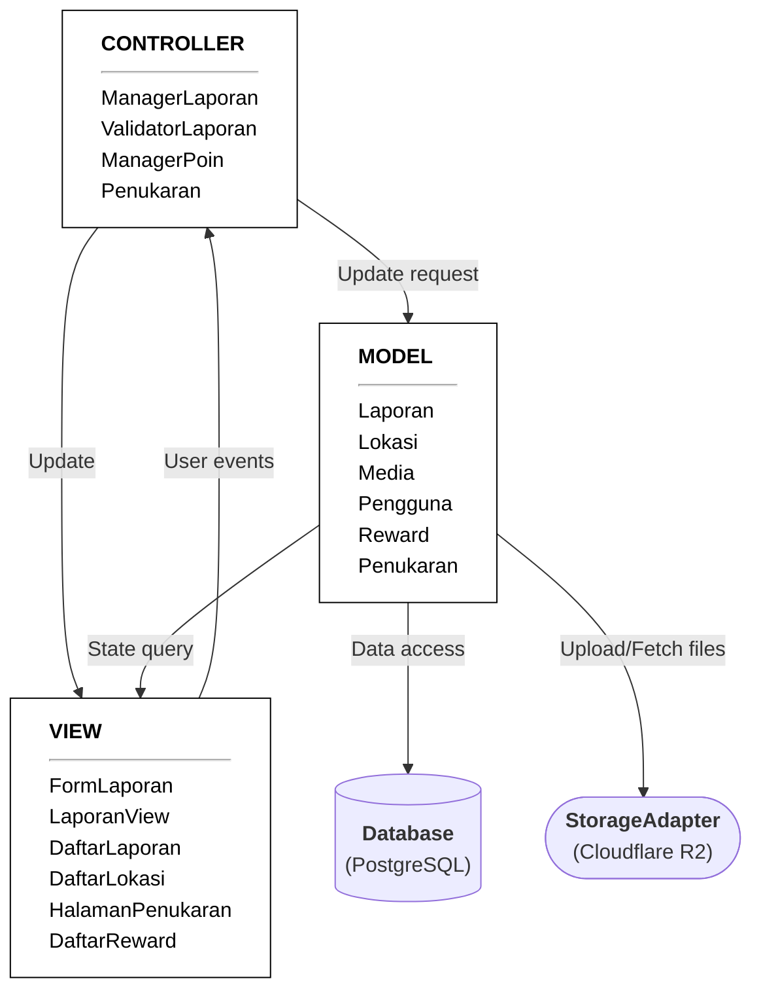

</p>
<p align="center">
<i>Gambar 1. Arsitektur MVC</i>
</p>

Style/pattern arsitektur yang digunakan dalam pengembangan P/L SoClean adalah MVC (Model-View-Controller). Model berperan sebagai pendefinisi struktur data dan logika bisnis. View berperan sebagai media penyajian informasi kepada pengguna. Controller berperan sebagai handler logic utama yang mengkoordinasi interaksi antar model dan view.

SoClean menggunakan style/pattern MVC dengan tujuan utama agar arsitektur mengutamakan simplisitas dan modularitas fitur-fitur yang dimiliki oleh P/L ini. Proses bisnis relatif sederhana sehingga pola yang dapat diabstraksikan menggunakan pemodelan MVC. Sebagai contoh, ketika pengguna membuat laporan (model) melalui request interface (view), operator dapat memverifikasi laporan dengan luaran sistem menolak atau menerima dan menyimpan status laporan ke dalam daftar lokasi (controller). KF dalam P/L ini juga dapat dipetakan dan digeneralisasi menjadi sebuah operasi yang melibatkan komponen-komponen MVC, sebagai contoh KF02, KF11, KF04, dll. (model); KF01, KF05, KF08, dll. (view); KF03, KF10, KF13, dll. (controller). Pemisahan berdasarkan MVC juga mendukung KNF yang ada, misalnya dari segi performa dan kemudahan maintenance. Modularitas struktural yang direncanakan juga membuat proses pengembangan lebih efisien karena pembagian kerja yang relatif lebih independen. Sebagai contoh dari efisiensi alur kerja proses dengan MVC, salah satu pengembang dapat mengerjakan bagian A (misal komponen view) sedangkan pengembang lain dapat mengerjakan fitur B (misal controller) secara bersamaan.

## 2.3 Identifikasi Komponen / Modul / Subsistem

<!-- Identifikasi komponen, modul, atau subsistem penyusun aplikasi berdasarkan *pattern* yang telah ditetapkan. Jelaskan tanggung jawab masing-masing komponen. Pengelompokan dapat mengikuti lapisan arsitektur atau fungsi/peran komponen dalam sistem.

Ambil dari **Tabel 2.1 dokumen APL**, lalu kelompokkan berdasarkan lapisan (Model/View/Controller). Kolom **Jenis** diisi sesuai pattern, misalnya View, Controller, Model, Service, Repository. Satu komponen merepresentasikan saatu tanggung jawab utama yang jelas, -->

Tabel 2.3. Identifikasi Komponen/Modul/Subsistem

| Nama Komponen/Modul/Subsistem | Jenis                 | Penjelasan                                                                                                           |
| :---------------------------- | :-------------------- | :------------------------------------------------------------------------------------------------------------------- |
| *FormLaporan* | *View* | *Menampilkan form pembuatan laporan dan meneruskannya dalam bentuk Laporan ke ValidatorLaporan* |
| *LaporanView* | *View* | *Menampilakan informasi dalam suatu laporan yang sudah dibuat pada FormLaporan* |
| *DaftarLaporan* | *View*| *Menampilakan daftar laporan yang sudah dibuat pada FormLaporan* |
| *DaftarLokasi* | *View* | *Menampilkan daftar lokasi yang diambil dari laporan yang sudah dibuat* |
| *HalamanPenukaran* | *View* | *Menampilakn halaman penukaran yang berisi DaftarReward dan jumlah poin serta meneruskan aksi pengguna (seperti menukar poin dengan reward) ke ManagerPoin dan Penukaran* |
| *DaftarReward* | *View* | *Menampilkan daftar reward yang tersedia untuk ditukarkan dengan poin* |
| *ManagerLaporan* | *Controller* | *Memproses perlakuan pada Laporan melalui interface-interface seperti FormLaporan* |
| *ValidatorLaporan* | *Controller* | *Memproses permintaan validasi laporan yang berada pada DaftarLaporan* |
| *ManagerPoin* | *Controller* | *Memproses perubahan jumlah poin yang dimiliki pengguna* |
| *Penukaran* | *Controller* | *Memproses permintaan penukaran poin dengan reward* |
| *Laporan* | *Model* | *Mendefinisikan struktur data dan informasi utama suatu laporan, termasuk data laporan dan status validasinya.* |
| *Lokasi* | *Model* | *Mendefinisikan struktur data lokasi yang berkaitan dengan suatu laporan dan digunakan untuk membentuk daftar lokasi.* |
| *Media* | *Model* | *Mendefinisikan struktur data media yang digunakan sebagai bukti pendukung laporan, seperti foto atau video.* |
| *Pengguna* | *Model* | *Mendefinisikan struktur data pengguna dan informasi yang berkaitan dengan pengguna dalam sistem.* |
| *Reward* | *Model* | *Mendefinisikan struktur data reward yang tersedia untuk ditukarkan menggunakan poin.* |
| *Penukaran* | *Model* | *Mendefinisikan struktur data transaksi penukaran poin pengguna dengan reward.* |
| *Database* | *Pendukung* | *Menyediakan penyimpanan data persisten bagi komponen model dan menggunakan PostgreSQL sebagai DBMS.* |
| *Storage* | *Pendukung* | *Menyediakan abstraksi akses object storage untuk melakukan proses upload file.* |

## 2.4 Model Arsitektur Perangkat Lunak

Architectural View adalah cara melihat atau mendeskripsikan arsitektur sebuah sistem dari sudut pandang tertentu. Untuk perangkat lunak SoClean, kami menggunakan satu view, yaitu Logical View, untuk menggambarkan bagaimana seluruh komponen pada Tabel 2.3 saling berinteraksi dalam menjalankan fungsi utama sistem.

<!-- Buat model arsitektur dalam bentuk satu atau lebih *view* yang memperlihatkan interaksi dan kolaborasi komponen, modul, serta subsistem dalam menjalankan fungsi sistem. Pilih notasi yang sesuai. Contoh *view*: *Logical View*, *Process View*, *Development View*, dan *Physical View*.

Gunakan hasil **BAB 3 Model Arsitektur Perangkat Lunak pada dokumen APL**. -->

## 2.4.1 Logical View
Logical View SoClean digambarkan dalam bentuk block diagram yang dikelompokkan sesuai pola MVC pada BAB 1, yaitu View, Controller, dan Model, ditambah komponen Pendukung. View ini dipilih karena paling sesuai untuk memperlihatkan pembagian tanggungjawab antarkomponen, sehingga menjadi alasan utama pemilihan MVC. Selain itu, view ini dapat menggambarkan kedua alur utama SoClean dalam satu diagram. Alur pertama adalah pelaporan dan verifikasi (ReportIt dan CleanIt), dan alur kedua adalah pengelolaan serta penukaran poin.

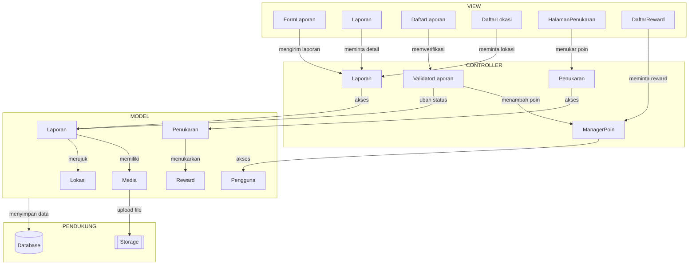

<p align="center"> <i>Gambar 2. Logical View P/L SoClean</i> </p>

Pada Gambar 2, komponen View meneruskan aksi pengguna ke komponen Controller yang sesuai, lalu Controller mengakses Model untuk membaca atau mengubah data.

Pada alur pelaporan, FormLaporan mengirim laporan ke Controller Laporan. Operator kemudian memverifikasi laporan melalui DaftarLaporan, yang diproses oleh ValidatorLaporan. Jika laporan pembersihan dinyatakan valid, ValidatorLaporan meminta ManagerPoin untuk menambahkan poin ke Pengguna.

Pada alur penukaran, HalamanPenukaran meneruskan permintaan ke Controller Penukaran, yang mencatat transaksi pada Model Penukaran beserta Reward yang ditukarkan.

Hubungan antar-model mengikuti diagram kelas yang ada sebelumnya. Laporan memiliki Media sebagai bukti dan merujuk Lokasi pencemaran. Seluruh Model menyimpan datanya pada Database (PostgreSQL), sedangkan file foto/video pada Media diupload melalui Storage ke object storage (Cloudflare R2).

<br>

---


# BAB 3: Realisasi Use Case

## 3.1 Use Case *Membuat Laporan Pencemaran*

**ID Use Case:** *UC01*  
**Nama Use Case:** *Membuat Laporan Pencemaran*

### 3.1.1 Identifikasi Kelas

Identifikasi kelas yang terkait dengan use case tersebut. Kelas di tahap perancangan dapat berbeda dengan dengan kelas di tahap analisis. Dapat menggunakan tabel di bawah:

Tabel 3.1. Identifikasi Kelas Use Case [UC01]

| No | Nama Kelas Perancangan | Nama Kelas Analisis Terkait |
|:--- | :--- | :--- |
| 1 | *FormLaporan* | *FormLaporan* |
| 2 | *Laporan, ManagerLaporan* | *Laporan* |
| 3 | *DaftarLaporan* | *DaftarLaporan* |

### 3.1.2 Sequence Diagram

Buat *sequence diagram* untuk **setiap skenario use case**, mencakup skenario normal dan alternatif pada subbab 4.4 SKPL. Diagram melibatkan kelas-kelas yang telah diidentifikasi pada SKPL. 

- **Skenario Normal**

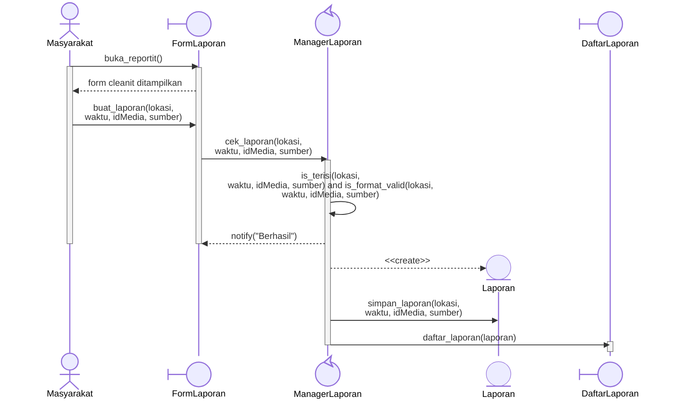
<p align="center">
<i>Gambar 3. Sequence Diagram UC01</i>
</p>

- **Skenario Alternatif 1: Informasi Tidak Sesuai Format**
<!--Jujur kita gak ada is_format_valid(); tanya kakaknya lagi ini boleh atau enggak-->
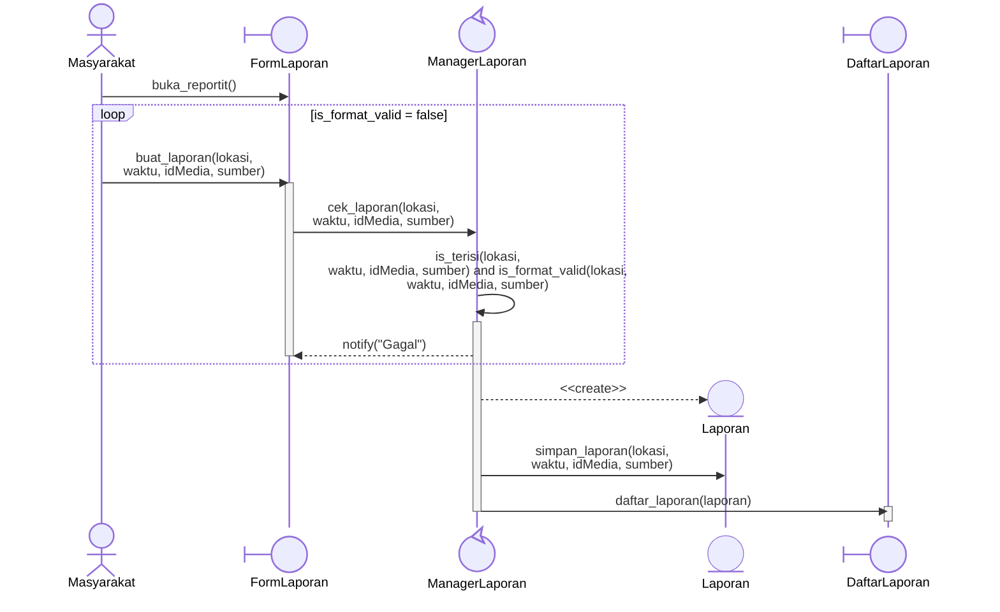
<p align="center">
<i>Gambar 4. Sequence Diagram UC01 - Informasi Tidak Sesuai Format</i>
</p>

- **Skenario Alternatif 2: Informasi Pada Laporan Tidak Lengkap**


<p align="center">
<i>Gambar 4. Sequence Diagram UC01 - Informasi Pada Laporan Tidak Lengkap</i>
</p>

### 3.1.3 Diagram Kelas

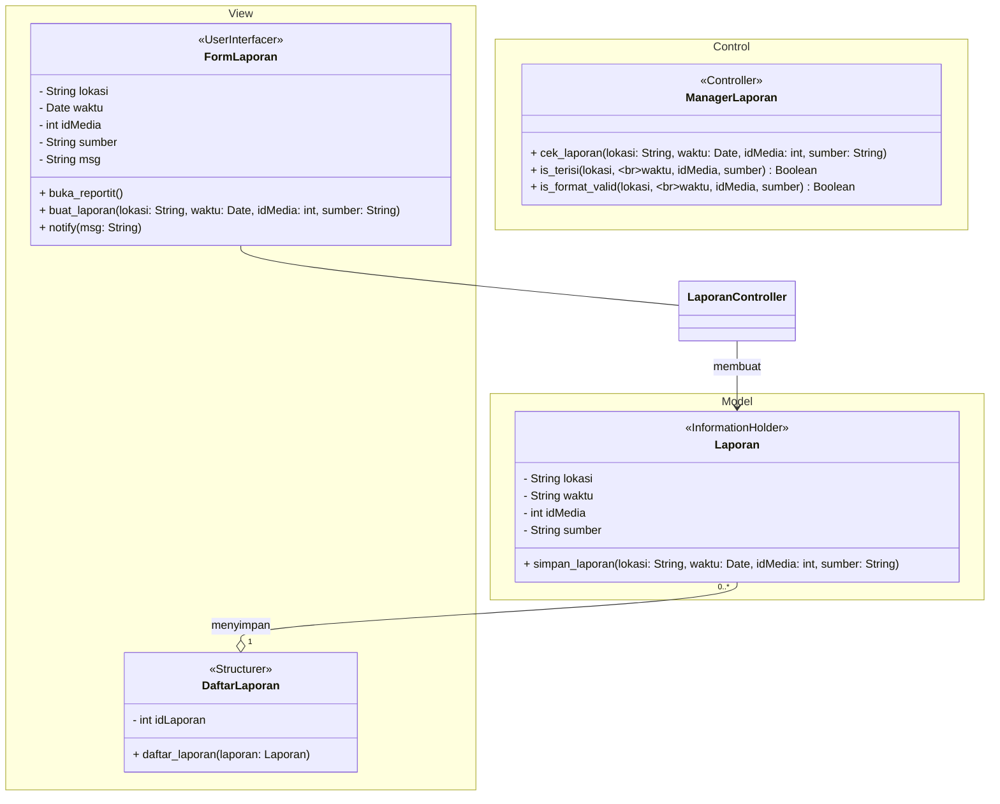
<p align="center">
<i>Gambar 5. Diagram Kelas UC01</i>
</p>

## 3.2 Use Case *Mengambil Bukti Foto/Video*

**ID Use Case:** *UC02*  
**Nama Use Case:** *Mengambil Bukti Foto/Video*

### 3.2.1 Identifikasi Kelas

Tabel 3.2. Identifikasi Kelas Use Case [UC02]

| No | Nama Kelas Perancangan | Nama Kelas Analisis Terkait |
|:--- | :--- | :--- |
| 1 | *FormLaporan* | *Form Laporan* |
| 2 | *Media* | *Media* |

### 3.2.2 Sequence Diagram

<!--Buat *sequence diagram* untuk **setiap skenario use case**, mencakup skenario normal dan alternatif pada subbab 4.4 SKPL. Diagram melibatkan kelas-kelas yang telah diidentifikasi pada SKPL.-->

- **Skenario Normal**

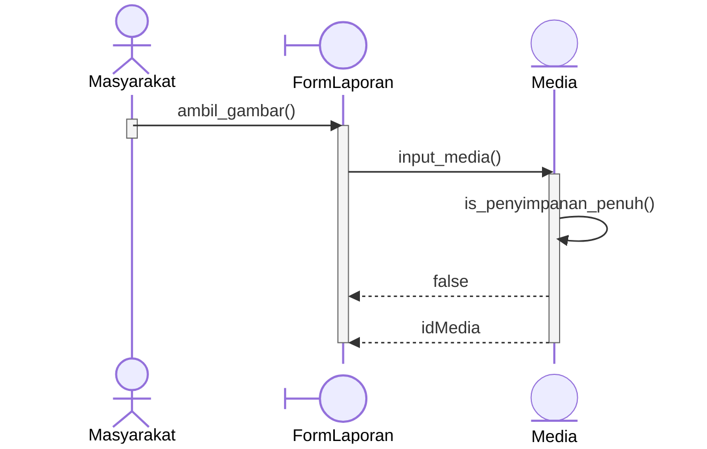
<p align="center">
<i>Gambar 6. Sequence Diagram UC02</i>
</p>

- **Skenario Alternatif 1: Penyimpanan Perangkat Penuh**

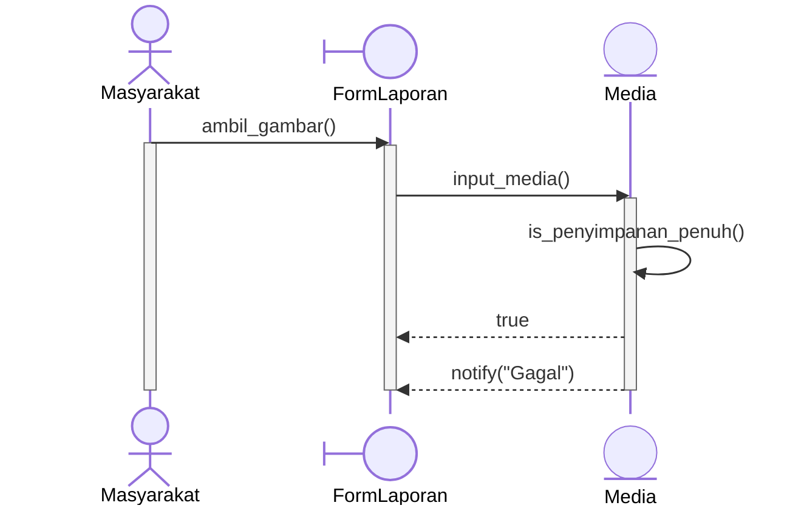
<p align="center">
<i>Gambar 7. Sequence Diagram UC02 - Penyimpanan Perangkat Penuh</i>
</p>

### 3.2.3 Diagram Kelas

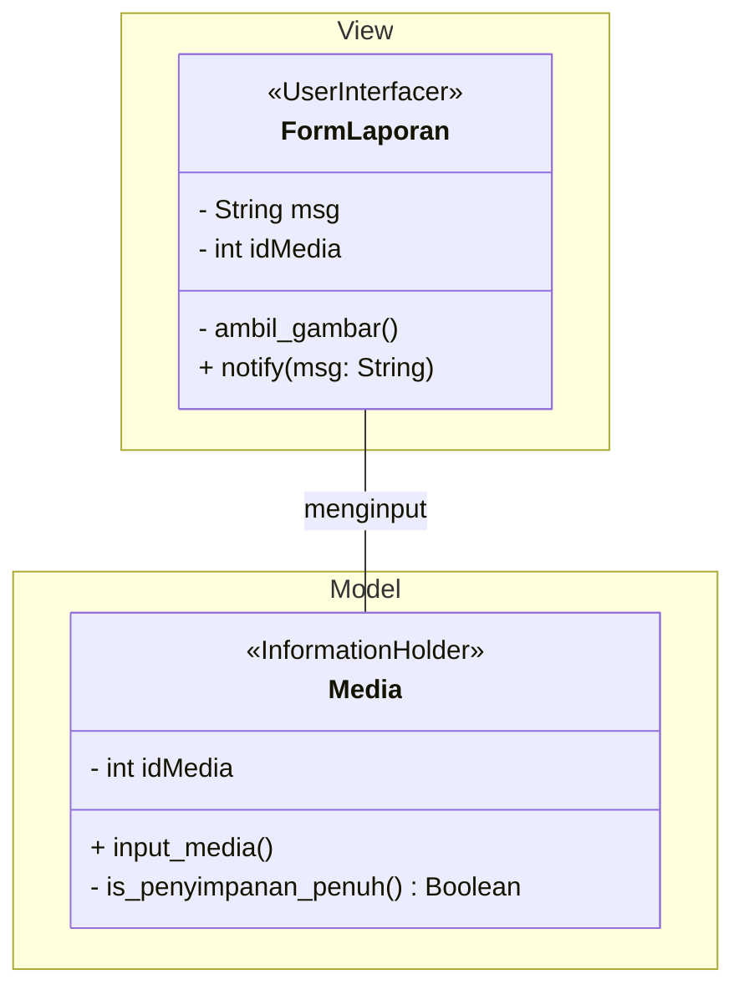
<p align="center">
<i>Gambar 8. Diagram Kelas Mengambil Bukti Foto/Video</i>
</p>

## 3.3 Use Case *Memverifikasi Laporan ReportIt*

**ID Use Case:** *UC03*  
**Nama Use Case:** *Memverifikasi Laporan ReportIt*

### 3.3.1 Identifikasi Kelas

Identifikasi kelas yang terkait dengan use case tersebut. Kelas di tahap perancangan dipetakan berdasarkan arsitektur MVC yang didefinisikan pada Bab 2.

Tabel 3.3. Identifikasi Kelas Use Case [UC03]

| No | Nama Kelas Perancangan | Nama Kelas Analisis Terkait |
|:--- | :--- | :--- |
| 1 | *DaftarLaporan (View)* | *DaftarLaporan* |
| 2 | *LaporanView (View)* | *Laporan* |
| 3 | *ValidatorLaporan (Controller)* | *ValidatorLaporan* |
| 4 | *ManagerLaporan (Controller)* | *Laporan* |
| 5 | *Laporan (Model)* | *Laporan* |
| 6 | *Lokasi (Model)* | *Lokasi* |

### 3.3.2 Sequence Diagram

Berikut adalah *sequence diagram* untuk skenario normal dan alternatif berdasarkan alur use case memverifikasi laporan ReportIt. 

- **Skenario Normal**

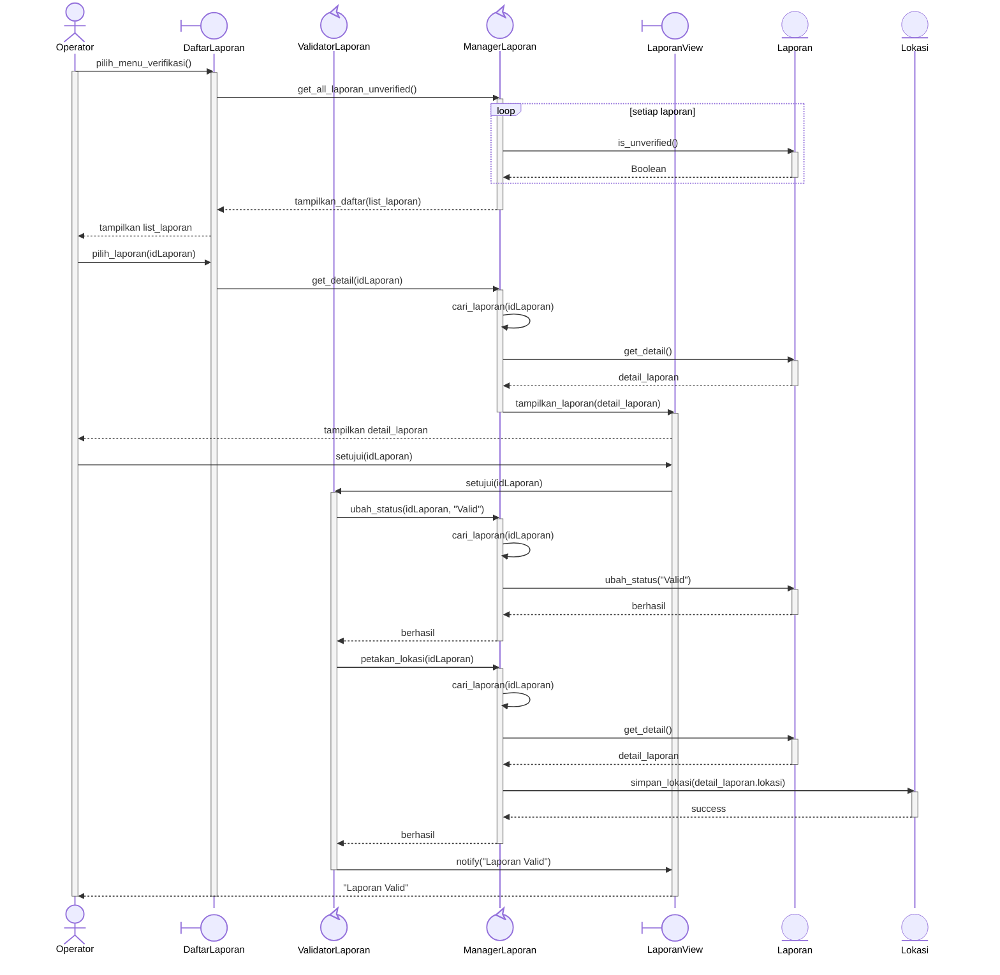
<p align="center">
<i>Gambar 9. Sequence Diagram UC03 - Skenario Normal</i>
</p>

- **Skenario Alternatif 1: Laporan Tidak Valid**

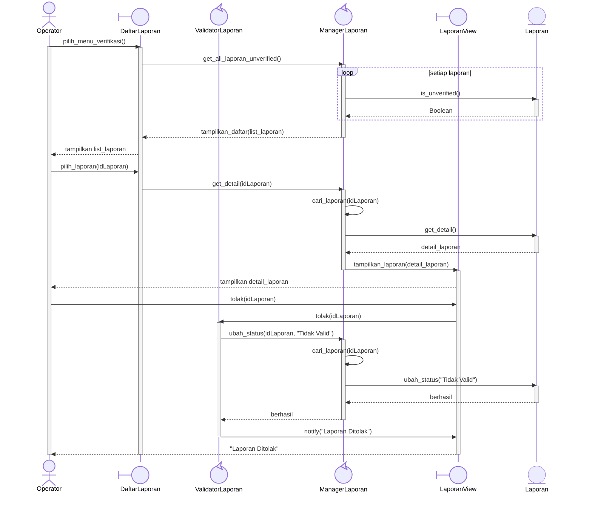
<p align="center">
<i>Gambar 10. Sequence Diagram UC03 - Laporan Tidak Valid</i>
</p>

### 3.3.3 Diagram Kelas

Diagram kelas di bawah ini merangkum interaksi antarkelas perancangan MVC yang diidentifikasi pada use case verifikasi laporan pencemaran.

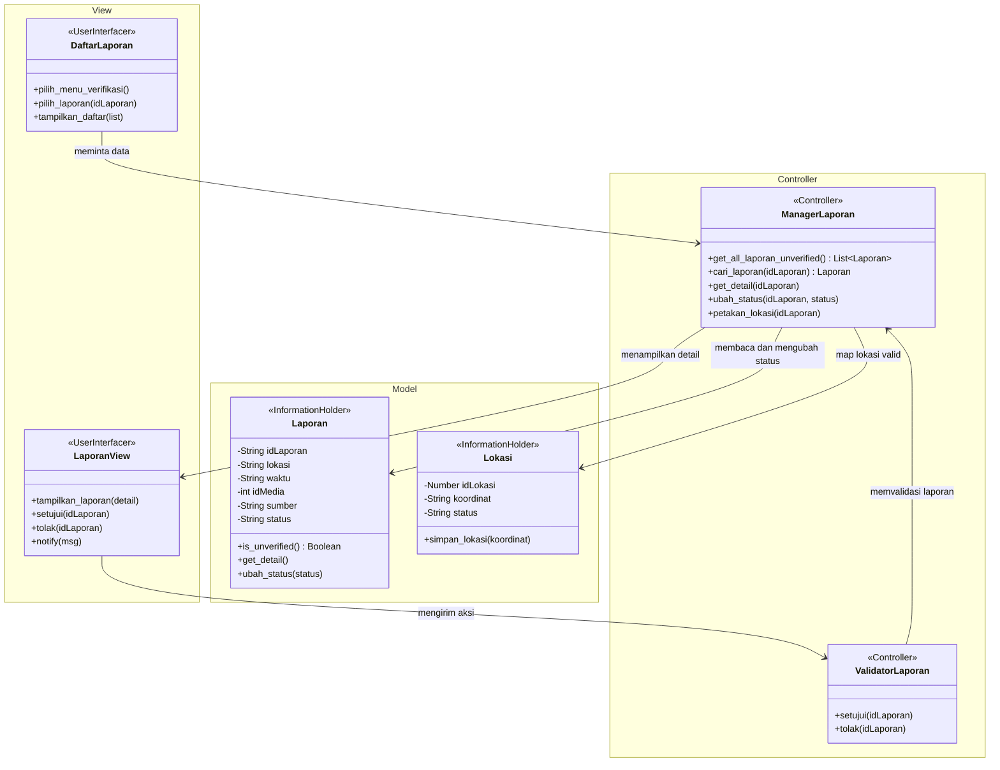
<p align="center">
<i>Gambar 11. Diagram Kelas UC03</i>
</p>

---

## 3.4 Use Case *Melihat Daftar Lokasi Pencemaran (CleanIt)*

**ID Use Case:** *UC04*  
**Nama Use Case:** *Melihat Daftar Lokasi Pencemaran (CleanIt)*

### 3.4.1 Identifikasi Kelas

Identifikasi kelas yang terkait dengan fitur melihat daftar lokasi untuk dibersihkan.

Tabel 3.4. Identifikasi Kelas Use Case [UC04]

| No | Nama Kelas Perancangan | Nama Kelas Analisis Terkait |
|:--- | :--- | :--- |
| 1 | *DaftarLokasi (View)* | *DaftarLokasi* |
| 2 | *LaporanView (View)* | *Laporan* |
| 3 | *ManagerLaporan (Controller)* | *Laporan* |
| 4 | *Lokasi (Model)* | *Lokasi* |

### 3.4.2 Sequence Diagram

Berikut adalah *sequence diagram* untuk melihat daftar pencemaran berdasarkan skenario normal dan alternatifnya. 

- **Skenario Normal**

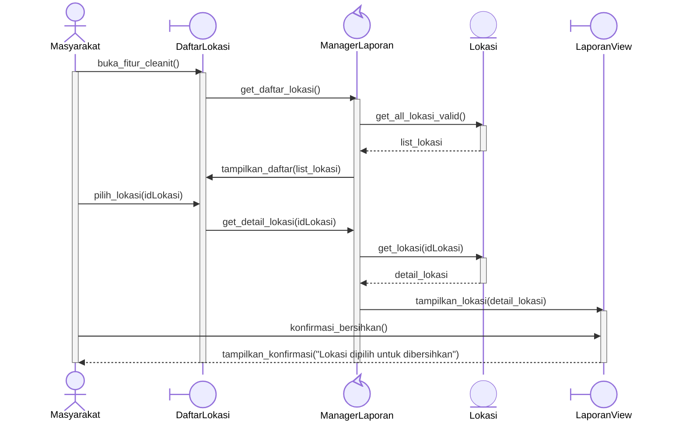
<p align="center">
<i>Gambar 12. Sequence Diagram UC04 - Skenario Normal</i>
</p>

- **Skenario Alternatif 1: Tidak Ada Lokasi Pencemaran di Daftar**

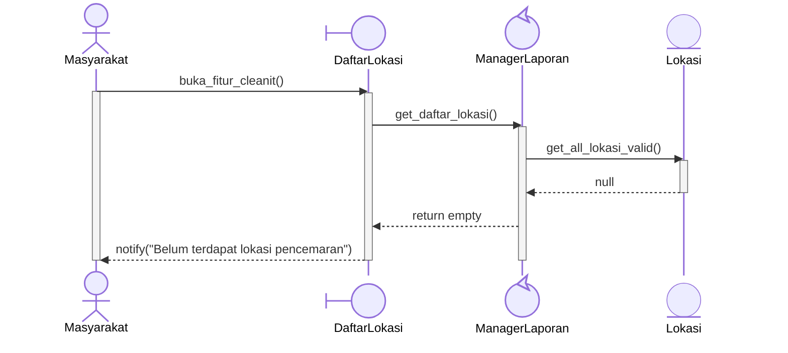
<p align="center">
<i>Gambar 13. Sequence Diagram UC04 - Tidak Ada Lokasi Pencemaran</i>
</p>

### 3.4.3 Diagram Kelas

Diagram kelas di bawah memvisualisasikan atribut, metode, dan relasi antarkelas perancangan pada proses melihat daftar lokasi CleanIt.

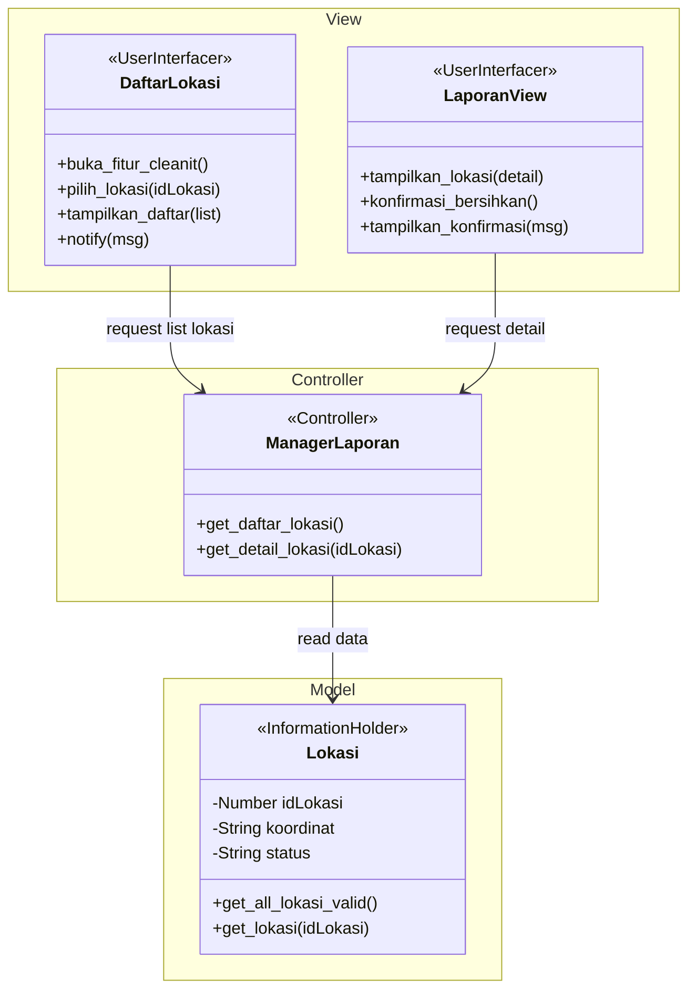
<p align="center">
<i>Gambar 14. Diagram Kelas UC04</i>
</p>

## 3.5 Use Case *Mengirimkan Bukti Pembersihan (CleanIt)*

**ID Use Case:** *UC05*  
**Nama Use Case:** *Mengirimkan Bukti Pembersihan (CleanIt)*

### 3.5.1 Identifikasi Kelas

Identifikasi kelas yang terkait dengan fitur mengirimkan bukti pembersihan.

Tabel 3.5. Identifikasi Kelas Use Case [UC05]

| No | Nama Kelas Perancangan | Nama Kelas Analisis Terkait |
|:--- | :--- | :--- |
| 1 | *FormLaporan (View)* | *FormLaporan* |
| 2 | *ManagerLaporan (Controller)* | *Laporan* |
| 3 | *DaftarLaporan (View)* | *DaftarLaporan* |
| 4 | *Laporan (Model)* | *Laporan* |

### 3.5.2 Sequence Diagram

Berikut adalah *sequence diagram* untuk mengirimkan bukti pembersihan berdasarkan skenario normal dan alternatifnya. 

- **Skenario Normal**

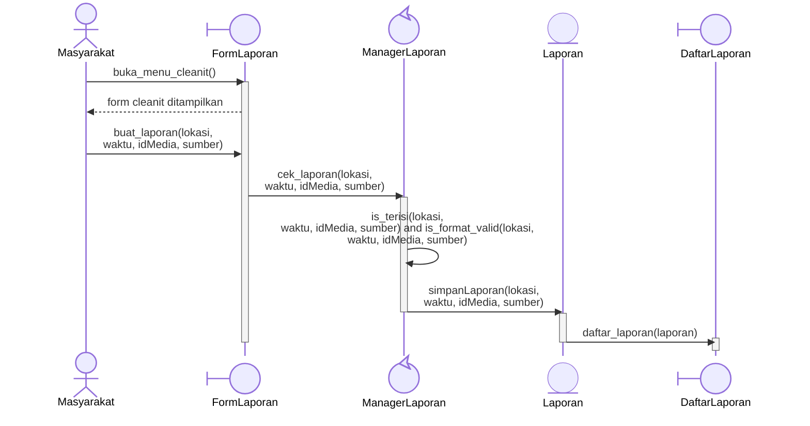
<p align="center">
<i>Gambar 15. Sequence Diagram UC05 - Skenario Normal</i>
</p>

- **Skenario Alternatif 1: Pengiriman Bukti Pembersihan Gagal**

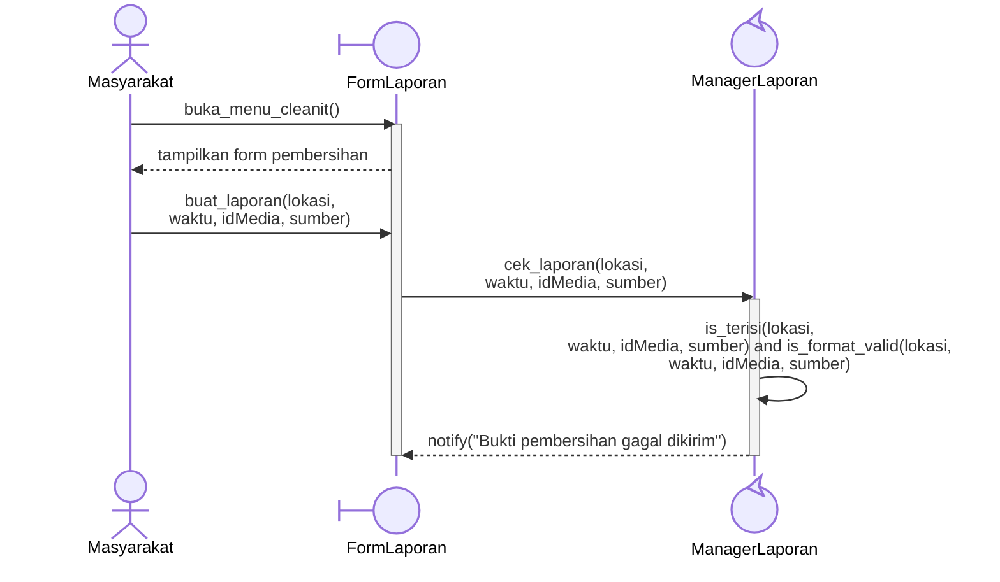
<p align="center">
<i>Gambar 16. Sequence Diagram UC05 - Pengiriman Bukti Pembersihan Gagal</i>
</p>


### 3.5.3 Diagram Kelas

Diagram kelas di bawah memvisualisasikan atribut, metode, dan relasi antarkelas perancangan pada proses mengirimkan bukti pembersihan.

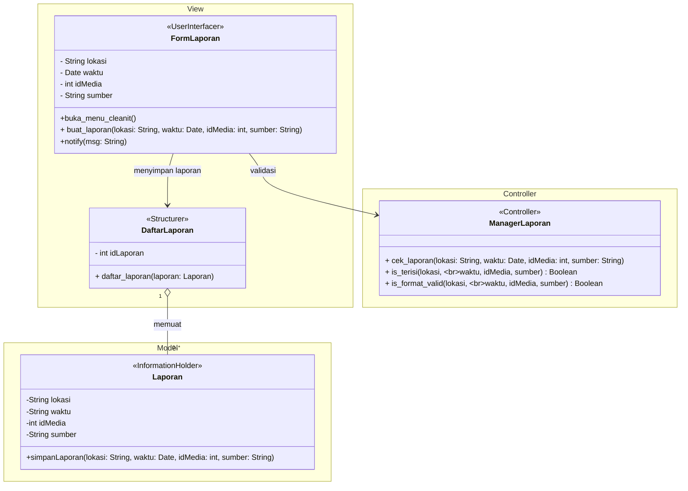
<p align="center">
<i>Gambar 17. Diagram Kelas UC05</i>
</p>


## 3.6 Use Case *Memverifikasi Laporan Pembersihan (CleanIt)*

**ID Use Case:** *UC06*  
**Nama Use Case:** *Memverifikasi Laporan Pembersihan (CleanIt)*

### 3.6.1 Identifikasi Kelas

Identifikasi kelas yang terkait dengan fitur memverifikasi laporan pembersihan.

Tabel 3.6. Identifikasi Kelas Use Case [UC06]

| No | Nama Kelas Perancangan | Nama Kelas Analisis Terkait |
|:--- | :--- | :--- |
| 1 | *LaporanView (View)* | *Laporan* |
| 2 | *ManagerLaporan (Controller)* | *Laporan* |
| 3 | *DaftarLaporan (View)* | *DaftarLaporan* |
| 4 | *ValidatorLaporan (Controller)* | *ValidatorLaporan* |
| 5 | *ManagerPoin (Controller)* | *Pengguna* |
| 6 | *Pengguna (Model)* | *Pengguna* |
| 7 | *Laporan (Model)* | *Laporan* |

### 3.6.2 Sequence Diagram

Berikut adalah *sequence diagram* untuk memverifikasi laporan pembersihan berdasarkan skenario normal dan alternatifnya. 

- **Skenario Normal**

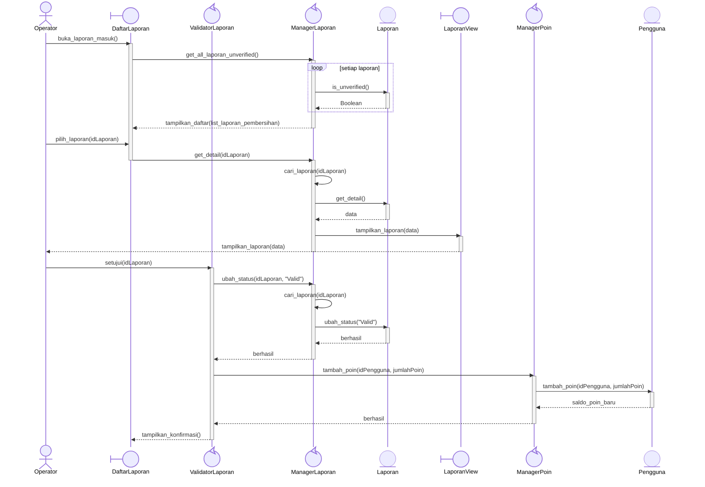
<p align="center">
<i>Gambar 18. Sequence Diagram UC06 - Skenario Normal</i>
</p>

- **Skenario Alternatif 1: Operator Menolak Laporan karena Bukti Tidak Sah**

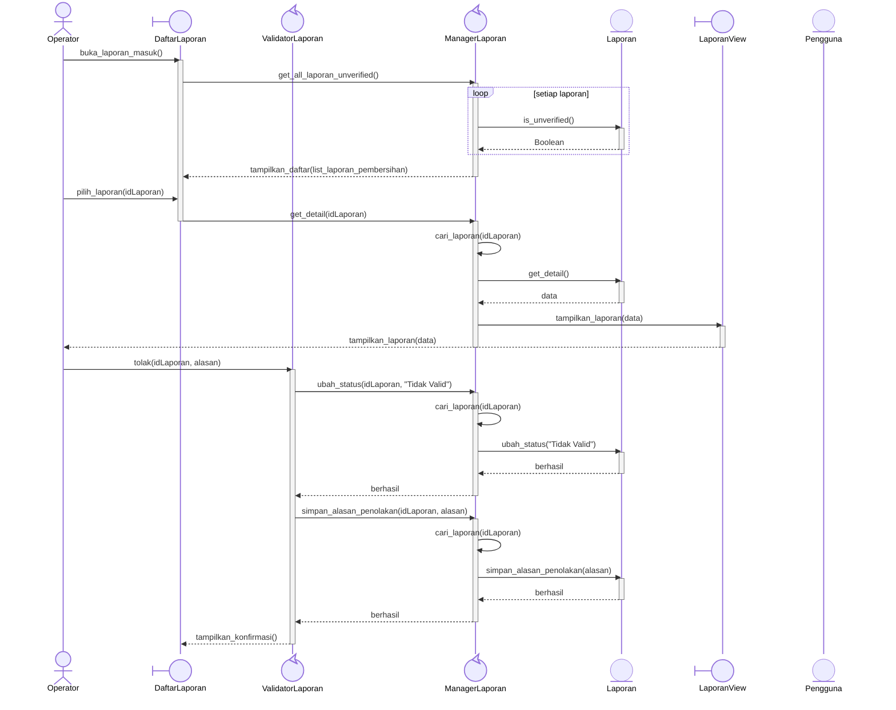
<p align="center">
<i>Gambar 19. Sequence Diagram UC06 - Operator Menolak Laporan karena Bukti Tidak Sah</i>
</p>

### 3.6.3 Diagram Kelas

Diagram kelas di bawah memvisualisasikan atribut, metode, dan relasi antarkelas perancangan pada proses validasi laporan pembersihan.

```mermaid
classDiagram
    direction TB

    namespace View {
        class DaftarLaporan {
            -String idLaporan
            +buka_laporan_masuk()
            +pilih_laporan(idLaporan)
            +tampilkan_daftar(list: List of Laporan)
        }
        class LaporanView {
            -String data
            -int idMedia
            +tampilkan_laporan(data)
        }
    }
    namespace Controller {
        class ManagerPoin {
            +tambah_poin(idPengguna, jumlahPoin)
        }
        class ValidatorLaporan {
            +setujui(idLaporan)
            +tolak(idLaporan, alasan)
            +tampilkan_konfirmasi()
        }
        class ManagerLaporan {
            -String data
            -int idMedia
            +get_all_laporan_unverified() List~Laporan~
            +cari_laporan(idLaporan) Laporan
            +get_detail(idLaporan)
            +ubah_status(idLaporan, status)
            +simpan_alasan_penolakan(idLaporan, alasan)
        }
    }
    namespace Model {
        class Laporan {
            -String idLaporan
            -String lokasi
            -String waktu
            -int idMedia
            -String sumber
            -String status
            -String alasanPenolakan
            +is_unverified() Boolean
            +get_detail()
            +ubah_status(status)
            +simpan_alasan_penolakan(alasan)
        }
        class Pengguna {
            -int idPengguna
            -int saldoPoin
            +tambah_poin(idPengguna, jumlahPoin)
        }
    }

    <<Controller>> ValidatorLaporan
    <<UserInterfacer>> LaporanView
    <<Controller>> ManagerLaporan
    <<Controller>> ManagerPoin
    <<Structurer>> DaftarLaporan
    <<InformationHolder>> Laporan
    <<InformationHolder>> Pengguna

    DaftarLaporan --> ManagerLaporan : meminta data
    ManagerLaporan --> Laporan : membaca dan mengubah status
    ManagerLaporan --> LaporanView : menampilkan detail
    ValidatorLaporan --> ManagerLaporan : memvalidasi laporan
    ValidatorLaporan --> ManagerPoin : menambah poin
    ManagerPoin --> Pengguna : memperbarui poin
    ValidatorLaporan ..> Pengguna : notifikasi
    DaftarLaporan "1" o-- "0..*" Laporan : memuat
```
<p align="center">
<i>Gambar 20. Diagram Kelas UC06</i>
</p>

## 3.10 Use Case *Melihat Saldo Poin*

**ID Use Case:** *UC07*  
**Nama Use Case:** *Melihat Saldo Poin*

### 3.10.1 Identifikasi Kelas

Use case Melihat Saldo Poin direalisasikan menggunakan tiga kelas berdasarkan arsitektur MVC. HalamanPenukaran bertindak sebagai View, ManagerPoin sebagai Controller, dan Pengguna sebagai Model yang menyimpan saldo poin.

Tabel 3.10. Identifikasi Kelas Use Case [UC07]

| No | Nama Kelas Perancangan | Nama Kelas Analisis Terkait |
| :--- | :--- | :--- |
| 1 | *HalamanPenukaran (View)* | *HalamanPenukaran* |
| 2 | *ManagerPoin (Controller)* | *ManagerPoin* |
| 3 | *Pengguna (Model)* | *Pengguna* |

### 3.10.2 Sequence Diagram

Sequence diagram berikut menggambarkan proses pengambilan saldo poin pengguna melalui ManagerPoin.

- **Skenario Normal**

```mermaid
sequenceDiagram
    actor M as Masyarakat
    participant HP as HalamanPenukaran
    participant MP as ManagerPoin
    participant P as Pengguna

    M->>HP: Membuka menu poin dan reward
    activate HP

    HP->>MP: lihatSaldo(pengguna)
    activate MP

    MP->>P: getSaldoPoin()
    activate P
    P-->>MP: saldoPoin
    deactivate P

    MP-->>HP: saldoPoin
    deactivate MP

    HP->>HP: tampilkanSaldo(saldoPoin)
    HP-->>M: Saldo poin ditampilkan

    deactivate HP
```

<p align="center">
<i>Gambar X. Sequence Diagram UC07 - Skenario Normal</i>
</p>

Use case UC07 hanya memiliki skenario normal, sehingga tidak diperlukan diagram alternatif.

### 3.10.3 Diagram Kelas

Diagram kelas menggambarkan hubungan antara View HalamanPenukaran, Controller ManagerPoin, dan Model Pengguna. Permintaan saldo diteruskan melalui ManagerPoin sehingga View tidak mengakses Model secara langsung.

```mermaid
classDiagram
    direction TB

    namespace View {
        class HalamanPenukaran {
            <<UserInterfacer>>
            +tampilkanSaldo(saldo: int) void
            +pilihReward(idReward: String) void
            +tampilkanNotifikasi(pesan: String) void
        }
    }

    namespace Controller {
        class ManagerPoin {
            <<Controller>>
            +lihatSaldo(pengguna: Pengguna) int
            +lihatRewardTersedia() List~Reward~
            +cekPoin(pengguna: Pengguna, harga: int) Boolean
            +kurangiPoin(pengguna: Pengguna, jumlah: int) Boolean
            +tambahPoin(idPengguna: String, jumlah: int) void
        }
    }

    namespace Model {
        class Pengguna {
            <<InformationHolder>>
            -idPengguna: String
            -nama: String
            -saldoPoin: int
            +getSaldoPoin() int
            +cukupPoin(harga: int) Boolean
            +kurangiPoin(jumlah: int) Boolean
        }
    }

    HalamanPenukaran "1" --> "1" ManagerPoin : meminta saldo
    ManagerPoin ..> Pengguna : membaca saldo
```

<p align="center">
<i>Gambar X. Diagram Kelas UC07 - Melihat Saldo Poin</i>
</p>


## 3.11 Use Case *Melihat Reward yang Tersedia*

**ID Use Case:** *UC08*  
**Nama Use Case:** *Melihat Reward yang Tersedia*

### 3.11.1 Identifikasi Kelas

Use case Melihat Reward yang Tersedia melibatkan HalamanPenukaran dan DaftarReward sebagai View, ManagerPoin sebagai Controller, serta Reward sebagai Model. DaftarReward bertanggung jawab menampilkan daftar hadiah, sedangkan ManagerPoin mengambil informasi reward dari Model.

Tabel 3.11. Identifikasi Kelas Use Case [UC08]

| No | Nama Kelas Perancangan | Nama Kelas Analisis Terkait |
| :--- | :--- | :--- |
| 1 | *HalamanPenukaran (View)* | *HalamanPenukaran* |
| 2 | *DaftarReward (View)* | *DaftarReward* |
| 3 | *ManagerPoin (Controller)* | *ManagerPoin* |
| 4 | *Reward (Model)* | *Reward* |

### 3.11.2 Sequence Diagram

Sequence diagram berikut menunjukkan interaksi ketika masyarakat membuka menu reward. HalamanPenukaran menampilkan komponen DaftarReward, yang kemudian meminta data melalui ManagerPoin. ManagerPoin mengambil reward yang tersedia dari Model Reward.

- **Skenario Normal**

```mermaid
sequenceDiagram
    actor M as Masyarakat
    participant HP as HalamanPenukaran
    participant DR as DaftarReward
    participant MP as ManagerPoin
    participant R as Reward

    M->>HP: Membuka menu reward
    activate HP

    HP->>DR: muatRewardTersedia()
    activate DR

    DR->>MP: lihatRewardTersedia()
    activate MP

    MP->>R: getRewardTersedia()
    activate R
    R-->>MP: daftarRewardTersedia
    deactivate R

    MP-->>DR: daftarRewardTersedia
    deactivate MP

    DR->>DR: tampilkanDaftarReward(daftarRewardTersedia)
    DR-->>M: Daftar reward ditampilkan

    deactivate DR
    deactivate HP
```

<p align="center">
<i>Gambar X. Sequence Diagram UC08 - Skenario Normal</i>
</p>

Use case UC08 hanya memiliki skenario normal, sehingga tidak diperlukan diagram alternatif.

### 3.11.3 Diagram Kelas

Diagram kelas memperlihatkan bahwa DaftarReward merupakan komponen View yang berada di dalam HalamanPenukaran. DaftarReward berinteraksi dengan ManagerPoin untuk memperoleh data reward, sedangkan ManagerPoin mengakses Model Reward.

```mermaid
classDiagram
    direction TB

    namespace View {
        class HalamanPenukaran {
            <<UserInterfacer>>
            +tampilkanSaldo(saldo: int) void
            +pilihReward(idReward: String) void
            +tampilkanNotifikasi(pesan: String) void
        }

        class DaftarReward {
            <<UserInterfacer>>
            +muatRewardTersedia() void
            +tampilkanDaftarReward(daftar: List~Reward~) void
            +pilihReward(idReward: String) void
        }
    }

    namespace Controller {
        class ManagerPoin {
            <<Controller>>
            +lihatSaldo(pengguna: Pengguna) int
            +lihatRewardTersedia() List~Reward~
            +cekPoin(pengguna: Pengguna, harga: int) Boolean
            +kurangiPoin(pengguna: Pengguna, jumlah: int) Boolean
            +tambahPoin(idPengguna: String, jumlah: int) void
        }
    }

    namespace Model {
        class Reward {
            <<InformationHolder>>
            -idReward: String
            -nama: String
            -jenis: String
            -hargaPoin: int
            -stok: int
            +getRewardTersedia() List~Reward~
            +cariReward(idReward: String) Reward
            +getHargaPoin() int
            +tersedia() Boolean
            +kurangiStok() Boolean
        }
    }

    HalamanPenukaran "1" *-- "1" DaftarReward : memuat tampilan
    DaftarReward --> ManagerPoin : meminta reward
    ManagerPoin ..> Reward : mengambil data
    DaftarReward ..> Reward : menampilkan data
```

<p align="center">
<i>Gambar X. Diagram Kelas UC08 - Melihat Reward yang Tersedia</i>
</p>


## 3.12 Use Case *Menukarkan Poin dengan Reward*

**ID Use Case:** *UC09*  
**Nama Use Case:** *Menukarkan Poin dengan Reward*

### 3.12.1 Identifikasi Kelas

Use case Menukarkan Poin dengan Reward melibatkan komponen View, Controller, dan Model. HalamanPenukaran dan DaftarReward bertanggung jawab menerima pilihan masyarakat. Controller Penukaran mengoordinasikan transaksi penukaran dengan bantuan ManagerPoin untuk memeriksa dan mengubah saldo. Model Pengguna menyimpan saldo poin, Reward menyimpan informasi hadiah, dan Penukaran mencatat transaksi yang berhasil dilakukan.

Tabel 3.12. Identifikasi Kelas Use Case [UC09]

| No | Nama Kelas Perancangan | Nama Kelas Analisis Terkait |
| :--- | :--- | :--- |
| 1 | *HalamanPenukaran (View)* | *HalamanPenukaran* |
| 2 | *DaftarReward (View)* | *DaftarReward* |
| 3 | *Penukaran (Controller)* | *Penukaran* |
| 4 | *ManagerPoin (Controller)* | *ManagerPoin* |
| 5 | *Pengguna (Model)* | *Pengguna* |
| 6 | *Reward (Model)* | *Reward* |
| 7 | *Penukaran (Model)* | *Penukaran* |

### 3.12.2 Sequence Diagram

Sequence diagram UC09 menggambarkan proses penukaran poin dengan reward melalui Controller Penukaran. Controller ini mengoordinasikan pengecekan reward, kecukupan saldo, dan pencatatan transaksi. ManagerPoin menangani pemeriksaan serta perubahan saldo pengguna.

- **Skenario Normal**

Pada skenario normal, masyarakat memilih reward dan memiliki poin yang mencukupi. Sistem kemudian memeriksa ketersediaan reward, mengurangi saldo dan stok, serta mencatat transaksi penukaran.

```mermaid
sequenceDiagram
    actor M as Masyarakat
    participant DR as DaftarReward
    participant HP as HalamanPenukaran
    participant PC as Penukaran (Controller)
    participant MP as ManagerPoin
    participant R as Reward
    participant P as Pengguna
    participant PN as Penukaran (Model)

    M->>DR: pilihReward(idReward)
    activate DR

    DR->>HP: pilihReward(idReward)
    activate HP
    deactivate DR

    HP->>PC: tukarPoin(pengguna, idReward)
    activate PC

    PC->>R: cariReward(idReward)
    activate R
    R-->>PC: reward
    deactivate R

    PC->>R: getHargaPoin()
    activate R
    R-->>PC: hargaPoin
    deactivate R

    PC->>R: tersedia()
    activate R
    R-->>PC: true
    deactivate R

    PC->>MP: cekPoin(pengguna, hargaPoin)
    activate MP

    MP->>P: cukupPoin(hargaPoin)
    activate P
    P-->>MP: true
    deactivate P

    MP-->>PC: true
    deactivate MP

    Note over PC,PN: Semua perubahan dilakukan dalam satu transaksi database atomik

    PC->>MP: kurangiPoin(pengguna, hargaPoin)
    activate MP

    MP->>P: kurangiPoin(hargaPoin)
    activate P
    P-->>MP: success
    deactivate P

    MP-->>PC: success
    deactivate MP

    PC->>R: kurangiStok()
    activate R
    R-->>PC: success
    deactivate R

    PC->>PN: buatPenukaran(pengguna, reward)
    activate PN
    PN-->>PC: success
    deactivate PN

    Note over PC,PN: Commit jika berhasil, rollback seluruh perubahan jika gagal

    PC-->>HP: penukaranBerhasil
    deactivate PC

    HP->>HP: tampilkanNotifikasi("Penukaran berhasil")
    HP-->>M: Konfirmasi penukaran berhasil

    deactivate HP
```

<p align="center">
<i>Gambar X. Sequence Diagram UC09 - Skenario Normal</i>
</p>

- **Skenario Alternatif 1: Poin Tidak Cukup**

Pada skenario alternatif, sistem menemukan bahwa saldo poin masyarakat tidak mencukupi harga reward. Controller Penukaran menghentikan proses transaksi dan menampilkan notifikasi kegagalan melalui HalamanPenukaran. Tidak ada perubahan saldo maupun stok reward.

```mermaid
sequenceDiagram
    actor M as Masyarakat
    participant DR as DaftarReward
    participant HP as HalamanPenukaran
    participant PC as Penukaran (Controller)
    participant MP as ManagerPoin
    participant R as Reward
    participant P as Pengguna

    M->>DR: pilihReward(idReward)
    activate DR

    DR->>HP: pilihReward(idReward)
    activate HP
    deactivate DR

    HP->>PC: tukarPoin(pengguna, idReward)
    activate PC

    PC->>R: cariReward(idReward)
    activate R
    R-->>PC: reward
    deactivate R

    PC->>R: getHargaPoin()
    activate R
    R-->>PC: hargaPoin
    deactivate R

    PC->>R: tersedia()
    activate R
    R-->>PC: true
    deactivate R

    PC->>MP: cekPoin(pengguna, hargaPoin)
    activate MP

    MP->>P: cukupPoin(hargaPoin)
    activate P
    P-->>MP: false
    deactivate P

    MP-->>PC: false
    deactivate MP

    Note over PC,P: Penukaran dihentikan tanpa perubahan data

    PC-->>HP: penukaranGagal
    deactivate PC

    HP->>HP: tampilkanNotifikasi("Poin tidak cukup")
    HP-->>M: Notifikasi penukaran gagal

    deactivate HP
```

<p align="center">
<i>Gambar X. Sequence Diagram UC09 - Poin Tidak Cukup</i>
</p>

### 3.12.3 Diagram Kelas

Diagram kelas berikut menunjukkan hubungan antarkomponen perancangan dalam proses penukaran. HalamanPenukaran mengirim permintaan penukaran ke Controller Penukaran. Controller Penukaran menggunakan ManagerPoin untuk mengelola saldo, mengakses Reward untuk memeriksa dan mengubah stok, serta membuat catatan transaksi melalui Model Penukaran.

Kedua komponen bernama Penukaran dibedakan berdasarkan peran Controller dan Model agar tidak terjadi ambiguitas pada diagram.

```mermaid
classDiagram
    direction TB

    namespace View {
        class HalamanPenukaran {
            <<UserInterfacer>>
            +tampilkanSaldo(saldo: int) void
            +pilihReward(idReward: String) void
            +tampilkanNotifikasi(pesan: String) void
        }

        class DaftarReward {
            <<UserInterfacer>>
            +muatRewardTersedia() void
            +tampilkanDaftarReward(daftar: List~Reward~) void
            +pilihReward(idReward: String) void
        }
    }

    namespace Controller {
        class PenukaranCtrl["Penukaran (Controller)"] {
            <<Controller>>
            +tukarPoin(pengguna: Pengguna, idReward: String) Boolean
        }

        class ManagerPoin {
            <<Controller>>
            +lihatSaldo(pengguna: Pengguna) int
            +lihatRewardTersedia() List~Reward~
            +cekPoin(pengguna: Pengguna, harga: int) Boolean
            +kurangiPoin(pengguna: Pengguna, jumlah: int) Boolean
            +tambahPoin(idPengguna: String, jumlah: int) void
        }
    }

    namespace Model {
        class Pengguna {
            <<InformationHolder>>
            -idPengguna: String
            -nama: String
            -saldoPoin: int
            +getSaldoPoin() int
            +cukupPoin(harga: int) Boolean
            +kurangiPoin(jumlah: int) Boolean
        }

        class Reward {
            <<InformationHolder>>
            -idReward: String
            -nama: String
            -jenis: String
            -hargaPoin: int
            -stok: int
            +getRewardTersedia() List~Reward~
            +cariReward(idReward: String) Reward
            +getHargaPoin() int
            +tersedia() Boolean
            +kurangiStok() Boolean
        }

        class PenukaranModel["Penukaran (Model)"] {
            <<InformationHolder>>
            -idPenukaran: String
            -waktuPenukaran: Date
            -poinDipakai: int
            +buatPenukaran(pengguna: Pengguna, reward: Reward) Boolean
        }
    }

    HalamanPenukaran "1" *-- "1" DaftarReward : memuat tampilan
    DaftarReward --> HalamanPenukaran : pilihan reward
    HalamanPenukaran --> PenukaranCtrl : meminta penukaran

    PenukaranCtrl --> ManagerPoin : mengelola poin
    ManagerPoin ..> Pengguna : membaca dan mengubah saldo
    PenukaranCtrl ..> Reward : memeriksa dan mengubah stok
    PenukaranCtrl ..> PenukaranModel : mencatat transaksi

    Pengguna "1" -- "0..*" PenukaranModel : memiliki riwayat
    PenukaranModel "0..*" --> "1" Reward : menukarkan
```

<p align="center">
<i>Gambar X. Diagram Kelas UC09 - Menukarkan Poin dengan Reward</i>
</p>

<br>

---

# BAB 4: Diagram Kelas Keseluruhan

## 4.1 Diagram Kelas

```mermaid
%%{init: {"theme": "neutral", "class": {"hideEmptyMembersBox": true}}}%%
classDiagram
    direction TB

    class FormLaporan
    class Laporan
    class Media
    class DaftarLaporan
    class ValidatorLaporan
    class Lokasi
    class DaftarLokasi
    class Pengguna
    class Reward
    class DaftarReward
    class ManagerPoin
    class HalamanPenukaran
    class PenukaranModel["Penukaran (Model)"]
    class LaporanView
    class ManagerLaporan
    class PenukaranCtrl["Penukaran (Controller)"]

    FormLaporan --> ManagerLaporan : membuat / validasi
    ManagerLaporan --> Laporan : membuat / membaca dan mengubah status
    Laporan "0..*" --o "1" DaftarLaporan : menyimpan / memuat
    FormLaporan -- Media : menginput
    DaftarLaporan --> ValidatorLaporan : meminta data
    LaporanView --> ValidatorLaporan : mengirim aksi
    ValidatorLaporan --> Laporan : validasi & update
    DaftarLokasi --> ManagerLaporan : request list lokasi
    LaporanView --> ManagerLaporan : request detail
    ManagerLaporan --> Lokasi : read data / map lokasi valid
    FormLaporan --> DaftarLaporan : menyimpan laporan
    DaftarLaporan --> ManagerLaporan : meminta data
    ManagerLaporan --> LaporanView : menampilkan detail
    ValidatorLaporan --> ManagerLaporan : memvalidasi laporan
    ValidatorLaporan --> ManagerPoin : menambah poin
    ManagerPoin --> Pengguna : memperbarui poin
    ValidatorLaporan ..> Pengguna : notifikasi
    HalamanPenukaran "1" --> "1" ManagerPoin : meminta saldo
    ManagerPoin ..> Pengguna : membaca saldo / membaca dan mengubah saldo
    HalamanPenukaran "1" *-- "1" DaftarReward : memuat tampilan
    DaftarReward --> ManagerPoin : meminta reward
    ManagerPoin ..> Reward : mengambil data
    DaftarReward ..> Reward : menampilkan data
    DaftarReward --> HalamanPenukaran : pilihan reward
    HalamanPenukaran --> PenukaranCtrl : meminta penukaran
    PenukaranCtrl --> ManagerPoin : mengelola poin
    PenukaranCtrl ..> Reward : memeriksa dan mengubah stok
    PenukaranCtrl ..> PenukaranModel : mencatat transaksi
    Pengguna "1" -- "0..*" PenukaranModel : memiliki riwayat
    PenukaranModel "0..*" --> "1" Reward : menukarkan
```
<p align="center">
<i>Gambar 4.1. Diagram Kelas Perancangan Keseluruhan SoClean</i>
</p>

Tabel 4.1. Daftar Kelas Perancangan Keseluruhan

| ID Kelas | Nama Kelas | Atribut | Metode/Operasi |
| :--- | :--- | :--- | :--- |
| C01 | *FormLaporan* | lokasi, waktu, idMedia, sumber, msg | buka_reportit(); buat_laporan(lokasi, waktu, idMedia, sumber); ambil_gambar(); notify(msg); buka_menu_cleanit() |
| C02 | *Laporan* | idLaporan, lokasi, waktu, idMedia, sumber, status | simpan_laporan(lokasi, waktu, idMedia, sumber); get_unverified(); get_detail(idLaporan); ubah_status(idLaporan, status); get_data(idLaporan); simpan_alasan_penolakan(idLaporan, alasan) |
| C03 | *Media* | idMedia | input_media(); is_penyimpanan_penuh() |
| C04 | *DaftarLaporan* | idLaporan | daftar_laporan(laporan); pilih_menu_verifikasi(); pilih_laporan(idLaporan); tampilkan_daftar(list); buka_laporan_masuk(); |
| C05 | *ValidatorLaporan* | — | get_laporan_unverified(); get_detail(idLaporan); setujui(idLaporan); tolak(idLaporan); tolak(idLaporan, alasan); tampilkan_konfirmasi() |
| C06 | *Lokasi* | idLokasi, koordinat, status | simpan_lokasi(koordinat); get_all_lokasi_valid(); get_lokasi(idLokasi) |
| C07 | *DaftarLokasi* | — | buka_fitur_cleanit(); pilih_lokasi(idLokasi); tampilkan_daftar(list); notify(msg) |
| C08 | *Pengguna* | idPengguna, nama, saldoPoin | tambah_poin(idPengguna, jumlahPoin); notify(msg); getSaldoPoin(); cukupPoin(harga); kurangiPoin(jumlah) |
| C09 | *Reward* | idReward, nama, jenis, hargaPoin, stok | getRewardTersedia(); cariReward(idReward); getHargaPoin(); tersedia(); kurangiStok() |
| C10 | *DaftarReward* | — | muatRewardTersedia(); tampilkanDaftarReward(daftar); pilihReward(idReward) |
| C11 | *ManagerPoin* | — | tambah_poin(idPengguna, jumlahPoin); lihatSaldo(pengguna); lihatRewardTersedia(); cekPoin(pengguna, harga); kurangiPoin(pengguna, jumlah); tambahPoin(idPengguna, jumlah) |
| C12 | *HalamanPenukaran* | — | tampilkanSaldo(saldo); pilihReward(idReward); tampilkanNotifikasi(pesan) |
| C13 | *Penukaran (Model)* | idPenukaran, waktuPenukaran, poinDipakai | buatPenukaran(pengguna, reward) |
| C14 | *LaporanView* | data, idMedia | tampilkan_laporan(data); setujui(idLaporan); tolak(idLaporan); notify(msg); tampilkan_lokasi(detail); konfirmasi_bersihkan(); tampilkan_konfirmasi(msg) |
| C15 | *ManagerLaporan* | - | cek_laporan(lokasi: String, waktu: Date, idMedia: int, sumber: String); is_terisi(lokasi, <br/>waktu, idMedia, sumber); is_format_valid(lokasi, <br/>waktu, idMedia, sumber); get_daftar_lokasi(); get_detail_lokasi(idLokasi); is_valid(idLaporan, lokasi, waktu, idMedia); get_all_laporan_unverified(); get_data(idLaporan); ubah_status(idLaporan, status); simpan_alasan_penolakan(idLaporan, alasan); petakan_lokasi(idLaporan) |
| C16 | *Penukaran (Controller)* | — | tukarPoin(pengguna, idReward) |

<br>

---

# BAB 5: Perancangan Rinci Kelas

Bagian ini diisi dengan daftar seluruh kelas dalam tabel berikut:

Tabel 5.1. Daftar Kelas Perancangan dan Kelas Analisis Terkait

| No | Nama Kelas Perancangan | Nama Kelas Analisis Terkait |
| :--- | :--- | :--- |
| 1 | *[Nama kelas perancangan]* | *[Nama kelas analisis pada SKPL atau -]* |
| 2 | *[Nama kelas perancangan]* | *[Nama kelas analisis pada SKPL atau -]* |
| ... | *...* | *...* |

Untuk **setiap kelas**, identifikasi operasi berdasarkan tanggung jawab kelas beserta *visibility*-nya, serta atribut beserta *visibility* dan tipenya. Buat subbab tersendiri untuk setiap kelas.

## 5.1 Kelas FormLaporan

**Nama Kelas:** *FormLaporan*  
**ID Kelas:** *C-01*

Tabel 5.1.1. Operasi Kelas FormLaporan

| Nama Operasi | Visibility (private, public) | Keterangan |
| :--- | :--- | :--- |
| *buka_reportit()* | *public* | *Membuka tampilan Form Laporan untuk fitur ReportIt() sehingga dapat dilihat oleh Pengguna* |
| *notify(msg: String)* | *public* | *Memberikan notifikasi pesan yang dapat dilihat oleh Pengguna. Digunakan dalam konteks user berhasil atau gagal* |
| *ambil_gambar()* | *private* | *Method passing yang meneruskan request dari Pengguna untuk menggunakan method input_media() pada Media* |
| *buka_menu_cleanit()* | *public* | *Membuka tampilan Form Laporan untuk fitur CleanIt() sehingga dapat dilihat oleh Pengguna* |
| *buat_laporan(lokasi: String, waktu: Date, idMedia: int, sumber: String)* | *public* | *Menginput isi laporan yang akan diteruskan ke ManagerLaporan untuk dicek* |

Tabel 5.1.2. Atribut Kelas FormLaporan

| Nama Atribut | Visibility (private, public) | Tipe |
| :--- | :--- | :--- |
| *lokasi* | *private* | *String* |
| *waktu* | *private* | *Date* |
| *idMedia* | *private* | *Number* |
| *sumber* | *private* | *String* |
| *msg* | *private* | *String* |

### 5.1.1 Algoritma/Query

**Nama Kelas:** *FormLaporan*  
**Nama Operasi:** *buka_reportit()*  
**ID Algoritma:** *Algo-001*

```text
function buka_reportit()
    Algoritma
        Tampilkan antarmuka ReportIt
```

<!--Jika operasi mengacu pada query tertentu, lengkapi tabel berikut. 

Tabel 5.1.3. Query Operasi [Nama Operasi]

| No Query | Query | Keterangan |
| :--- | :--- | :--- |
| *[Q-001]* | *[Tuliskan query]* | *[Fungsi query]* |
| *...* | *...* | *...* |-->


### 5.1.2 Algoritma/Query

**Nama Kelas:** *FormLaporan*  
**Nama Operasi:** *notify(msg: String)*  
**ID Algoritma:** *Algo-002*

```text
function notify(msg: String)
    Algoritma
        Tampilkan msg pada antarmuka
```

<!--Jika operasi mengacu pada query tertentu, lengkapi tabel berikut. 

Tabel 5.1.3. Query Operasi [Nama Operasi]

| No Query | Query | Keterangan |
| :--- | :--- | :--- |
| *[Q-001]* | *[Tuliskan query]* | *[Fungsi query]* |
| *...* | *...* | *...* |-->

### 5.1.3 Algoritma/Query

**Nama Kelas:** *FormLaporan*  
**Nama Operasi:** *buka_menu_cleanit()*  
**ID Algoritma:** *Algo-003*

```text
function buka_menu_cleanit()
    Algoritma
        Tampilkan antarmuka CleanIt
```

<!--Jika operasi mengacu pada query tertentu, lengkapi tabel berikut. 

Tabel 5.1.3. Query Operasi [Nama Operasi]

| No Query | Query | Keterangan |
| :--- | :--- | :--- |
| *[Q-001]* | *[Tuliskan query]* | *[Fungsi query]* |
| *...* | *...* | *...* |-->

### 5.1.4 Algoritma/Query

**Nama Kelas:** *FormLaporan*  
**Nama Operasi:** *buat_laporan(lokasi: String, waktu: Date, idMedia: Number, sumber: String)*  
**ID Algoritma:** *Algo-004*

```text
function buat_laporan(lokasi: String, waktu: Date, idMedia: int, sumber: String)
    Prasyarat
        Terdapat sebuah obyek singular global yang merupakan instance dari ManagerLaporan
    Algoritma
        ManagerLaporan.cek_laporan(lokasi, waktu, idMedia, sumber)
```

<!--Jika operasi mengacu pada query tertentu, lengkapi tabel berikut. 

Tabel 5.1.3. Query Operasi [Nama Operasi]

| No Query | Query | Keterangan |
| :--- | :--- | :--- |
| *[Q-001]* | *[Tuliskan query]* | *[Fungsi query]* |
| *...* | *...* | *...* |-->


## 5.2 Kelas Laporan

**Nama Kelas:** *Laporan*  
**ID Kelas:** *C-02*

Tabel 5.2.1. Operasi Kelas Laporan

| Nama Operasi | Visibility (private, public) | Keterangan |
| :--- | :--- | :--- |
| *simpan_laporan(lokasi: String, waktu: Date, idMedia: Number, sumber: String)* | *public* | *Menyimpan data keterangan laporan sesuai parameter ke dalam obyek laporan yang telah dibuat* |
| *get_unverified()* | *public* | *Mengembalikan laporan yang statusnya belum diverifikasi* |
| *get_detail(idLaporan: Number)* | *public* | *Mengembalikan keterangan laporan idLaporan (lokasi, waktu, idMedia, sumber)* |
| *ubah_status(idLaporan: Number, status: String)* | *public* | *Mengubah status laporan idLaporan ke status tertentu* |
| *get_data(idLaporan: Number)* | *public* | *Mengembalikan keterangan laporan idLaporan (lokasi, waktu, idMedia, sumber)* |


Tabel 5.2.2. Atribut Kelas Laporan

| Nama Atribut | Visibility (private, public) | Tipe |
| :--- | :--- | :--- |
| *idLaporan* | *private* | *Number* |
| *lokasi* | *private* | *String* |
| *waktu* | *private* | *Date* |
| *idMedia* | *private* | *Number* |
| *sumber* | *private* | *String* |
| *status* | *private* | *String* |

### 5.2.1 Algoritma/Query

**Nama Kelas:** *Laporan*  
**Nama Operasi:** *simpan_laporan(lokasi: String, waktu: Date, idMedia: Number, sumber: String)*  
**ID Algoritma:** *Algo-001*

```text
function simpan_laporan(lokasi: String, waktu: Date, idMedia: Number, sumber: String)
    Algoritma
        self.lokasi = lokasi
        self.waktu = waktu
        self.idMedia = idMedia
        self.sumber = sumber
        self.status = "Belum Diperiksa"
```

<!--Tabel 5.2.3. Query Operasi [Nama Operasi]

| No Query | Query | Keterangan |
| :--- | :--- | :--- |
| *[Q-001]* | *[Tuliskan query]* | *[Fungsi query]* |
| *...* | *...* | *...* |-->


### 5.2.2 Algoritma/Query

**Nama Kelas:** *Laporan*  
**Nama Operasi:** *get_unverified()*  
**ID Algoritma:** *Algo-002*

```text
function get_unverified()
    Algoritma
        if self.status is "Belum Diperiksa" then
            return self
        return NIL
```

<!--Tabel 5.2.3. Query Operasi [Nama Operasi]

| No Query | Query | Keterangan |
| :--- | :--- | :--- |
| *[Q-001]* | *[Tuliskan query]* | *[Fungsi query]* |
| *...* | *...* | *...* |-->

### 5.2.3 Algoritma/Query

**Nama Kelas:** *Laporan*  
**Nama Operasi:** *get_detail(idLaporan: Number)*  
**ID Algoritma:** *Algo-003*

```text
function get_detail(idLaporan: Number)
    Algoritma
        return (self.lokasi, self.waktu, self.idMedia, self.sumber, self.status)
```

<!--Tabel 5.2.3. Query Operasi [Nama Operasi]

| No Query | Query | Keterangan |
| :--- | :--- | :--- |
| *[Q-001]* | *[Tuliskan query]* | *[Fungsi query]* |
| *...* | *...* | *...* |-->

### 5.2.4 Algoritma/Query

**Nama Kelas:** *Laporan*  
**Nama Operasi:** *ubah_status(idLaporan: Number, status: String)*  
**ID Algoritma:** *Algo-004*

```text
function ubah_status(idLaporan: Number, status: String)
    Algoritma
        self.status = status
```

<!--Tabel 5.2.3. Query Operasi [Nama Operasi]

| No Query | Query | Keterangan |
| :--- | :--- | :--- |
| *[Q-001]* | *[Tuliskan query]* | *[Fungsi query]* |
| *...* | *...* | *...* |-->

### 5.2.5 Algoritma/Query

**Nama Kelas:** *Laporan*  
**Nama Operasi:** *get_detail(idLaporan: Number)*  
**ID Algoritma:** *Algo-005*

```text
function get_data(idLaporan: Number)
    Algoritma
        return (self.lokasi, self.waktu, self.idMedia, self.sumber, self.status)
```

<!--Tabel 5.2.3. Query Operasi [Nama Operasi]

| No Query | Query | Keterangan |
| :--- | :--- | :--- |
| *[Q-001]* | *[Tuliskan query]* | *[Fungsi query]* |
| *...* | *...* | *...* |-->


## 5.3 Kelas Media

**Nama Kelas:** *Media*  
**ID Kelas:** *C-03*

Tabel 5.3.1. Operasi Kelas Media

| Nama Operasi | Visibility (private, public) | Keterangan |
| :--- | :--- | :--- |
| *input_media(): Number* | *public* | *Mengambil foto/video dari kamera perangkat, menambahkan watermark dan timestamp, mengunggah berkas ke object storage, lalu mengembalikan idMedia. Jika penyimpanan perangkat penuh, mengirim notifikasi kegagalan ke FormLaporan dan mengembalikan null* |
| *is_penyimpanan_penuh(): Boolean* | *private* | *Memeriksa apakah sisa penyimpanan perangkat tidak cukup untuk menyimpan satu foto/video baru* |

Tabel 5.3.2. Atribut Kelas Media

| Nama Atribut | Visibility (private, public) | Tipe |
| :--- | :--- | :--- |
| *idMedia* | *private* | *Number* |

### 5.3.1 Algoritma/Query

**Nama Kelas:** *Media*  
**Nama Operasi:** *input_media(): Number*  
**ID Algoritma:** *Algo-001*

```text
function input_media(): Number
    Prasyarat
        Perangkat pengguna memiliki kamera dan izin akses telah diberikan
    Algoritma
        if is_penyimpanan_penuh() then
            FormLaporan.notify("Gagal")
            return null
        file = ambil foto/video menggunakan kamera perangkat
        timestamp = waktu saat ini
        file = tambahkan watermark dan timestamp pada file
        Simpan file pada penyimpanan perangkat
        url = Storage.upload(file)
        self.idMedia = hasil Q-001(url)
        return self.idMedia
```

Tabel 5.3.3. Query Operasi input_media()

| No Query | Query | Keterangan |
| :--- | :--- | :--- |
| *Q-001* | `INSERT INTO media (url) VALUES (:url) RETURNING id;` | *Menyimpan metadata media yang sudah diunggah ke Cloudflare R2 dan mengembalikan idMedia yang baru dibuat* |

### 5.3.2 Algoritma/Query

**Nama Kelas:** *Media*  
**Nama Operasi:** *is_penyimpanan_penuh(): Boolean*  
**ID Algoritma:** *Algo-002*

```text
function is_penyimpanan_penuh(): Boolean
    Kamus
        MAX_MEDIA_SIZE: Number { batas ukuran satu berkas foto/video, dalam byte }
    Algoritma
        sisa = sisa penyimpanan perangkat saat ini, dalam byte
        return sisa < MAX_MEDIA_SIZE
```


## 5.4 Kelas DaftarLaporan

**Nama Kelas:** *DaftarLaporan*  
**ID Kelas:** *C-04*

Tabel 5.4.1. Operasi Kelas DaftarLaporan

| Nama Operasi | Visibility (private, public) | Keterangan |
| :--- | :--- | :--- |
| *daftar_laporan(laporan: Laporan)* | *public* | *Memasukkan laporan ke daftar laporan* |
| *pilih_menu_verifikasi()* | *public* | *Membuka menu verifikasi untuk operator* |
| *pilih_laporan(idLaporan: Number)* | *public* | *Memilih laporan yang akan ditampilkan dengan idLaporan tertentu* |
| *tampilkan_daftar(list: List of Laporan)* | *public* | *Menampilkan daftar list laporan* |
| *buka_laporan_masuk()* | *public* | *Fungsi passer untuk meminta membuka daftar laporan yang masuk* |

Tabel 5.4.2. Atribut Kelas DaftarLaporan

| Nama Atribut | Visibility (private, public) | Tipe |
| :--- | :--- | :--- |
| *idLaporan* | *private* | *Number* |

### 5.4.1 Algoritma/Query

**Nama Kelas:** *DaftarLaporan*  
**Nama Operasi:** *daftar_laporan(laporan: Laporan)*  
**ID Algoritma:** *Algo-001*

```text
function daftar_laporan(laporan: Laporan)
    Algoritma
        Query untuk create pada database
```

Jika operasi mengacu pada query tertentu, lengkapi tabel berikut. 

Tabel 5.4.3. Query Operasi daftar_laporan(laporan: Laporan)

| No Query | Query | Keterangan |
| :--- | :--- | :--- |
| *Q-001* | *Insert entry laporan into laporan table* | *Memasukkan suatu laporan ke dalam database list Laporan* |


### 5.4.2 Algoritma/Query

**Nama Kelas:** *DaftarLaporan*  
**Nama Operasi:** *pilih_menu_verifikasi()*  
**ID Algoritma:** *Algo-002*

```text
function pilih_menu_verifikasi()
    Algoritma
        Tampilkan antarmuka verifikasi
```

<!--Jika operasi mengacu pada query tertentu, lengkapi tabel berikut. 

Tabel 5.4.3. Query Operasi daftar_laporan(laporan: Laporan)

| No Query | Query | Keterangan |
| :--- | :--- | :--- |
| *Q-001* | *Insert entry laporan into laporan table* | *Memasukkan suatu laporan ke dalam database list Laporan* |-->

### 5.4.3 Algoritma/Query

**Nama Kelas:** *DaftarLaporan*  
**Nama Operasi:** *tampilkan_daftar(list: List of Laporan)*  
**ID Algoritma:** *Algo-003*

```text
function tampilkan_daftar(list: List of Laporan)
    Algoritma
        Tampilkan list pada antarmuka
```

<!--Jika operasi mengacu pada query tertentu, lengkapi tabel berikut. 

Tabel 5.4.3. Query Operasi daftar_laporan(laporan: Laporan)

| No Query | Query | Keterangan |
| :--- | :--- | :--- |
| *Q-001* | *Insert entry laporan into laporan table* | *Memasukkan suatu laporan ke dalam database list Laporan* |-->


## 5.5 Kelas ValidatorLaporan

**Nama Kelas:** *ValidatorLaporan*  
**ID Kelas:** *C-05*

Tabel 5.5.1. Operasi Kelas [Nama Kelas 5]

| Nama Operasi | Visibility (private, public) | Keterangan |
| :--- | :--- | :--- |
| *get_laporan_unverified(): List of Laporan* | *public* | *Mengambil daftar laporan ReportIt yang belum diverifikasi melalui Model Laporan.* |
| *get_detail(idLaporan: String): Laporan* | *public* | *Mengambil informasi detail laporan berdasarkan ID laporan yang dipilih oleh Operator.* |
| *setujui(idLaporan: String): void* | *public* | *Menyetujui laporan, mengubah status menjadi Valid, serta menjalankan tindak lanjut sesuai jenis laporan.* |
| *tolak(idLaporan: String): void* | *public* | *Menolak laporan ReportIt dengan mengubah status laporan menjadi Tidak Valid.* |
| *tolak(idLaporan: String, alasan: String): void* | *public* | *Menolak laporan CleanIt dengan mengubah status laporan menjadi Tidak Valid dan menyimpan alasan penolakan.* |
| *tampilkan_konfirmasi(): void* | *public* | *Mengirimkan konfirmasi hasil verifikasi agar dapat ditampilkan kepada Operator.* |
| *...* | *...* | *...* |

### 5.5.1 Algoritma/Query


**Nama Kelas:** *ValidatorLaporan*  
**Nama Operasi:** *setujui(idLaporan: String): void*  
**ID Algoritma:** *Algo-001*

```text
function setujui(idLaporan: String)
    Prasyarat
        Laporan dengan idLaporan telah dipilih oleh Operator
        Laporan belum diverifikasi

    Algoritma
        Ambil detail laporan berdasarkan idLaporan

        if laporan tidak ditemukan then
            Tampilkan konfirmasi gagal
            return

        if laporan merupakan ReportIt then
            Laporan.ubah_status(idLaporan, "Valid")
            Lokasi.simpan_lokasi(koordinat)
        else if laporan merupakan CleanIt then
            ManagerLaporan.ubah_status(idLaporan, "Valid")
            ManagerPoin.tambah_poin(idPengguna, jumlahPoin)

        tampilkan_konfirmasi()
```

### 5.5.2 Algoritma/Query

**Nama Kelas:** *ValidatorLaporan*  
**Nama Operasi:** *tolak(idLaporan: String, alasan: String): void*  
**ID Algoritma:** *Algo-002*

```text
function tolak(idLaporan: String, alasan: String)
    Prasyarat
        Laporan dengan idLaporan telah dipilih oleh Operator
        Laporan belum diverifikasi

    Algoritma
        Ambil detail laporan berdasarkan idLaporan

        if laporan tidak ditemukan then
            Tampilkan konfirmasi gagal
            return

        if laporan merupakan ReportIt then
            Laporan.ubah_status(idLaporan, "Tidak Valid")

        else if laporan merupakan CleanIt then
            ManagerLaporan.ubah_status(idLaporan, "Tidak Valid")
            ManagerLaporan.simpan_alasan_penolakan(idLaporan, alasan)

        tampilkan_konfirmasi()
```

## 5.6 Kelas Lokasi

**Nama Kelas:** *Lokasi*  
**ID Kelas:** *C-06*

Tabel 5.6.1. Operasi Kelas Lokasi

| Nama Operasi | Visibility (private, public) | Keterangan |
| :--- | :--- | :--- |
| *simpan_lokasi(koordinat: String): Boolean* | *public* | *Menyimpan lokasi pencemaran dari laporan yang telah divalidasi dengan status "Tercemar". Jika lokasi dengan koordinat yang sama masih berstatus "Tercemar", data tidak diduplikasi* |
| *get_all_lokasi_valid(): List of Lokasi* | *public* | *Mengembalikan seluruh lokasi berstatus "Tercemar" untuk ditampilkan pada daftar CleanIt. Mengembalikan null jika tidak ada lokasi* |
| *get_lokasi(idLokasi: Number): Lokasi* | *public* | *Mengembalikan data lokasi (idLokasi, koordinat, status) dengan idLokasi tertentu* |

Tabel 5.6.2. Atribut Kelas Lokasi

| Nama Atribut | Visibility (private, public) | Tipe |
| :--- | :--- | :--- |
| *idLokasi* | *private* | *Number* |
| *koordinat* | *private* | *String* |
| *status* | *private* | *String* |

### 5.6.1 Algoritma/Query

**Nama Kelas:** *Lokasi*  
**Nama Operasi:** *simpan_lokasi(koordinat: String): Boolean*  
**ID Algoritma:** *Algo-001*

```text
function simpan_lokasi(koordinat: String): Boolean
    Algoritma
        lokasi = hasil Q-001(koordinat)
        if lokasi is not null then
            return true
        self.koordinat = koordinat
        self.status = "Tercemar"
        self.idLokasi = hasil Q-002(self.koordinat, self.status)
        return true
```

Tabel 5.6.3. Query Operasi simpan_lokasi(koordinat: String)

| No Query | Query | Keterangan |
| :--- | :--- | :--- |
| *Q-001* | `SELECT id FROM lokasi WHERE koordinat = :koordinat AND status = 'Tercemar' LIMIT 1;` | *Memeriksa apakah lokasi di koordinat yang sama sudah tercatat dan belum dibersihkan* |
| *Q-002* | `INSERT INTO lokasi (koordinat, status) VALUES (:koordinat, :status) RETURNING id;` | *Menyimpan lokasi pencemaran baru dan mengembalikan idLokasi* |

### 5.6.2 Algoritma/Query

**Nama Kelas:** *Lokasi*  
**Nama Operasi:** *get_all_lokasi_valid(): List of Lokasi*  
**ID Algoritma:** *Algo-002*

```text
function get_all_lokasi_valid(): List of Lokasi
    Algoritma
        list = hasil Q-003
        if list kosong then
            return null
        return list
```

Tabel 5.6.4. Query Operasi get_all_lokasi_valid()

| No Query | Query | Keterangan |
| :--- | :--- | :--- |
| *Q-003* | `SELECT id, koordinat, status FROM lokasi WHERE status = 'Tercemar' ORDER BY id;` | *Mengambil seluruh lokasi pencemaran yang belum dibersihkan* |

### 5.6.3 Algoritma/Query

**Nama Kelas:** *Lokasi*  
**Nama Operasi:** *get_lokasi(idLokasi: Number): Lokasi*  
**ID Algoritma:** *Algo-003*

```text
function get_lokasi(idLokasi: Number): Lokasi
    Algoritma
        lokasi = hasil Q-004(idLokasi)
        return lokasi { null jika idLokasi tidak ditemukan }
```

Tabel 5.6.5. Query Operasi get_lokasi(idLokasi: Number)

| No Query | Query | Keterangan |
| :--- | :--- | :--- |
| *Q-004* | `SELECT id, koordinat, status FROM lokasi WHERE id = :idLokasi;` | *Mengambil satu data lokasi berdasarkan idLokasi* |


## 5.7 Kelas DaftarLokasi

**Nama Kelas:** *DaftarLokasi*  
**ID Kelas:** *C07*

Tabel 5.7.1. Operasi Kelas DaftarLokasi

| Nama Operasi | Visibility (private, public) | Keterangan |
| :--- | :--- | :--- |
| *buka_fitur_cleanit()* | *public* | *Membuka antarmuka fitur CleanIt dan meminta daftar lokasi pencemaran yang telah diverifikasi melalui ManagerLaporan* |
| *pilih_lokasi(idLokasi: String)* | *public* | *Meneruskan ID lokasi yang dipilih pengguna kepada ManagerLaporan untuk memperoleh informasi detail lokasi.* |
| *tampilkan_daftar(list: List)* | *public* | *Menampilkan daftar lokasi pencemaran yang diterima dari ManagerLaporan pada antarmuka CleanIt.* |
| *notify(msg: String)* | *public* | *Memberikan notifikasi pesan yang dapat dilihat oleh Pengguna. Digunakan dalam konteks user berhasil atau gagal.* | 

Tabel 5.7.2. Atribut Kelas DaftarLokasi

| Nama Atribut | Visibility (private, public) | Tipe |
| :--- | :--- | :--- |
| *-* | *-* | *-* |

### 5.7.1 Algoritma/Query

Bagian ini diisi untuk kerangka algoritma proses yang dianggap cukup penting. Algoritma dapat dituliskan sebagai *pseudocode*. Implementasi *skeleton code* juga dapat digunakan untuk kelas yang sudah terdefinisi pada bahasa pemrograman tertentu.

**Nama Kelas:** *DaftarLokasi*  
**Nama Operasi:** *buka_fitur_cleanit()*  
**ID Algoritma:** *Algo-001*

```text
function buka_fitur_cleanit()
    Algoritma
        Tampilkan antarmuka CleanIt
        ManagerLaporan.get_daftar_lokasi()
```

### 5.7.2 Algoritma/Query

**Nama Kelas:** *DaftarLokasi*  
**Nama Operasi:** *pilih_lokasi(idLokasi: String)*  
**ID Algoritma:** *Algo-002*

```text
function pilih_lokasi(idLokasi: String)
    Prasyarat 
        idLokasi merupakan ID lokasi yang dipilih oleh pengguna
    Algoritma
        ManagerLaporan.get_detail_lokasi(idLokasi)
```

### 5.7.3 Algoritma/Query

**Nama Kelas:** *DaftarLokasi*  
**Nama Operasi:** *tampilkan_daftar(list: List)*  
**ID Algoritma:** *Algo-003*

```text
function tampilkan_daftar(list: List)
    Algoritma
        if list kosong then
            notify("Belum terdapat lokasi pencemaran")
        else
            for each lokasi in list do
                Tampilkan informasi lokasi pada antarmuka CleanIt
            endfor
        endif
```

### 5.7.4 Algoritma/Query

**Nama Kelas:** *DaftarLokasi*  
**Nama Operasi:** *notify(msg: String)*  
**ID Algoritma:** *Algo-004*

```text
function notify(msg: String)
    Algoritma
        Tampilkan msg pada antarmuka CleanIt
```
**Keterangan Query:** Seluruh operasi kelas DaftarLokasi tidak menjalankan query database secara langsung.

## 5.8 Kelas Pengguna

**Nama Kelas:** *Pengguna*  
**ID Kelas:** *C08*

Tabel 5.8.1. Operasi Kelas Pengguna

| Nama Operasi | Visibility (private, public) | Keterangan |
| :--- | :--- | :--- |
| *getSaldoPoin(): int* | *public* | *Mengembalikan saldo poin pengguna saat ini* |
| *cukupPoin(harga: int): Boolean* | *public* | *Memeriksa apakah saldo poin pengguna mencukupi harga poin reward* |
| *kurangiPoin(jumlah: int): Boolean* | *public* | *Mengurangi saldo poin pengguna sebesar jumlah. Mengembalikan false jika saldo tidak mencukupi sehingga saldo tidak pernah bernilai negatif* |
| *tambah_poin(jumlahPoin: int): int* | *public* | *Menambahkan poin ke saldo pengguna setelah laporan pembersihannya divalidasi, lalu mengembalikan saldo poin yang baru* |
| *notify(msg: String)* | *public* | *Menyimpan notifikasi untuk pengguna, misalnya informasi bahwa laporannya diterima atau ditolak* |

Tabel 5.8.2. Atribut Kelas Pengguna

| Nama Atribut | Visibility (private, public) | Tipe |
| :--- | :--- | :--- |
| *idPengguna* | *private* | *String* |
| *nama* | *private* | *String* |
| *saldoPoin* | *private* | *int* |

### 5.8.1 Algoritma/Query

**Nama Kelas:** *Pengguna*  
**Nama Operasi:** *getSaldoPoin(): int*  
**ID Algoritma:** *Algo-001*

```text
function getSaldoPoin(): int
    Algoritma
        self.saldoPoin = hasil Q-001(self.idPengguna)
        return self.saldoPoin
```

Tabel 5.8.3. Query Operasi getSaldoPoin()

| No Query | Query | Keterangan |
| :--- | :--- | :--- |
| *Q-001* | `SELECT saldo_poin FROM pengguna WHERE id = $1;` | *Mengambil saldo poin terbaru milik pengguna. $1 = idPengguna* |

### 5.8.2 Algoritma/Query

**Nama Kelas:** *Pengguna*  
**Nama Operasi:** *cukupPoin(harga: int): Boolean*  
**ID Algoritma:** *Algo-002*

```text
function cukupPoin(harga: int): Boolean
    Algoritma
        if getSaldoPoin() >= harga then
            return true
        endif
        return false
```

### 5.8.3 Algoritma/Query

**Nama Kelas:** *Pengguna*  
**Nama Operasi:** *kurangiPoin(jumlah: int): Boolean*  
**ID Algoritma:** *Algo-003*

```text
function kurangiPoin(jumlah: int): Boolean
    Prasyarat
        Dipanggil di dalam transaksi database yang dibuka oleh Penukaran (Controller)
    Algoritma
        saldoBaru = hasil Q-002(self.idPengguna, jumlah)

        if saldoBaru is null then
            return false    { saldo tidak cukup, tidak ada baris yang diubah }
        endif

        self.saldoPoin = saldoBaru
        return true
```

Tabel 5.8.4. Query Operasi kurangiPoin(jumlah: int)

| No Query | Query | Keterangan |
| :--- | :--- | :--- |
| *Q-002* | `UPDATE pengguna SET saldo_poin = saldo_poin - $2 WHERE id = $1 AND saldo_poin >= $2 RETURNING saldo_poin;` | *Mengurangi saldo hanya jika masih mencukupi. Syarat pada WHERE mencegah saldo negatif ketika terjadi dua penukaran bersamaan. $1 = idPengguna, $2 = jumlah* |

### 5.8.4 Algoritma/Query

**Nama Kelas:** *Pengguna*  
**Nama Operasi:** *tambah_poin(jumlahPoin: int): int*  
**ID Algoritma:** *Algo-004*

```text
function tambah_poin(jumlahPoin: int): int
    Prasyarat
        Laporan pembersihan milik pengguna telah dinyatakan "Valid" oleh ValidatorLaporan
    Algoritma
        if jumlahPoin <= 0 then
            return self.saldoPoin
        endif

        self.saldoPoin = hasil Q-003(self.idPengguna, jumlahPoin)
        return self.saldoPoin
```

Tabel 5.8.5. Query Operasi tambah_poin(jumlahPoin: int)

| No Query | Query | Keterangan |
| :--- | :--- | :--- |
| *Q-003* | `UPDATE pengguna SET saldo_poin = saldo_poin + $2 WHERE id = $1 RETURNING saldo_poin;` | *Menambahkan poin ke saldo pengguna dan mengembalikan saldo yang baru. $1 = idPengguna, $2 = jumlahPoin* |

### 5.8.5 Algoritma/Query

**Nama Kelas:** *Pengguna*  
**Nama Operasi:** *notify(msg: String)*  
**ID Algoritma:** *Algo-005*

```text
function notify(msg: String)
    Algoritma
        hasil Q-004(self.idPengguna, msg)
```

Tabel 5.8.6. Query Operasi notify(msg: String)

| No Query | Query | Keterangan |
| :--- | :--- | :--- |
| *Q-004* | `INSERT INTO notifikasi (id_pengguna, pesan, waktu) VALUES ($1, $2, NOW());` | *Menyimpan notifikasi beserta waktu pembuatannya agar dapat dilihat pengguna saat membuka aplikasi. $1 = idPengguna, $2 = msg* |


## 5.9 Kelas Reward

**Nama Kelas:** *Reward*  
**ID Kelas:** *C09*

Tabel 5.9.1. Operasi Kelas Reward

| Nama Operasi | Visibility (private, public) | Keterangan |
| :--- | :--- | :--- |
| *getRewardTersedia(): List of Reward* | *public* | *(static) Mengembalikan seluruh reward yang stoknya masih tersedia untuk ditampilkan pada DaftarReward* |
| *cariReward(idReward: String): Reward* | *public* | *(static) Mengembalikan data reward dengan idReward tertentu, atau null jika tidak ditemukan* |
| *getHargaPoin(): int* | *public* | *Mengembalikan jumlah poin yang dibutuhkan untuk menukarkan reward* |
| *tersedia(): Boolean* | *public* | *Memeriksa apakah stok reward masih lebih dari nol* |
| *kurangiStok(): Boolean* | *public* | *Mengurangi stok reward sebanyak satu. Mengembalikan false jika stok sudah habis* |

Tabel 5.9.2. Atribut Kelas Reward

| Nama Atribut | Visibility (private, public) | Tipe |
| :--- | :--- | :--- |
| *idReward* | *private* | *String* |
| *nama* | *private* | *String* |
| *jenis* | *private* | *String* |
| *hargaPoin* | *private* | *int* |
| *stok* | *private* | *int* |

### 5.9.1 Algoritma/Query

**Nama Kelas:** *Reward*  
**Nama Operasi:** *getRewardTersedia(): List of Reward*  
**ID Algoritma:** *Algo-001*

```text
function getRewardTersedia(): List of Reward
    Algoritma
        list = hasil Q-001
        return list    { list kosong jika tidak ada reward yang tersedia }
```

Tabel 5.9.3. Query Operasi getRewardTersedia()

| No Query | Query | Keterangan |
| :--- | :--- | :--- |
| *Q-001* | `SELECT id, nama, jenis, harga_poin, stok FROM reward WHERE stok > 0 ORDER BY harga_poin ASC;` | *Mengambil seluruh reward yang masih memiliki stok, diurutkan dari harga poin termurah* |

### 5.9.2 Algoritma/Query

**Nama Kelas:** *Reward*  
**Nama Operasi:** *cariReward(idReward: String): Reward*  
**ID Algoritma:** *Algo-002*

```text
function cariReward(idReward: String): Reward
    Algoritma
        reward = hasil Q-002(idReward)
        return reward    { null jika idReward tidak ditemukan }
```

Tabel 5.9.4. Query Operasi cariReward(idReward: String)

| No Query | Query | Keterangan |
| :--- | :--- | :--- |
| *Q-002* | `SELECT id, nama, jenis, harga_poin, stok FROM reward WHERE id = $1;` | *Mengambil satu data reward berdasarkan idReward. $1 = idReward* |

### 5.9.3 Algoritma/Query

**Nama Kelas:** *Reward*  
**Nama Operasi:** *getHargaPoin(): int*  
**ID Algoritma:** *Algo-003*

```text
function getHargaPoin(): int
    Algoritma
        return self.hargaPoin
```

### 5.9.4 Algoritma/Query

**Nama Kelas:** *Reward*  
**Nama Operasi:** *tersedia(): Boolean*  
**ID Algoritma:** *Algo-004*

```text
function tersedia(): Boolean
    Algoritma
        if self.stok > 0 then
            return true
        endif
        return false
```

### 5.9.5 Algoritma/Query

**Nama Kelas:** *Reward*  
**Nama Operasi:** *kurangiStok(): Boolean*  
**ID Algoritma:** *Algo-005*

```text
function kurangiStok(): Boolean
    Prasyarat
        Dipanggil di dalam transaksi database yang dibuka oleh Penukaran (Controller)
    Algoritma
        stokBaru = hasil Q-003(self.idReward)

        if stokBaru is null then
            return false    { stok sudah habis }
        endif

        self.stok = stokBaru
        return true
```

Tabel 5.9.5. Query Operasi kurangiStok()

| No Query | Query | Keterangan |
| :--- | :--- | :--- |
| *Q-003* | `UPDATE reward SET stok = stok - 1 WHERE id = $1 AND stok > 0 RETURNING stok;` | *Mengurangi stok hanya jika masih tersedia, sehingga stok tidak pernah negatif ketika terjadi penukaran bersamaan. $1 = idReward* |


## 5.10 Kelas DaftarReward

**Nama Kelas:** *DaftarReward*  
**ID Kelas:** *C10*

Tabel 5.10.1. Operasi Kelas DaftarReward

| Nama Operasi | Visibility (private, public) | Keterangan |
| :--- | :--- | :--- |
| *muatRewardTersedia()* | *public* | *Meminta data reward yang tersedia melalui ManagerPoin dan meneruskan hasilnya untuk ditampilkan.* |
| *tampilkanDaftarReward(daftar: List)* | *public* | *Menampilkan informasi reward yang tersedia pada antarmuka, termasuk nama, jenis, harga poin, dan ketersediaannya.* |
| *pilihReward(idReward: String)* | *public* | *Meneruskan ID reward yang dipilih pengguna kepada Halaman Penukaran sebagai bagian dari proses penukaran poin.* |

Tabel 5.10.2. Atribut Kelas DaftarReward

| Nama Atribut | Visibility (private, public) | Tipe |
| :--- | :--- | :--- |
| *-* | *-* | *-* |

### 5.10.1 Algoritma/Query

Bagian ini diisi untuk kerangka algoritma proses yang dianggap cukup penting. Algoritma dapat dituliskan sebagai *pseudocode*. Implementasi *skeleton code* juga dapat digunakan untuk kelas yang sudah terdefinisi pada bahasa pemrograman tertentu.

**Nama Kelas:** *DaftarReward*  
**Nama Operasi:** *muatRewardTersedia*  
**ID Algoritma:** *Algo-001*

```text
function muatRewardTersedia()
    Algoritma
        daftarReward = ManagerPoin.lihatRewardTersedia()
        tampilkanDaftarReward(daftarReward)
```

### 5.10.2 Algoritma/Query

**Nama Kelas:** *DaftarReward*  
**Nama Operasi:** *tampilkanDaftarReward(daftar: List)*  
**ID Algoritma:** *Algo-002*

```text
function tampilkanDaftarReward(daftar: List)
    Algoritma
        for each reward in daftar do
            Tampilkan nama reward
            Tampilkan jenis reward
            Tampilkan harga poin reward
            Tampilkan informasi ketersediaan reward
        endfor
```

### 5.10.3 Algoritma/Query

**Nama Kelas:** *DaftarReward*  
**Nama Operasi:** *pilihReward(idReward: String)*  
**ID Algoritma:** *Algo-003*

```text
function pilihReward(idReward: String)
    Prasyarat
        idReward merupakan ID reward yang dipilih oleh pengguna
    Algoritma
        HalamanPenukaran.pilihReward(idReward)
```

**Keterangan Query:** Kelas DaftarReward tidak berinteraksi langsung dengan query atau database.


## 5.11 Kelas ManagerPoin

**Nama Kelas:** *ManagerPoin*  
**ID Kelas:** *C-11*

Tabel 5.11.1. Operasi Kelas ManagerPoin

| Nama Operasi | Visibility (private, public) | Keterangan |
| :--- | :--- | :--- |
| *tambah_poin(idPengguna: String, jumlahPoin: int): void* | *public* | *Menambahkan poin kepada pengguna setelah laporan pembersihan dinyatakan valid oleh Operator.* |
| *lihatSaldo(pengguna: Pengguna): int* | *public* | *Mengambil jumlah saldo poin pengguna melalui Model Pengguna.* |
| *lihatRewardTersedia(): List of Reward* | *public* | *Mengambil daftar reward yang tersedia melalui Model Reward.* |
| *cekPoin(pengguna: Pengguna, harga: int): Boolean* | *public* | *Memeriksa apakah saldo poin pengguna mencukupi harga reward yang dipilih.* |
| *kurangiPoin(pengguna: Pengguna, jumlah: int): Boolean* | *public* | *Mengurangi saldo poin pengguna ketika transaksi penukaran berhasil diproses.* |
| *tambahPoin(idPengguna: String, jumlah: int): void* | *public* | *Operasi penambahan poin yang meneruskan pemanggilan ke tambah_poin().* |

### 5.11.1 Algoritma/Query


**Nama Kelas:** *ManagerPoin*  
**Nama Operasi:** *tambah_poin(idPengguna: String, jumlahPoin: int): void*  
**ID Algoritma:** *Algo-001*

```text
function tambah_poin(idPengguna: String, jumlahPoin: int)
    Prasyarat
        Laporan pembersihan telah dinyatakan Valid
        idPengguna merupakan pengguna yang menerima poin

    Algoritma
        if jumlahPoin <= 0 then
            return

        Pengguna.tambah_poin(idPengguna, jumlahPoin)
```

### 5.11.2 Algoritma/Query

**Nama Kelas:** *ManagerPoin*  
**Nama Operasi:** *lihatSaldo(pengguna: Pengguna): int*  
**ID Algoritma:** *Algo-002*

```text
function lihatSaldo(pengguna: Pengguna): int
    Prasyarat
        Pengguna telah teridentifikasi dalam sistem

    Algoritma
        saldoPoin <- pengguna.getSaldoPoin()

        return saldoPoin
```

### 5.11.3 Algoritma/Query

**Nama Kelas:** *ManagerPoin*  
**Nama Operasi:** *lihatRewardTersedia(): List of Reward*  
**ID Algoritma:** *Algo-003*

```text
function lihatRewardTersedia(): List of Reward
    Algoritma
        daftarReward <- Reward.getRewardTersedia()

        return daftarReward
```

### 5.11.4 Algoritma/Query

**Nama Kelas:** *ManagerPoin*  
**Nama Operasi:** *kurangiPoin(pengguna: Pengguna, jumlah: int): Boolean*  
**ID Algoritma:** *Algo-004*

```text
function kurangiPoin(pengguna: Pengguna, jumlah: int): Boolean
    Prasyarat
        Reward tersedia untuk ditukarkan
        Saldo pengguna mencukupi jumlah poin
        Transaksi penukaran sedang berlangsung

    Algoritma
        if jumlah <= 0 then
            return false

        if cekPoin(pengguna, jumlah) = false then
            return false

        berhasil <- pengguna.kurangiPoin(jumlah)

        return berhasil
```

### 5.11.5 Algoritma/Query

**Nama Kelas:** *ManagerPoin*  
**Nama Operasi:** *cekPoin(pengguna: Pengguna, harga: int): Boolean*  
**ID Algoritma:** *Algo-005*

```text
function cekPoin(pengguna: Pengguna, harga: int): Boolean
    Prasyarat
        Pengguna telah memilih reward
        Harga reward telah diperoleh

    Algoritma
        if harga < 0 then
            return false

        hasil <- pengguna.cukupPoin(harga)

        return hasil
```

## 5.12 Kelas HalamanPenukaran

**Nama Kelas:** *HalamanPenukaran*  
**ID Kelas:** *C12*

Tabel 5.12.1. Operasi Kelas HalamanPenukaran

| Nama Operasi | Visibility (private, public) | Keterangan |
| :--- | :--- | :--- |
| *tampilkanSaldo(saldo: int)* | *public* | *Menampilkan saldo poin pengguna yang diperoleh melalui ManagerPoin pada antarmuka penukaran.* |
| *pilihReward(idReward: String)* | *public* | *Menerima pilih reward dari DaftarReward dan meneruskan permintaan penukaran.* |
| *tampilkanNotifikasi(pesan: String)* | *public* | *Menampilkan notifikasi hasil proses penukaran kepada pengguna baik ketika transaksi berhasil maupun gagal.* |

Tabel 5.12.2. Atribut Kelas HalamanPenukaran

| Nama Atribut | Visibility (private, public) | Tipe |
| :--- | :--- | :--- |
| *-* | *-* | *-* |

### 5.12.1 Algoritma/Query

Bagian ini diisi untuk kerangka algoritma proses yang dianggap cukup penting. Algoritma dapat dituliskan sebagai *pseudocode*. Implementasi *skeleton code* juga dapat digunakan untuk kelas yang sudah terdefinisi pada bahasa pemrograman tertentu.

**Nama Kelas:** *HalamanPenukaran*  
**Nama Operasi:** *tampilkanSaldo(saldo: int)*  
**ID Algoritma:** *Algo-001*

```text
function tampilkanSaldo(saldo: int)
    Algoritma
        Tampilkan saldo pada antarmuka HalamanPenukaran
```

### 5.12.2 Algoritma/Query

**Nama Kelas:** *HalamanPenukaran*  
**Nama Operasi:** *pilihReward(idReward: string)*  
**ID Algoritma:** *Algo-002*

```text
function pilihReward(idReward: String)
    Prasyarat
        idReward merupakan ID reward yang dipilih pengguna
    Algoritma
        pengguna <- Pengguna yang melakukan permintaan
        hasil <- PenukaranController.tukarPoin(pengguna, idReward)

        if hasil = true then 
            tampilkanNotifikasi("Penukaran berhasil")
        else
            tampilkanNotifikasi("Penukaran gagal")
        endif
```

### 5.12.3 Algoritma/Query

**Nama Kelas:** *HalamanPenukaran*  
**Nama Operasi:** *tampilkanNotifikasi(pesan: String)*  
**ID Algoritma:** *Algo-003*

```text
function tampilkanNotifikasi(pesan: String)
    Algoritma
        Tampilkan pesan pada antarmuka HalamanPenukaran
```

**Keterangan Query:** HalamanPenukaran tidak melakukan query database directly.

## 5.13 Kelas Penukaran (Model)

**Nama Kelas:** *Penukaran (Model)*  
**ID Kelas:** *C-13*

Tabel 5.13.1. Operasi Kelas Penukaran (Model)

| Nama Operasi | Visibility (private, public) | Keterangan |
| :--- | :--- | :--- |
| *buatPenukaran(pengguna: Pengguna, reward: Reward): Boolean* | *public* | *Membuat dan menyimpan catatan transaksi penukaran poin dengan reward, mencakup identitas transaksi, waktu penukaran, serta jumlah poin yang digunakan.* |
| *...* | *...* | *...* |

Tabel 5.13.2. Atribut Kelas Penukaran (Model)

| Nama Atribut | Visibility (private, public) | Tipe |
| :--- | :--- | :--- |
| *idPenukaran* | *private* | *String* |
| *waktuPenukaran* | *private* | *Date* |
| *poinDipakai* | *private* | *Number* |

### 5.13.1 Algoritma/Query

Bagian ini diisi untuk kerangka algoritma proses yang dianggap cukup penting. Algoritma dapat dituliskan sebagai *pseudocode*. Implementasi *skeleton code* juga dapat digunakan untuk kelas yang sudah terdefinisi pada bahasa pemrograman tertentu.

**Nama Kelas:** *Penukaran (Model)*  
**Nama Operasi:** *buatPenukaran(pengguna: Pengguna, reward: Reward): Boolean*  
**ID Algoritma:** *Algo-001*

```text
function buatPenukaran(pengguna: Pengguna, reward: Reward): Boolean
    Prasyarat
        Pengguna memiliki poin yang mencukupi
        Reward tersedia untuk ditukarkan
        Controller Penukaran telah memulai transaksi database

    Algoritma
        idPenukaran <- generateUniqueId()
        waktuPenukaran <- currentTimestamp()
        poinDipakai <- reward.getHargaPoin()

        hasil <- simpan data penukaran:
            idPenukaran
            pengguna.idPengguna
            reward.idReward
            waktuPenukaran
            poinDipakai

        if hasil = berhasil then
            return true
        else
            return false
```

## 5.14 Kelas LaporanView

**Nama Kelas:** *LaporanView*  
**ID Kelas:** *C-14*

Tabel 5.14.1. Operasi Kelas LaporanView

| Nama Operasi | Visibility (private, public) | Keterangan |
| :--- | :--- | :--- |
| *tampilkan_laporan(data: String)* | *public* | *Menampilkan detail laporan (lokasi, waktu, media bukti, sumber, status) beserta tombol aksi verifikasi kepada Operator. Digunakan pada UC03 dan UC06* |
| *setujui(idLaporan: Number)* | *public* | *Meneruskan aksi persetujuan laporan dari Operator ke ValidatorLaporan* |
| *tolak(idLaporan: Number)* | *public* | *Meneruskan aksi penolakan laporan dari Operator ke ValidatorLaporan* |
| *notify(msg: String)* | *public* | *Menampilkan pesan hasil verifikasi kepada Operator* |
| *tampilkan_lokasi(detail: String)* | *public* | *Menampilkan detail lokasi pencemaran* |
| *konfirmasi_bersihkan()* | *public* | *Menerima pilihan Masyarakat untuk membersihkan lokasi yang sedang ditampilkan* |
| *tampilkan_konfirmasi(msg: String)* | *public* | *Menampilkan pesan konfirmasi kepada Masyarakat* |

Tabel 5.14.2. Atribut Kelas LaporanView

| Nama Atribut | Visibility (private, public) | Tipe |
| :--- | :--- | :--- |
| *data* | *private* | *String* |
| *idMedia* | *private* | *Number* |

Atribut *data* menyimpan detail laporan atau lokasi yang sedang ditampilkan dalam bentuk *string* JSON dari ManagerLaporan.

### 5.14.1 Algoritma/Query

**Nama Kelas:** *LaporanView*  
**Nama Operasi:** *tampilkan_laporan(data: String)*  
**ID Algoritma:** *Algo-001*

```text
function tampilkan_laporan(data: String)
    Algoritma
        self.data = data
        Uraikan self.data menjadi idLaporan, lokasi, waktu, idMedia, sumber, dan status
        self.idMedia = idMedia
        Tampilkan lokasi, waktu, sumber, dan status pada antarmuka
        Tampilkan foto/video bukti dengan idMedia self.idMedia
        Tampilkan tombol "Setujui" dan "Tolak"
```

### 5.14.2 Algoritma/Query

**Nama Kelas:** *LaporanView*  
**Nama Operasi:** *setujui(idLaporan: Number)*  
**ID Algoritma:** *Algo-002*

```text
function setujui(idLaporan: Number)
    Prasyarat
        Terdapat sebuah obyek singular global yang merupakan instance dari ValidatorLaporan
    Algoritma
        ValidatorLaporan.setujui(idLaporan)
```

### 5.14.3 Algoritma/Query

**Nama Kelas:** *LaporanView*  
**Nama Operasi:** *tolak(idLaporan: Number)*  
**ID Algoritma:** *Algo-003*

```text
function tolak(idLaporan: Number)
    Prasyarat
        Terdapat sebuah obyek singular global yang merupakan instance dari ValidatorLaporan
    Algoritma
        ValidatorLaporan.tolak(idLaporan)
```

### 5.14.4 Algoritma/Query

**Nama Kelas:** *LaporanView*  
**Nama Operasi:** *notify(msg: String)*  
**ID Algoritma:** *Algo-004*

```text
function notify(msg: String)
    Algoritma
        Tampilkan msg pada antarmuka
        Nonaktifkan tombol "Setujui" dan "Tolak"
```

### 5.14.5 Algoritma/Query

**Nama Kelas:** *LaporanView*  
**Nama Operasi:** *tampilkan_lokasi(detail: String)*  
**ID Algoritma:** *Algo-005*

```text
function tampilkan_lokasi(detail: String)
    Algoritma
        self.data = detail
        Uraikan self.data menjadi idLokasi, koordinat, dan status
        Tampilkan koordinat pada peta dan status lokasi pada antarmuka
        Tampilkan tombol "Bersihkan"
```

### 5.14.6 Algoritma/Query

**Nama Kelas:** *LaporanView*  
**Nama Operasi:** *konfirmasi_bersihkan()*  
**ID Algoritma:** *Algo-006*

```text
function konfirmasi_bersihkan()
    Algoritma
        tampilkan_konfirmasi("Lokasi dipilih untuk dibersihkan")
```

### 5.14.7 Algoritma/Query

**Nama Kelas:** *LaporanView*  
**Nama Operasi:** *tampilkan_konfirmasi(msg: String)*  
**ID Algoritma:** *Algo-007*

```text
function tampilkan_konfirmasi(msg: String)
    Algoritma
        Tampilkan msg pada antarmuka
```


## 5.15 Kelas ManagerLaporan

**Nama Kelas:** *ManagerLaporan*  
**ID Kelas:** *C15*

Tabel 5.15.1. Operasi Kelas ManagerLaporan

| Nama Operasi | Visibility (private, public) | Keterangan |
| :--- | :--- | :--- |
| *cek_laporan(lokasi: String, waktu: Date, idMedia: int, sumber: String)* | *public* | *Memeriksa kelengkapan dan kesesuaian format data laporan sebelum diteruskan untuk disimpan.* |
| *is_terisi(lokasi: String, waktu: Date, idMedia: int, sumber: String): Boolean* | *public* | *Memeriksa apakah seluruh informasi wajib laporan telah diisi.* |
| *is_format_valid(lokasi: String, waktu: Date, idMedia: int, sumber: String): Boolean* | *public* | *Memeriksa kesesuaian tipe dan format data laporan terhadap ketentuan input.* |
| *get_daftar_lokasi(): List* | *public* | *Meminta daftar lokasi pencemaran yang telah diverifikasi.* |
| *get_detail_lokasi(idLokasi: String)* | *public* | *Mengambil informasi lokasi berdasarkan ID lokasi dan meneruskannya untuk ditampilkan* |
| *is_valid(idLaporan: Number, lokasi: String, waktu: Date, idMedia: int): Boolean* | *private* | *Memeriksa kesesuaian informasi yang diberikan terhadap data laporan berdasarkan ID laporan.* |
| *get_all_laporan_unverified(): List* | *public* | *Mengambil seluruh laporan yang masih berstatus belum diperiksa untuk ditampilkkan dalam DaftarLaporan* |
| *get_data(idLaporan: Number)* | *public* | *Memperoleh informasi laporan berdasarkan ID laporan dari Model Laporan.* |
| *ubah_status(idLaporan: Number, status: String)* | *public* | *Meneruskan perubahan status laporan ke Model Laporan berdasarkan hasil keputusan ValidatorLaporan.* |
| *simpan_alasan_penolakan(idLaporan: Number, alasan: String)* | *public* | *Menyimpan alasan penolakan untuk laporan yang telah dinyatakan tidak valid.* |
| *petakan_lokasi(idLaporan: Number)* | *public* | *Memperoleh informasi lokasi dari laporan ReportIt yang telah diverifikasi dan meneruskannya kepada Model Lokasi.* |

Tabel 5.15.2. Atribut Kelas ManagerLaporan

| Nama Atribut | Visibility (private, public) | Tipe |
| :--- | :--- | :--- |
| *-* | *-* | *-* |

### 5.15.1 Algoritma/Query

Bagian ini diisi untuk kerangka algoritma proses yang dianggap cukup penting. Algoritma dapat dituliskan sebagai *pseudocode*. Implementasi *skeleton code* juga dapat digunakan untuk kelas yang sudah terdefinisi pada bahasa pemrograman tertentu.

**Nama Kelas:** *ManagerLaporan*  
**Nama Operasi:** *cek_laporan(lokasi: String, waktu: Date, idMedia: int, sumber: String)*  
**ID Algoritma:** *Algo-001*

```text
function cek_laporan(lokasi, waktu, idMedia, sumber)
    Algoritma
        if not is_terisi(lokasi, waktu, idMedia, sumber) then
            FormLaporan.notify("Data laporan tidak lengkap")
            return
        end if

        if not is_format_valid(lokasi, waktu, idMedia, sumber) then
            FormLaporan.notify("Format laporan tidak valid")
            return
        end if

        Buat objek laporan baru
        Laporan.simpan_laporan(lokasi, waktu, idMedia, sumber)
        DaftarLaporan.daftar_laporan(laporan)
        FormLaporan.notify("Laporan berhasil dikirim")
```

### 5.15.2 Algoritma/Query

**Nama Kelas:** *ManagerLaporan*  
**Nama Operasi:** is_terisi(lokasi: String, waktu: Date, idMedia: int, sumber: String): Boolean 
**ID Algoritma:** *Algo-002*

```text
function is_terisi(lokasi, waktu, idMedia, sumber)
    Algoritma
        if lokasi kosong or
           waktu kosong or
           idMedia kosong or
           sumber kosong then
            return false
        endif
        return true
```
### 5.15.3 Algoritma/Query
**Nama Kelas:** *ManagerLaporan*  
**Nama Operasi:** is_format_valid(lokasi: String, waktu: Date, idMedia: int, sumber: String): Boolean
**ID Algoritma:** *Algo-003*

```text
function is_format_valid(lokasi, waktu, idMedia, sumber)
    Algoritma
        if lokasi not String then
            return false
        endif

        if waktu not Date yang valid then
            return false
        endif

        if idMedia not integer then
            return false
        endif

        if sumber not String then
            return false
        endif
        return true
```


### 5.15.4 Algoritma/Query

**Nama Kelas:** *ManagerLaporan*  
**Nama Operasi:** `get_daftar_lokasi(): List<Lokasi>`  
**ID Algoritma:** *Algo-004*

```text
function get_daftar_lokasi()
    Algoritma
        list_lokasi = Lokasi.get_all_lokasi_valid()
        DaftarLokasi.tampilkan_daftar(list_lokasi)
        return list_lokasi
```

### 5.15.5 Algoritma/Query

**Nama Kelas:** *ManagerLaporan*  
**Nama Operasi:** `get_detail_lokasi(idLokasi: String)`  
**ID Algoritma:** *Algo-005*

```text
function get_detail_lokasi(idLokasi)
    Algoritma
        detail_lokasi = Lokasi.get_lokasi(idLokasi)

        if detail_lokasi = NIL then
            DaftarLokasi.notify("Lokasi tidak ditemukan")
            return
        endif

        LaporanView.tampilkan_lokasi(detail_lokasi)
```

### 5.15.6 Algoritma/Query

**Nama Kelas:** *ManagerLaporan*  
**Nama Operasi:** `is_valid(idLaporan: Number, lokasi: String, waktu: Date, idMedia: int): Boolean`  
**ID Algoritma:** *Algo-006*

```text
function is_valid(idLaporan, lokasi, waktu, idMedia)
    Algoritma
        data = get_data(idLaporan)

        if data = NIL then
            return false
        endif

        (lokasiData, waktuData, idMediaData, sumberData, statusData) = data

        if lokasiData != lokasi or
        waktuData != waktu or
        idMediaData != idMedia then
            return false
        endif

        return true
```

Operasi ini didefinisikan sebagai pemeriksaan konsistensi data. Keputusan apakah bukti laporan layak diterima atau ditolak tetap berada pada ValidatorLaporan sesuai UC03 dan UC06.

### 5.15.7 Algoritma/Query

**Nama Kelas:** *ManagerLaporan*  
**Nama Operasi:** `get_all_laporan_unverified(): List<Laporan>`  
**ID Algoritma:** *Algo-007*

```text
function get_all_laporan_unverified()
    Algoritma
        daftar = List kosong
        koleksi_laporan = Laporan.get_all_laporan()

        for each laporan in koleksi_laporan do
            if laporan.is_unverified() = true then
                Tambahkan laporan ke daftar
            endif
        endfor

        return daftar
```

Pengambilan koleksi laporan merupakan tanggung jawab akses data Model. Mekanisme teknis untuk membaca seluruh koleksi belum dijabarkan dalam operasi Model Laporan pada Bab 4 sehingga bagian tersebut merupakan abstraksi yang perlu diperinci pada implementasi.

### 5.15.8 Algoritma/Query

**Nama Kelas:** *ManagerLaporan*  
**Nama Operasi:** `get_data(idLaporan: Number)`  
**ID Algoritma:** *Algo-008*

```text
function get_data(idLaporan)
    Algoritma
        data = Laporan.get_data(idLaporan)
        return data
```

### 5.15.9 Algoritma/Query

**Nama Kelas:** *ManagerLaporan*  
**Nama Operasi:** `ubah_status(idLaporan: Number, status: String)`  
**ID Algoritma:** *Algo-009*

```text
function ubah_status(idLaporan, status)
    Prasyarat
        Terdapat keputusan verifikasi dari ValidatorLaporan
        status adalah "Valid" atau "Tidak Valid"

    Algoritma
        Laporan.ubah_status(idLaporan, status)
```

### 5.15.10 Algoritma/Query

**Nama Kelas:** *ManagerLaporan*  
**Nama Operasi:** `simpan_alasan_penolakan(idLaporan: Number, alasan: String)`  
**ID Algoritma:** *Algo-010*

```text
function simpan_alasan_penolakan(idLaporan, alasan)
    Prasyarat
        Laporan telah dinyatakan "Tidak Valid"

    Algoritma
        Laporan.simpan_alasan_penolakan(idLaporan, alasan)
```

### 5.15.11 Algoritma/Query

**Nama Kelas:** *ManagerLaporan*  
**Nama Operasi:** `petakan_lokasi(idLaporan: Number)`  
**ID Algoritma:** *Algo-011*

```text
function petakan_lokasi(idLaporan)
    Prasyarat
        Laporan merupakan laporan ReportIt
        Laporan telah diverifikasi dengan status "Valid"

    Algoritma
        data_laporan = Laporan.get_data(idLaporan)

        if data_laporan = NIL then
            return
        endif

        (lokasi, waktu, idMedia, sumber, status) = data_laporan

        if status != "Valid" then
            return
        endif

        Lokasi.simpan_lokasi(lokasi)
```

## 5.16 Kelas Penukaran (Controller)

**Nama Kelas:** *Penukaran (Controller)*  
**ID Kelas:** *C16*

Tabel 5.16.1. Operasi Kelas Penukaran (Controller)

| Nama Operasi | Visibility (private, public) | Keterangan |
| :--- | :--- | :--- |
| *tukarPoin(pengguna: Pengguna, idReward: String): Boolean* | *public* | *Mengoordinasikan penukaran poin dengan reward: memeriksa reward dan ketersediaannya, memeriksa kecukupan saldo melalui ManagerPoin, lalu mengurangi saldo, mengurangi stok, dan mencatat transaksi dalam satu transaksi database atomik. Mengembalikan true jika berhasil dan false jika gagal* |

Tabel 5.16.2. Atribut Kelas Penukaran (Controller)

| Nama Atribut | Visibility (private, public) | Tipe |
| :--- | :--- | :--- |
| *-* | *-* | *-* |

### 5.16.1 Algoritma/Query

**Nama Kelas:** *Penukaran (Controller)*  
**Nama Operasi:** `tukarPoin(pengguna: Pengguna, idReward: String): Boolean`  
**ID Algoritma:** *Algo-001*

```text
function tukarPoin(pengguna: Pengguna, idReward: String): Boolean
    Prasyarat
        Terdapat sebuah obyek singular global yang merupakan instance dari ManagerPoin
        pengguna merupakan Pengguna yang sedang login
    Algoritma
        reward = Reward.cariReward(idReward)

        if reward is null then
            return false
        endif

        hargaPoin = reward.getHargaPoin()

        if not reward.tersedia() then
            return false
        endif

        if not ManagerPoin.cekPoin(pengguna, hargaPoin) then
            return false    { poin tidak cukup, tidak ada data yang diubah }
        endif

        hasil Q-001    { mulai transaksi }

        if not ManagerPoin.kurangiPoin(pengguna, hargaPoin) then
            hasil Q-003
            return false
        endif

        if not reward.kurangiStok() then
            hasil Q-003
            return false
        endif

        if not PenukaranModel.buatPenukaran(pengguna, reward) then
            hasil Q-003
            return false
        endif

        hasil Q-002    { semua langkah berhasil }
        return true
```

Tabel 5.16.3. Query Operasi tukarPoin(pengguna: Pengguna, idReward: String)

| No Query | Query | Keterangan |
| :--- | :--- | :--- |
| *Q-001* | `BEGIN;` | *Membuka transaksi database agar pengurangan saldo, pengurangan stok, dan pencatatan penukaran berjalan sebagai satu kesatuan* |
| *Q-002* | `COMMIT;` | *Menyimpan seluruh perubahan jika semua langkah berhasil* |
| *Q-003* | `ROLLBACK;` | *Membatalkan seluruh perubahan jika salah satu langkah gagal* |

Query perubahan data dijalankan oleh kelas Model masing-masing (Q-002 pada Pengguna, Q-003 pada Reward, dan query pada Penukaran (Model)). Penukaran (Controller) hanya mengatur batas transaksinya. Pemeriksaan saldo dan stok sebelum transaksi tetap aman dari penukaran bersamaan karena kedua query UPDATE tersebut memeriksa ulang syaratnya pada klausa WHERE.


<br>

---

# BAB 6: Perancangan Antarmuka

## 6.1 Rancangan Antarmuka I-01

**Antarmuka:** *I-01*  
**Nama Layar:** *Login Page*

<p align="center">

</p>
<p align="center">
<i>Gambar 6.1. Rancangan Antarmuka I-01 - Login Page</i>
</p>

Tabel 6.1. Spesifikasi Objek Antarmuka I-01

| Id_Objek | Jenis | Konten | Keterangan |
| :--- | :--- | :--- | :--- |
| O-001 | Textbox | DapinGacor@gmail.com (placeholder) | Pengguna menginput email |
| O-002 | Hyperlink | Lupa password | Sistem membuka layanan perubahan password |
| O-003 | Textbox (Password) | DapinSukses123456 (placeholder) | Pengguna mengisi password |
| O-004 | Button | Masuk | Sistem memvalidasi email dan password. Jika benar, membuka layar Beranda. Jika salah, menampilkan pesan kesalahan |
| O-005 | Hyperlink | Daftar | Sistem membuka layanan Daftar Akun |


## 6.2 Rancangan Antarmuka I-02

**Antarmuka:** *I-02*  
**Nama Layar:** *Register Page*

<p align="center">

</p>
<p align="center">
<i>Gambar 6.1. Rancangan Antarmuka I-02 - Register Page</i>
</p>

Tabel 6.1. Spesifikasi Objek Antarmuka I-02

| Id_Objek | Jenis | Konten | Keterangan |
| :--- | :--- | :--- | :--- |
| O-001 | Textbox | DapinTampan | Pengguna menginput nama |
| O-002 | Textbox | DapinGacor@gmail.com (placeholder) | Pengguna menginput email dan memvalidasi format email |
| O-003 | Hyperlink | Lupa password | Sistem membuka layanan perubahan password |
| O-004 | Textbox (Password) | DapinSukses123456 (placeholder) | Pengguna mengisi password |
| O-005 | Button | Daftar | Sistem memvalidasi apakah email belum terdaftar. Jika benar, akun terdaftar dan membuka layar Beranda. Jika tidak, menampilkan pesan kesalahan |
| O-006 | Hyperlink | Masuk | Sistem membuka layanan Masuk Akun |

## 6.1 Rancangan Antarmuka I-03

**Antarmuka:** *I-03*  
**Nama Layar:** *Main Page*

<p align="center">

</p>
<p align="center">
<i>Gambar 6.1. Rancangan Antarmuka I-03 - Main Page</i>
</p>

Tabel 6.1. Spesifikasi Objek Antarmuka I-03

| Id_Objek | Jenis | Konten | Keterangan |
| :--- | :--- | :--- | :--- |
| O-001 | Teks | Username | Berisi data username pengguna |
| O-002 | Teks | Jumlah skor | Menampilkan skor sesuai C-12 Algo-001 dengan tampilkanSaldo(poin: Number) |
| O-003 | Button | Tukar Hadiah | Pengguna masuk ke halaman penukaran |
| O-004 | Button | Fitur ReportIt | Pengguna masuk ke ReportIt (buka_reportit()) |
| O-005 | Button | Fitur CleanIt | Pengguna masuk ke CleanIt (buka_cleanit()) |
| O-006 | Button | Home | Pengguna masuk ke menu beranda |
| O-007 | Button | Lokasi | Pengguna masuk ke halaman yang menunjukkan DaftarLokasi |
| O-008 | Button | Hadiah | Pengguna masuk ke halaman yang menunjukkan HalamanPenukaran |
| O-009 | Button | Profil | Pengguna masuk ke halaman yang menunjukkan jumlah skornya |
## 6.Y Rancangan Antarmuka Keseluruhan

Tuliskan daftar gambar seluruh antarmuka. Berikan ID unik untuk setiap tampilan dan gunakan ID yang sama pada subbab perancangan antarmuka masing-masing.

Tabel 6.Y. Rancangan Antarmuka Keseluruhan

| No | Tampilan Antarmuka |
| :--- | :--- |
| *[I-01]* |  |
| *[I-02]* |  |
| *[I-03]* |  |

<br>

---

# BAB 7: Matriks Kerunutan

Tabel 5.1. Matriks Kerunutan Kelas terhadap Use Case

| Kelas | Use Case Terkait |
| :--- | :--- |
| C01 - *FormLaporan* | UC01 - Membuat Laporan Pencemaran; UC02 - Mengambil Bukti Foto/Video; UC05 - Mengirimkan Bukti Pembersihan (CleanIt) |
| C02 - *Laporan* | UC01 - Membuat Laporan Pencemaran; UC03 - Memverifikasi Laporan ReportIt; UC05 - Mengirimkan Bukti Pembersihan (CleanIt); UC06 - Memverifikasi Laporan Pembersihan (CleanIt) |
| C03 - *Media* | UC02 - Mengambil Bukti Foto/Video |
| C04 - *DaftarLaporan* | UC01 - Membuat Laporan Pencemaran; UC03 - Memverifikasi Laporan ReportIt; UC05 - Mengirimkan Bukti Pembersihan (CleanIt); UC06 - Memverifikasi Laporan Pembersihan (CleanIt) |
| C05 - *ValidatorLaporan* | UC03 - Memverifikasi Laporan ReportIt; UC06 - Memverifikasi Laporan Pembersihan (CleanIt) |
| C06 - *Lokasi* | UC03 - Memverifikasi Laporan ReportIt; UC04 - Melihat Daftar Lokasi Pencemaran (CleanIt) |
| C07 - *DaftarLokasi* | UC04 - Melihat Daftar Lokasi Pencemaran (CleanIt) |
| C08 - *Pengguna* | UC06 - Memverifikasi Laporan Pembersihan (CleanIt); UC07 - Melihat Saldo Poin; UC09 - Menukarkan Poin dengan Reward |
| C09 - *Reward* | UC08 - Melihat Reward yang Tersedia; UC09 - Menukarkan Poin dengan Reward |
| C10 - *DaftarReward* | UC08 - Melihat Reward yang Tersedia; UC09 - Menukarkan Poin dengan Reward |
| C11 - *ManagerPoin* | UC06 - Memverifikasi Laporan Pembersihan (CleanIt); UC07 - Melihat Saldo Poin; UC08 - Melihat Reward yang Tersedia; UC09 - Menukarkan Poin dengan Reward |
| C12 - *HalamanPenukaran* | UC07 - Melihat Saldo Poin; UC08 - Melihat Reward yang Tersedia; UC09 - Menukarkan Poin dengan Reward |
| C13 - *Penukaran (Model)* | UC09 - Menukarkan Poin dengan Reward |
| C14 - *LaporanView* | UC03 - Memverifikasi Laporan ReportIt; UC04 - Melihat Daftar Lokasi Pencemaran (CleanIt); UC06 - Memverifikasi Laporan Pembersihan (CleanIt) |
| C15 - *ManagerLaporan* | UC01 - Membuat Laporan Pencemaran; UC04 - Melihat Daftar Lokasi Pencemaran (CleanIt); UC05 - Mengirimkan Bukti Pembersihan (CleanIt); UC06 - Memverifikasi Laporan Pembersihan (CleanIt) |
| C16 - *Penukaran (Controller)* | UC09 - Menukarkan Poin dengan Reward |

# BAB 8: Lampiran
Link Figma:
https://www.figma.com/design/ruLkhRWcOxlw8FFg2INRiW/UI-Prototype-CleanIt?node-id=41-58&t=Yw6u6RGPkeAS6fBT-1