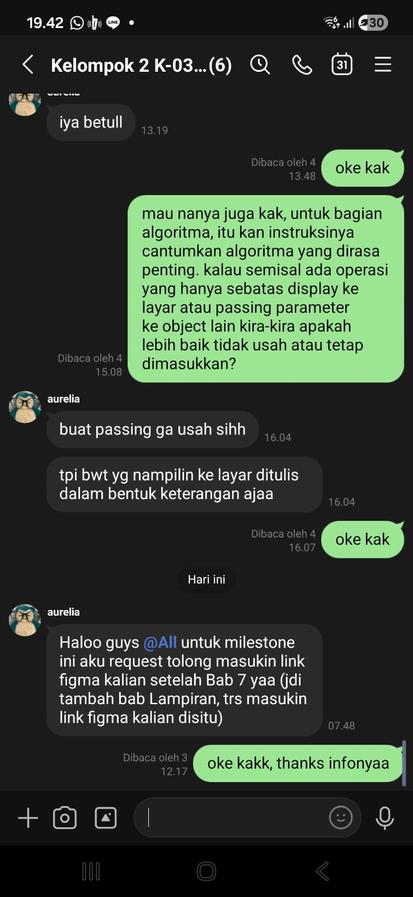

# Form Asistensi

## Tugas Besar IF2150 - Rekayasa Perangkat Lunak

| Informasi | Keterangan |
| --- | --- |
| **Hari** | *Rabu* |
| **Tanggal** | *28 Oktober 2026* |
| **Kelas** | *K-03* |
| **Nomor Kelompok** | *G-02*  |
| **Nama Kelompok** | *DapinKoding*  |
| **Nama Perangkat Lunak** | *SoClean*  |
| **Dokumen** | *K03_G02_DPPL2*  |

### Anggota Kelompok

| NIM      | Nama                      |
| -------- | ------------------------- |
| 13525027 | Faishal Ahmad Nurdin      |
| 13525042 | Justin William            |
| 13525060 | M. Aqsha Bagus R.I.B.     |
| 13525087 | Jovan Nathanael           |
| 13525147 | Muhammad Dhafin Al Khairy |

### Catatan

| Catatan |
| --- |
| 1. *Untuk algoritma, kalau passing gak usah ditulis. Kalo display, tampilin di layar dalam bentuk keterangan*  |
| 2. Masukin link Figma ke lampiran |
| 3. ... |
| 4. ... |

## Dokumentasi

<!--  -->

  

  <i>Gambar 1. Dokumentasi kegiatan asistensi.</i>

